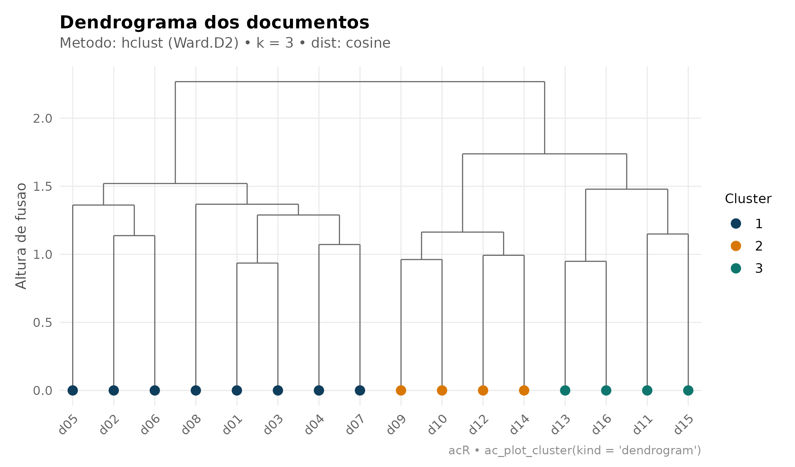
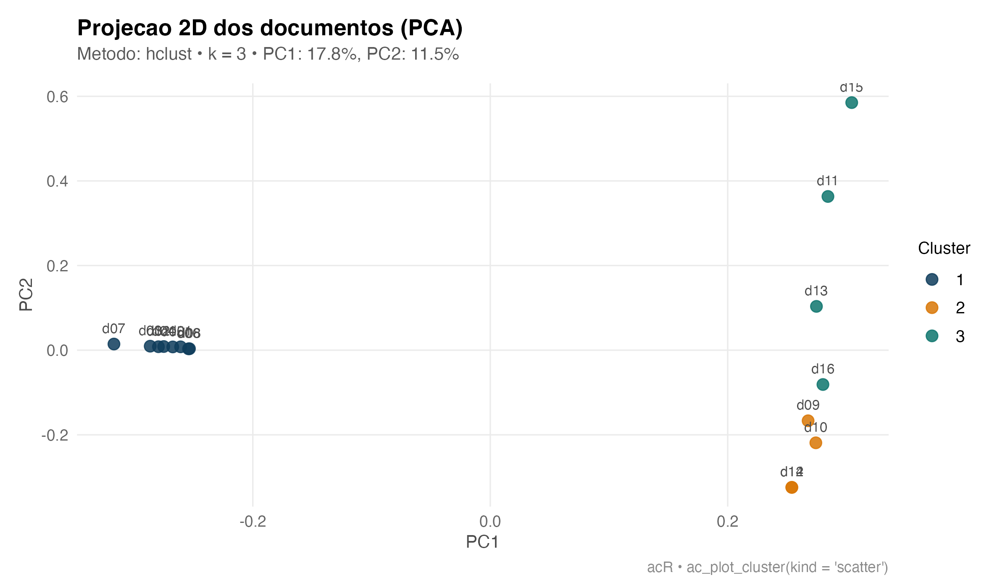
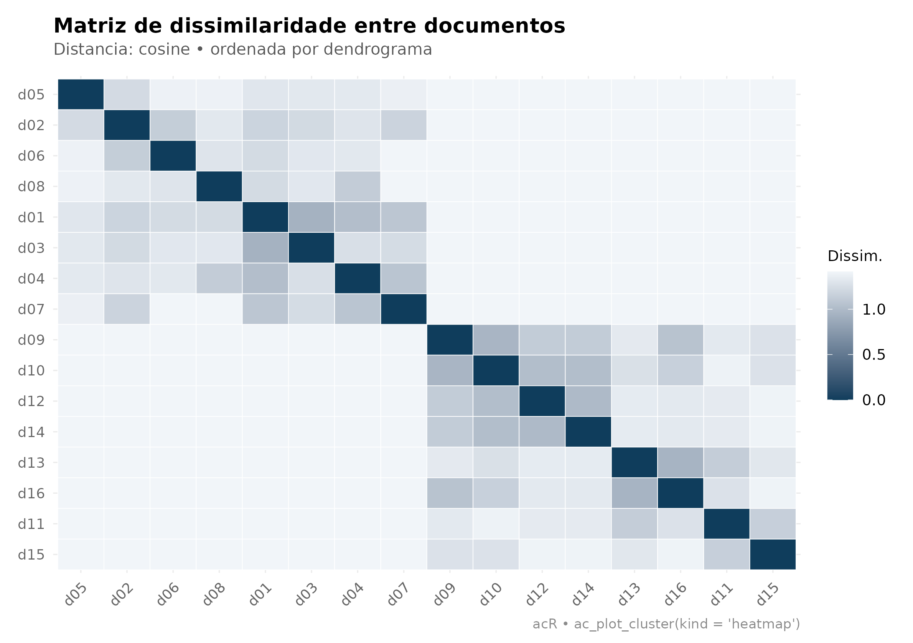
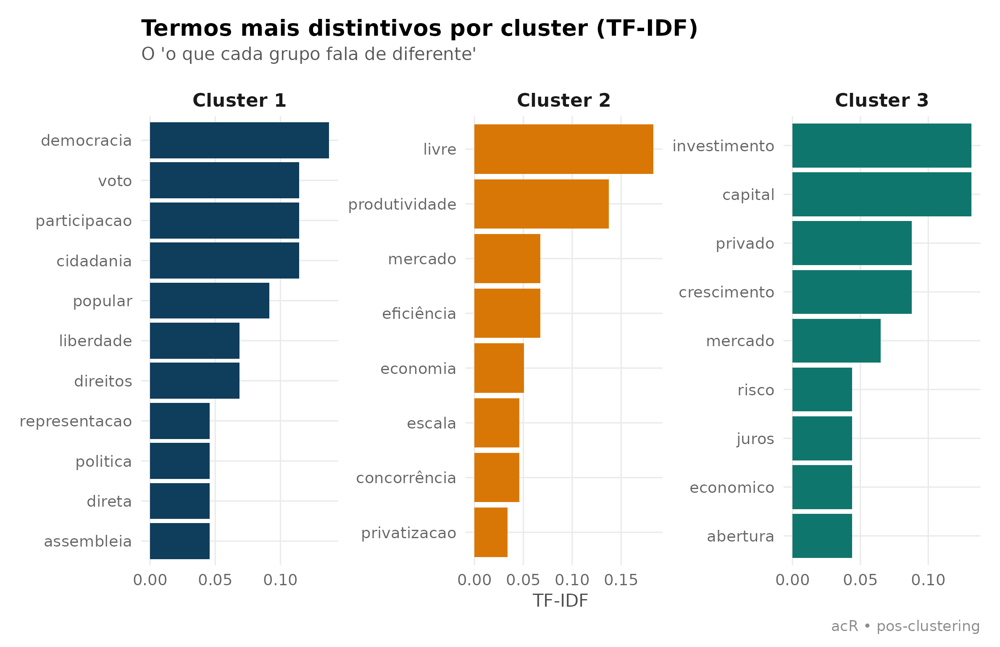
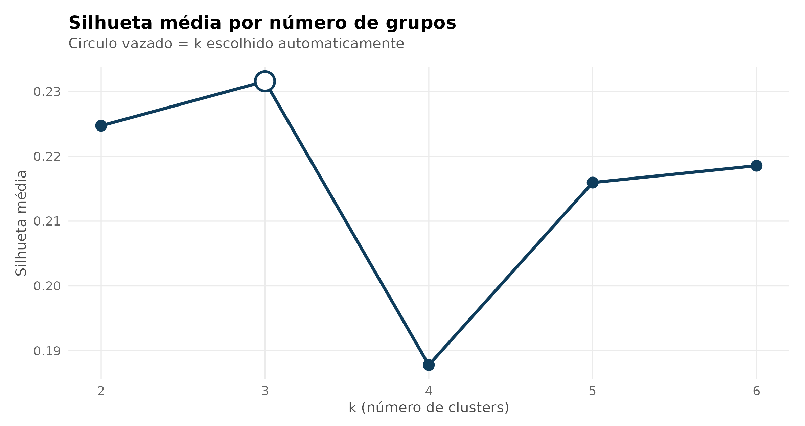
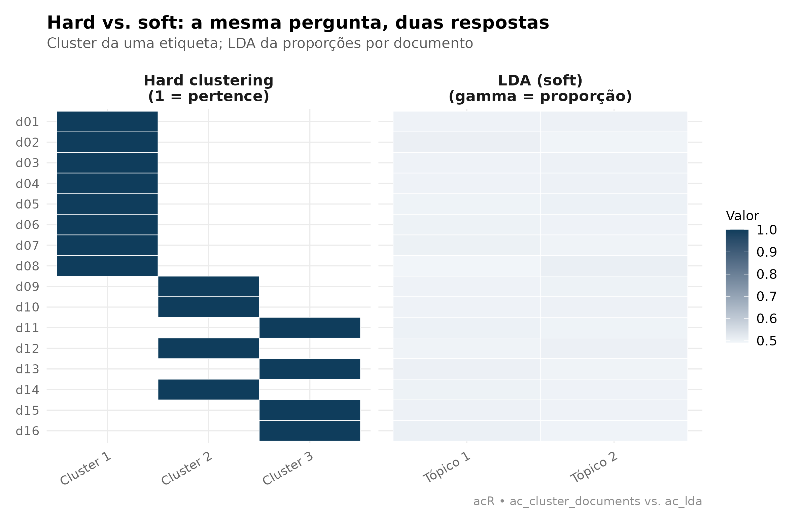
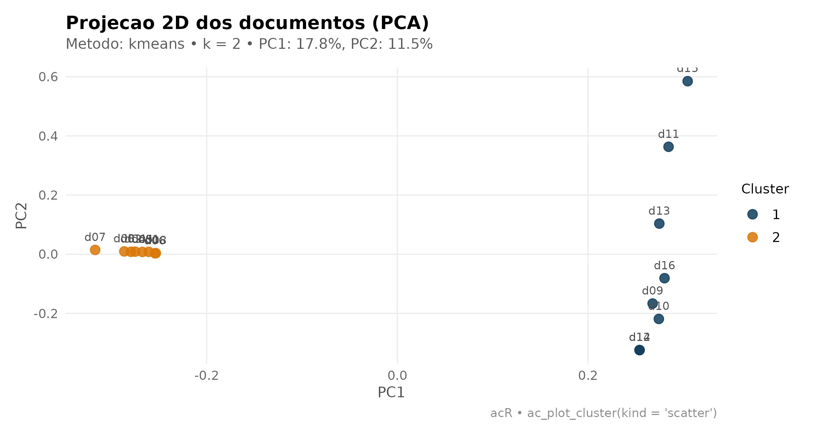

# Agrupamento não supervisionado de documentos

## Por que agrupar documentos?

Nem toda pesquisa começa com um livro de códigos pronto. Às vezes você
tem centenas de discursos, proposições ou entrevistas e precisa
**descobrir tipologias latentes**, antes de rotular, antes de contar,
antes de qualquer LLM. É aí que entra o *clustering*: um algoritmo lê a
matriz de vocabulário e devolve **uma etiqueta por documento**,
agrupando o que se parece por co-ocorrência de termos.

## 1. Três famílias, três leituras teóricas

Antes de rodar qualquer código, vale entender que “descobrir grupos em
texto” é uma família de técnicas com **três leituras teóricas
diferentes**, cada uma respondendo a uma pergunta distinta:

### 1.1 Hard clustering (o que esta vignette faz)

Cada documento pertence a **um único grupo**. A saída é uma etiqueta
`cluster ∈ {1, 2, …, k}`. É o mundo do
[`ac_cluster_documents()`](https://andersonheri.github.io/acR/reference/ac_cluster_documents.md):
hierárquico (`hclust`), `kmeans` e `pam`.

- **Modelo mental:** cada documento é *do* tipo A ou *do* tipo B.
- **Pergunta:** “que tipologias existem no corpus?”
- **Boa para:** amostragem estratificada, dendrogramas metodológicos,
  triagem antes de codificação qualitativa, criação de estratos para
  análise comparativa.

### 1.2 Soft (fuzzy) clustering

Cada documento tem um **vetor de graus de pertencimento** que soma 1
entre `k` clusters. Um documento “60% tipo A, 40% tipo B” existe. Fuzzy
c-means (`e1071::cmeans()`) e misturas gaussianas (`mclust`) são os
exemplos clássicos.

- **Modelo mental:** documentos são pontos numa **zona cinzenta** entre
  protótipos.
- **Pergunta:** “quão típico deste grupo cada documento é?”
- **Boa para:** identificar documentos *fronteiriços* (bons candidatos a
  revisão humana), ranquear documentos por representatividade dentro de
  um grupo.

### 1.3 Modelos de tópicos (LDA)

Cada documento é uma **mistura probabilística de tópicos**, e cada
tópico é uma **distribuição sobre palavras**. É o mundo do
[`ac_lda()`](https://andersonheri.github.io/acR/reference/ac_lda.md): o
output é uma matriz **γ (gamma)** de probabilidades documento × tópico e
uma matriz **β (beta)** de probabilidades tópico × palavra.

- **Modelo mental:** o autor amostrou tópicos com certas proporções e,
  para cada palavra, sorteou um tópico e depois uma palavra dele.
- **Pergunta:** “que temas coexistem em cada documento e como eles se
  compõem?”
- **Boa para:** discurso parlamentar, artigos jornalísticos, textos
  longos com múltiplos temas por documento.

### 1.4 Como escolher?

| Se você quer… | Use |
|----|----|
| Uma partição limpa, uma etiqueta por documento | Hard clustering (esta vignette) |
| Detectar documentos fronteiriços, quão típico de um grupo cada é | Soft clustering (fuzzy c-means) |
| Descobrir temas que se **misturam** em cada texto | LDA (veja [`vignette("lda")`](https://andersonheri.github.io/acR/articles/lda.md)) |
| Rotular documentos com **categorias pré-definidas** por um pesquisador | LLM (veja [`vignette("qualitativo-llm")`](https://andersonheri.github.io/acR/articles/qualitativo-llm.md)) |

Um bom pipeline muitas vezes **combina** essas técnicas: hard clustering
para triagem inicial, LDA para entender temas dentro de cada grupo, LLM
para codificar categorias teoricamente motivadas, revisão humana nos
documentos que caírem em fronteiras.

## 2. Um corpus de dois blocos

Para tornar o exemplo transparente, vamos construir um corpus com **dois
blocos temáticos** deliberadamente separados: democracia participativa
de um lado, economia de mercado do outro. O clustering deve, sem
supervisão, reencontrar essa divisão.

``` r

df <- data.frame(
  id = paste0("d", sprintf("%02d", 1:16)),
  tema_real = rep(c("democracia", "mercado"), each = 8),
  texto = c(
    "democracia participacao voto liberdade cidadania popular",
    "cidadania direitos participacao democracia representacao politica",
    "voto direitos liberdade cidadania soberania popular",
    "democracia voto participacao popular assembleia direta",
    "participacao social democracia direitos coletivos comunidade",
    "cidadania voto democracia representacao plural minorias",
    "liberdade participacao politica assembleia popular deliberacao",
    "democracia direta cidadania voto plebiscito referendo",
    "mercado economia eficiência privatizacao competicao livre",
    "privatizacao mercado livre eficiência produtividade lucro",
    "economia crescimento investimento mercado capital juros",
    "eficiência mercado economia livre concorrência produtividade",
    "mercado privado investimento economia lucro capital risco",
    "economia livre mercado eficiência produtividade escala",
    "crescimento economico mercado investimento privatizacao abertura",
    "mercado competicao eficiência lucro capital privado"
  ),
  stringsAsFactors = FALSE
)

corpus <- ac_corpus(df, text = texto, docid = id)
corpus
#> # A tibble: 16 × 3
#>   doc_id text                                                          tema_real
#>   <chr>  <chr>                                                         <chr>    
#> 1 d01    democracia participacao voto liberdade cidadania popular      democrac…
#> 2 d02    cidadania direitos participacao democracia representacao pol… democrac…
#> 3 d03    voto direitos liberdade cidadania soberania popular           democrac…
#> 4 d04    democracia voto participacao popular assembleia direta        democrac…
#> 5 d05    participacao social democracia direitos coletivos comunidade  democrac…
#> 6 d06    cidadania voto democracia representacao plural minorias       democrac…
#> # ℹ 10 more rows
```

Guardei `tema_real` fora do corpus para poder validar depois: o
clustering **não vê** essa coluna; só o texto.

## 3. Ajuste em três linhas

``` r

clust <- ac_cluster_documents(corpus)
clust
#> 
#> Documentos por cluster:
#> 
#> 1 2 3 
#> 8 4 4
```

Os padrões são:

- **hclust + Ward.D2**: hierárquico, produz dendrograma interpretável.
- **TF-IDF**: palavras raras e discriminantes contam mais.
- **Distância cosseno**: o clássico em texto (Salton & McGill, 1983),
  invariante ao tamanho do documento. Internamente ela é calculada como
  distância de corda, √(2(1 − cos θ)): mesma ordenação dos pares que 1 −
  cos θ, mas euclidiana, que é o que o critério de Ward exige (Murtagh &
  Legendre, 2014).
- **`k` automático por silhueta**: testa `k ∈ {2, …, 8}` e escolhe o
  melhor (requer pacote `cluster`).

## 4. Seis formas de olhar para o mesmo cluster

### 4.1 Dendrograma: a árvore das fusões

Mostra a ordem em que documentos foram unidos e a **altura** de cada
fusão. Cortes altos separam grupos sólidos; cortes baixos indicam
agrupamentos frouxos.

``` r

ac_plot_cluster(clust, kind = "dendrogram")
```



> **Como ler este gráfico**
>
> 1.  **Onde olhar.** Os documentos estão na base, coloridos pelo
>     cluster. Leia **de baixo para cima**: cada “telhado” junta dois
>     grupos, e a altura do telhado (eixo vertical) diz quão diferentes
>     eram os grupos que ele juntou. Telhado baixo = documentos
>     parecidos; telhado alto = junção forçada.
>
> 2.  **O que este exemplo mostra.** O telhado mais alto, em ≈ 2,27,
>     separa os 8 documentos de `democracia` (azul-escuro, à esquerda)
>     dos 8 de `mercado` (à direita). O bloco de democracia termina de
>     se juntar em ≈ 1,52; o de mercado só em ≈ 1,74, e ele se divide
>     antes em dois ramos, laranja (d09, d10, d12, d14) e verde-azulado
>     (d11, d13, d15, d16).
>
> 3.  **Em palavras simples.** A primeira divisão do corpus é democracia
>     × mercado. Dentro de mercado há uma segunda divisão quase tão
>     forte, e é por isso que, pedindo 3 grupos, o algoritmo separa
>     mercado em dois.
>
> 4.  **Cuidado.** No método de Ward a altura não é a distância entre
>     dois documentos: é o quanto a fusão aumenta a variação dentro dos
>     grupos (Murtagh & Legendre, 2014). Compare alturas entre si, não
>     as leia como distâncias. E a ordem das folhas na base dentro de um
>     mesmo ramo é arbitrária.

### 4.2 Projeção PCA: a geometria do corpus

Cada documento vira um ponto no plano das duas componentes principais.
Documentos com vocabulário parecido ficam próximos; a cor mostra a
divisão do algoritmo.

``` r

ac_plot_cluster(clust, kind = "scatter")
```



> **Como ler este gráfico**
>
> 1.  **Onde olhar.** Cada ponto é um documento, colorido pelo cluster.
>     Pontos próximos = vocabulário parecido. O subtítulo diz quanto da
>     variação cada eixo resume (PC1: 17,8%; PC2: 11,5%).
>
> 2.  **O que este exemplo mostra.** O eixo horizontal (PC1) separa os
>     dois temas: os 8 documentos de democracia (azul-escuro) ficam
>     amontoados à esquerda, tão juntos que os rótulos se sobrepõem; os
>     de mercado ficam todos à direita. O eixo vertical (PC2) espalha só
>     os de mercado: os laranja (cluster 2) embaixo, os verde-azulados
>     (cluster 3) em cima.
>
> 3.  **Em palavras simples.** Democracia é um bloco homogêneo; mercado
>     é mais variado, e a variação dele tem uma direção, que é
>     justamente a divisão entre os clusters 2 e 3.
>
> 4.  **Cuidado.** Os dois eixos juntos mostram menos de 30% da
>     variação: a maior parte das diferenças entre documentos não
>     aparece neste plano. Confie nas separações nítidas (como a da
>     esquerda × direita) e não interprete distâncias pequenas entre
>     pontos próximos.

### 4.3 Mapa de calor: a assinatura da separação

Ordena os documentos pelo dendrograma e desenha a matriz de
dissimilaridade inteira. **Blocos escuros na diagonal** são o carimbo de
qualidade de um clustering bem-sucedido.

``` r

ac_plot_cluster(clust, kind = "heatmap")
```



> **Como ler este gráfico**
>
> 1.  **Onde olhar.** Cada célula compara dois documentos; a cor é a
>     dissimilaridade (escuro = parecidos, claro = diferentes). A
>     diagonal é sempre escura (cada documento comparado consigo mesmo).
>     Procure **quadrados** de cinza mais escuro ao longo da diagonal:
>     cada um é um grupo de documentos parecidos entre si.
>
> 2.  **O que este exemplo mostra.** Há dois quadrados: d05 a d07 no
>     canto superior esquerdo (democracia) e d09 a d15 no canto inferior
>     direito (mercado), com tons de cinza médio por dentro. Os dois
>     retângulos fora da diagonal, que cruzam democracia com mercado,
>     são quase brancos: esses documentos não têm nenhuma palavra em
>     comum. Dentro do quadrado de mercado, d09-d14 e d13-d15 formam
>     dois quadrados menores, um pouco mais escuros.
>
> 3.  **Em palavras simples.** A separação entre os temas é total; a
>     separação interna de mercado em dois subgrupos existe, mas é mais
>     fraca.
>
> 4.  **Cuidado.** Em textos curtos quase todos os pares são bem
>     diferentes, então mesmo dentro de um grupo as células ficam cinza,
>     não escuras. Compare o tom **dentro** dos quadrados com o tom
>     **entre** eles, não com o preto da diagonal.

### 4.4 Termos mais distintivos por cluster

Este gráfico responde à pergunta que interessa depois de rodar o modelo:
**“o que cada grupo *fala* de diferente?”**. Juntamos a etiqueta do
cluster ao TF-IDF e mostramos os 8 termos mais fortes por grupo.

``` r

tokens_com_cluster <- corpus |>
  ac_clean() |>
  ac_count() |>
  left_join(clust$assignments, by = "doc_id") |>
  group_by(cluster, token) |>
  summarise(n = sum(n), .groups = "drop") |>
  rename(doc_id = cluster) |>
  mutate(doc_id = paste0("Cluster ", doc_id))

tfidf_cluster <- ac_tf_idf(tokens_com_cluster)

top_por_cluster <- tfidf_cluster |>
  group_by(doc_id) |>
  slice_max(tf_idf, n = 8) |>
  ungroup() |>
  mutate(token = tidytext::reorder_within(token, tf_idf, doc_id))

ggplot(top_por_cluster, aes(tf_idf, token, fill = doc_id)) +
  geom_col(show.legend = FALSE) +
  tidytext::scale_y_reordered() +
  facet_wrap(~ doc_id, scales = "free") +
  scale_fill_manual(values = ac_palette(clust$k)) +
  labs(
    title    = "Termos mais distintivos por cluster (TF-IDF)",
    subtitle = "O 'o que cada grupo fala de diferente'",
    x = "TF-IDF", y = NULL,
    caption = "acR • pos-clustering"
  ) +
  theme_ac()
```



> **Como ler este gráfico**
>
> 1.  **Onde olhar.** Um painel por cluster, com as 8 palavras de maior
>     TF-IDF (as mais características daquele grupo em relação aos
>     outros). Compare os painéis **entre si**: o que um grupo diz que
>     os outros não dizem?
>
> 2.  **O que este exemplo mostra.** O Cluster 1 traz *democracia*,
>     *cidadania*, *participacao*, *voto*. O Cluster 2 traz *livre*,
>     *produtividade*, *eficiência*, *concorrência*, *privatizacao*. O
>     Cluster 3 traz *capital*, *investimento*, *crescimento*,
>     *privado*, *juros*.
>
> 3.  **Em palavras simples.** O tema `mercado` tem duas vertentes no
>     corpus: uma de eficiência e concorrência (cluster 2) e outra de
>     investimento e crescimento (cluster 3). A divisão que o
>     dendrograma e o gráfico de projeção mostraram tem conteúdo, não é
>     ruído.
>
> 4.  **Cuidado.** Os nomes dos grupos são interpretação sua, a partir
>     dessas palavras; o algoritmo só entrega números. Leia alguns
>     documentos de cada cluster antes de batizá-los, e lembre que
>     *mercado* aparece nos dois painéis de mercado: palavras
>     compartilhadas podem aparecer em mais de um grupo.

### 4.5 Curva de silhueta: escolhendo `k` visualmente

Quando o `k` automático parecer arbitrário, olhe para a curva. A
silhueta média de cada `k` diz o quão *coeso* é o agrupamento naquele
número de grupos. Picos claros são bons; platôs indicam que a divisão
seguinte é quase tão boa quanto.

``` r

if (requireNamespace("cluster", quietly = TRUE)) {
  ks   <- 2:6
  sils <- vapply(ks, function(k_try) {
    ac_cluster_documents(corpus, k = k_try)$silhouette
  }, numeric(1))

  df_sil <- data.frame(k = ks, silhueta = sils)

  ggplot(df_sil, aes(k, silhueta)) +
    geom_line(color = ac_palette(1), linewidth = 1.1) +
    geom_point(size = 3.5, color = ac_palette(1)) +
    geom_point(
      data = df_sil[which.max(df_sil$silhueta), ],
      aes(k, silhueta),
      size = 6, shape = 21, stroke = 1.4,
      fill = "white", color = ac_palette(1)
    ) +
    scale_x_continuous(breaks = ks) +
    labs(
      title    = "Silhueta média por número de grupos",
      subtitle = "Circulo vazado = k escolhido automaticamente",
      x = "k (número de clusters)", y = "Silhueta média"
    ) +
    theme_ac()
}
```



> **Como ler este gráfico**
>
> 1.  **Onde olhar.** Cada ponto é um número de grupos (k) testado, e a
>     altura é a silhueta média: o quanto, em média, cada documento está
>     mais perto do próprio grupo do que do grupo vizinho (de −1 a 1;
>     maior = grupos mais nítidos). O círculo vazado é o k que a função
>     escolheu, o de maior silhueta.
>
> 2.  **O que este exemplo mostra.** K = 3 vence com ≈ 0,128, mas k = 2
>     (≈ 0,124) e k = 5 (≈ 0,123) estão praticamente empatados: as
>     diferenças estão na terceira casa decimal. Note também a escala do
>     eixo vertical: tudo está entre 0,11 e 0,13.
>
> 3.  **Em palavras simples.** O corpus não aponta com clareza um número
>     de grupos. A escolha automática de k = 3 é frágil, e a decisão
>     deve vir também da leitura dos termos de cada grupo (seção 4.4).
>
> 4.  **Cuidado.** O valor absoluto da silhueta importa. Kaufman &
>     Rousseeuw (1990, p. 88) leem a silhueta média acima de 0,70 como
>     estrutura forte, de 0,51 a 0,70 razoável, de 0,26 a 0,50 fraca e
>     **até 0,25 como ausência de estrutura substancial**: todos os
>     valores aqui estão nessa última faixa, mesmo com os dois temas
>     sendo recuperados sem erro (seção 6). A causa é o tamanho dos
>     textos: com 6 palavras por documento, a distância até o próprio
>     grupo e até o vizinho ficam parecidas. Reporte a silhueta junto
>     com os grupos.

### 4.6 Hard vs. soft: comparando com LDA

Este é o gráfico mais **didático** da vignette: mostra lado a lado como
hard clustering e LDA veem o mesmo corpus. À esquerda, cada linha do
heatmap é um documento e cada coluna, o cluster ao qual ele pertence
(binário: 0 ou 1). À direita, cada linha é o mesmo documento e cada
coluna é a proporção γ do tópico LDA, que **pode** variar continuamente
entre 0 e 1.

``` r

# Gibbs com alpha baixo: adequado a textos curtos de tema único
# (ver vignette("lda"), seção 3)
lda_fit <- ac_lda(corpus, k = 2, seed = 42, method = "Gibbs",
                  control = list(alpha = 0.1, iter = 2000, burnin = 500))

hard <- clust$assignments |>
  mutate(valor = 1, tipo = paste0("Cluster ", cluster)) |>
  select(doc_id, tipo, valor)

soft <- lda_fit$documents |>
  mutate(tipo = paste0("Tópico ", topic), valor = gamma) |>
  select(doc_id, tipo, valor)

plot_df <- bind_rows(
  hard |> mutate(painel = "Hard clustering\n(1 = pertence)"),
  soft |> mutate(painel = "LDA (soft)\n(gamma = proporção)")
) |>
  mutate(doc_id = factor(doc_id, levels = rev(sort(unique(doc_id)))))

ggplot(plot_df, aes(tipo, doc_id, fill = valor)) +
  geom_tile(color = "white") +
  facet_wrap(~ painel, scales = "free_x") +
  scale_fill_gradient(low = "#F1F5F9", high = ac_palette(1), name = "Valor") +
  labs(
    title    = "Hard vs. soft: a mesma pergunta, duas respostas",
    subtitle = "Cluster da uma etiqueta; LDA da proporções por documento",
    x = NULL, y = NULL,
    caption = "acR • ac_cluster_documents vs. ac_lda"
  ) +
  theme_ac() +
  theme(axis.text.x = element_text(angle = 30, hjust = 1))
```



> **Como ler este gráfico**
>
> 1.  **Onde olhar.** Os dois painéis têm uma linha por documento. À
>     esquerda, cada linha tem **uma** célula escura: o cluster do
>     documento. À direita, cada célula é a proporção γ do documento
>     atribuída a cada tópico do LDA; ela **pode** ser um tom
>     intermediário quando o documento mistura temas.
>
> 2.  **O que este exemplo mostra.** À direita, cada linha também tem
>     uma única célula escura: os 8 documentos de democracia ficam ≈
>     0,98 no Tópico 2, e os 8 de mercado ≈ 0,98 no Tópico 1. Não há
>     tons intermediários.
>
> 3.  **Em palavras simples.** Aqui o LDA concorda com o clustering
>     porque cada documento foi escrito sobre um único tema: não há
>     mistura a mostrar. O γ só fica “dividido” quando o texto de fato
>     fala de mais de um assunto, como os casos ambíguos da
>     [`vignette("lda")`](https://andersonheri.github.io/acR/articles/lda.md),
>     seção 8.
>
> 4.  **Cuidado.** Γ mede **pertencimento misto** (que fração do texto é
>     de cada tópico), não incerteza sobre qual é o “grupo verdadeiro”
>     do documento (Airoldi et al., 2014). Com o ajuste padrão do LDA
>     (`method = "VEM"`), este corpus dá γ ≈ 0,50/0,50 para todo
>     documento, um modelo que não aprendeu nada; por isso o exemplo usa
>     Gibbs com α baixo. E o painel da esquerda tem 3 colunas e o da
>     direita 2: o que se compara é a forma das linhas, não o número de
>     colunas.

## 5. Validando contra a verdade

Como guardamos `tema_real` fora do modelo, dá para conferir a acurácia
da partição:

``` r

validacao <- clust$assignments |>
  mutate(tema_real = df$tema_real[match(doc_id, df$id)]) |>
  count(tema_real, cluster)
validacao
#> # A tibble: 3 × 3
#>   tema_real  cluster     n
#>   <chr>        <int> <int>
#> 1 democracia       1     8
#> 2 mercado          2     4
#> 3 mercado          3     4
```

Se o algoritmo separou corretamente, cada `tema_real` deve concentrar-se
num único cluster (permutação de rótulos é esperada: o clustering não
sabe qual grupo é “democracia” ou “mercado”, só que são diferentes).

> **Como ler esta tabela**
>
> 1.  **Onde olhar.** Cada linha cruza o tema real (que o algoritmo não
>     viu) com o cluster atribuído; `n` é quantos documentos caem em
>     cada combinação. O ideal é cada tema concentrado num cluster só.
>     Os números dos clusters são arbitrários: importa o agrupamento,
>     não o rótulo 1, 2 ou 3.
>
> 2.  **O que este exemplo mostra.** `democracia` cai inteiro no cluster
>     1 (8 de 8). `mercado` se divide em duas partes iguais: 4
>     documentos no cluster 2 e 4 no cluster 3.
>
> 3.  **Em palavras simples.** O algoritmo acertou a fronteira entre os
>     dois temas. A divisão de mercado não é erro: é a distinção
>     eficiência × investimento que a seção 4.4 mostrou.
>
> 4.  **Cuidado.** Uma tabela “imperfeita” contra uma variável externa
>     nem sempre significa clustering ruim; pode significar que a
>     variável de validação é mais grosseira que a estrutura do texto.
>     Antes de chamar um cluster extra de erro, leia os termos e alguns
>     documentos dele.

## 6. Escolhendo o método

[`ac_cluster_documents()`](https://andersonheri.github.io/acR/reference/ac_cluster_documents.md)
aceita três algoritmos:

| Método | Quando usar |
|----|----|
| `hclust` | Padrão. Você quer dendrograma, ou não sabe `k` de antemão. |
| `kmeans` | Corpus grande (milhares de documentos), você já sabe `k`, quer rapidez. |
| `pam` | Robusto a *outliers*; devolve medoides reais (documentos exemplares). |

`pam` requer o pacote `cluster` instalado; os demais rodam com apenas o
`stats` base.

``` r

clust_km <- ac_cluster_documents(corpus, method = "kmeans", k = 2)
ac_plot_cluster(clust_km, kind = "scatter")
```



> **Como ler este gráfico**
>
> 1.  **Onde olhar.** O mesmo plano de projeção da seção 4.2, agora com
>     as cores dadas pelo k-means com `k = 2` fixo.
>
> 2.  **O que este exemplo mostra.** Os 8 documentos de democracia ficam
>     todos de uma cor (à esquerda) e os 8 de mercado todos da outra (à
>     direita): a divisão original, sem nenhum erro. Os pontos estão nos
>     mesmos lugares do gráfico da seção 4.2; só as cores mudaram.
>
> 3.  **Em palavras simples.** Fixar k = 2 recupera os dois temas;
>     deixar a silhueta escolher (k = 3) acrescentou a subdivisão de
>     mercado. Os dois resultados são corretos, em resoluções
>     diferentes.
>
> 4.  **Cuidado.** O rótulo do cluster é arbitrário (aqui, democracia
>     virou 2 e mercado 1). Se você tem uma hipótese sobre o número de
>     grupos, fixe k e diga isso no texto; se está explorando, compare
>     alguns valores de k lendo os termos de cada solução, sem confiar
>     só na silhueta, que neste corpus é baixa (seção 4.5).

## 7. E depois? Integrando com o pipeline

Fluxo típico onde clustering é **etapa prévia**:

1.  [`ac_cluster_documents()`](https://andersonheri.github.io/acR/reference/ac_cluster_documents.md)
    particiona o corpus em `k` grupos.
2.  Amostre `n` documentos por cluster para leitura humana.
3.  Use as leituras para escrever um **codebook inicial** com
    [`ac_qual_codebook()`](https://andersonheri.github.io/acR/reference/ac_qual_codebook.md).
4.  Aplique o codebook ao corpus inteiro com
    [`ac_qual_code()`](https://andersonheri.github.io/acR/reference/ac_qual_code.md).
5.  Se quiser refinar temas *dentro* de um cluster, rode
    [`ac_lda()`](https://andersonheri.github.io/acR/reference/ac_lda.md)
    só naquele subcorpus.

Isso reduz o custo cognitivo do primeiro contato com o corpus: em vez de
enfrentar centenas de documentos aleatórios, você lê um punhado de
exemplares de cada tipologia latente.

## Referências

- Blei, D. M., Ng, A. Y., & Jordan, M. I. (2003). Latent Dirichlet
  Allocation. *JMLR*, 3, 993–1022 (o paper original do LDA).
- Airoldi, E. M.; Blei, D.; Erosheva, E. A.; Fienberg, S. E. (Eds.)
  (2014). *Handbook of Mixed Membership Models and Their Applications*.
  Chapman & Hall/CRC.
- Bezdek, J. C. (1981). *Pattern Recognition with Fuzzy Objective
  Function Algorithms*. Plenum (fuzzy c-means).
- Kaufman, L. & Rousseeuw, P. J. (1990). *Finding Groups in Data*. Wiley
  (PAM e silhueta).
- Manning, C., Raghavan, P. & Schütze, H. (2008). *Introduction to
  Information Retrieval*. Cambridge University Press. Cap. 16–17.
- Salton, G. & McGill, M. J. (1983). *Introduction to Modern Information
  Retrieval*. McGraw-Hill.
- Murtagh, F. & Legendre, P. (2014). Ward’s hierarchical agglomerative
  clustering method: Which algorithms implement Ward’s criterion?
  *Journal of Classification*, 31(3), 274–295.
