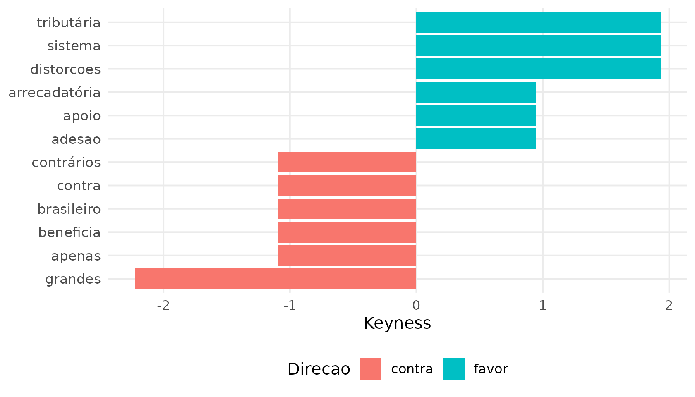
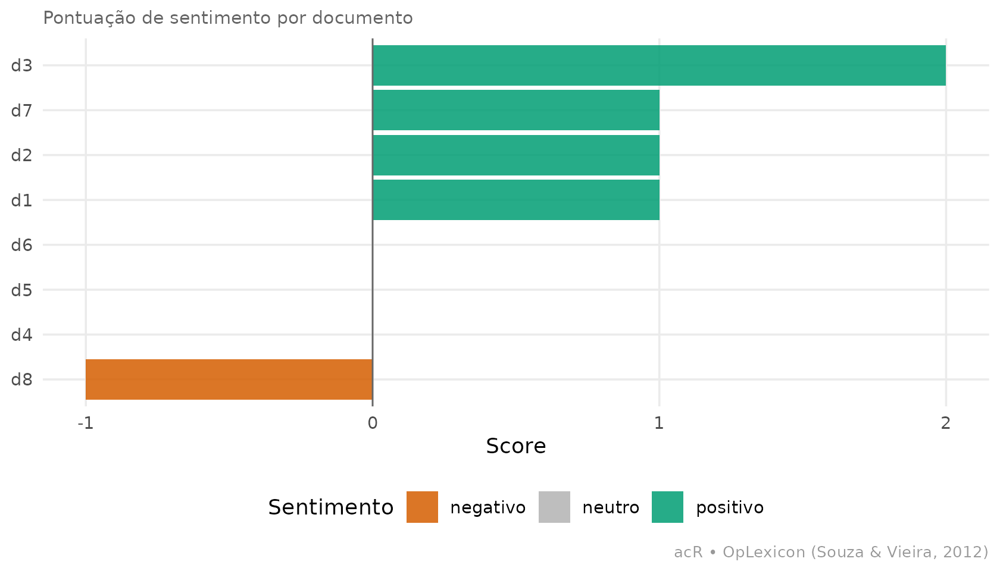

# Introdução ao acR: pipeline integrado de análise de conteúdo

Esta vignette percorre o pipeline completo do `acR` em um exemplo
pequeno mas realista (discursos parlamentares favoráveis e contrários a
uma reforma), mostrando o *output* efetivo de cada etapa. Se você
prefere um tour de 5 minutos com só o essencial, veja o
**[Quickstart](https://ahenriquecp.com/acR/articles/quickstart.md)**.

``` r

library(acR)
```

## O objeto central: `ac_corpus`

Tudo no `acR` gira em torno do `ac_corpus`, um `tibble` com colunas
padronizadas `doc_id` e `text` que carrega quaisquer metadados
adicionais. As demais funções aceitam esse objeto diretamente.

``` r

df <- data.frame(
  id      = paste0("d", 1:8),
  texto   = c(
    "Sou favoravel a reforma tributária: simplifica o sistema e reduz distorcoes.",
    "Voto contra: essa reforma vai destruir o setor produtivo brasileiro.",
    "Apoio a proposta com forte adesao, ha ganhos claros de eficiência arrecadatória.",
    "Rejeito o texto: transfere renda das familias para grandes corporacoes.",
    "Defendo a reforma que corrige as distorcoes historicas do nosso sistema.",
    "Somos contrários: o projeto beneficia apenas os mais ricos do pais.",
    "Voto sim, precisamos modernizar urgentemente a estrutura tributária.",
    "Voto não, os pequenos empresários serao os grandes prejudicados."
  ),
  partido = c("PT","PL","PT","PL","PT","PL","PT","PL"),
  posicao = c("favor","contra","favor","contra","favor","contra","favor","contra"),
  stringsAsFactors = FALSE
)

corpus <- ac_corpus(df, text = texto, docid = id, meta = c(partido, posicao))
corpus
#> 
#> ── Corpus acR ──────────────────────────────────────────────────────────────────
#> • Documentos: 8
#> • Metadados: 2 colunas
#> • Idioma: "pt"
#> 
#> # A tibble: 8 × 4
#>   doc_id text                                                    partido posicao
#>   <chr>  <chr>                                                   <chr>   <chr>  
#> 1 d1     Sou favoravel a reforma tributária: simplifica o siste… PT      favor  
#> 2 d2     Voto contra: essa reforma vai destruir o setor produti… PL      contra 
#> 3 d3     Apoio a proposta com forte adesao, ha ganhos claros de… PT      favor  
#> 4 d4     Rejeito o texto: transfere renda das familias para gra… PL      contra 
#> 5 d5     Defendo a reforma que corrige as distorcoes historicas… PT      favor  
#> 6 d6     Somos contrários: o projeto beneficia apenas os mais r… PL      contra 
#> # ℹ 2 more rows
```

## 1. Frequências e termos salientes

Antes de contar, precisamos **remover stopwords**. Sem essa etapa, os
termos mais frequentes seriam `o`, `a`, `de`, `que`: carregam pouca
informação temática e mascaram os padrões reais do corpus.

``` r

corpus_limpo <- ac_clean(corpus, remove_stopwords = "pt")

# Frequência global
freq <- ac_count(corpus_limpo)
ac_top_terms(freq, n = 8)
#> # A tibble: 8 × 2
#>   token          n
#>   <chr>      <int>
#> 1 reforma        3
#> 2 voto           3
#> 3 distorcoes     2
#> 4 grandes        2
#> 5 sistema        2
#> 6 tributária     2
#> 7 adesao         1
#> 8 apenas         1
```

Agora quebrando por lado (`favor` vs `contra`):

``` r

freq_lado <- ac_count(corpus_limpo, by = "posicao")
ac_top_terms(freq_lado, n = 5, by = "posicao")
#> # A tibble: 10 × 3
#>    posicao token          n
#>    <chr>   <chr>      <int>
#>  1 contra  grandes        2
#>  2 contra  voto           2
#>  3 contra  apenas         1
#>  4 contra  beneficia      1
#>  5 contra  brasileiro     1
#>  6 favor   distorcoes     2
#>  7 favor   reforma        2
#>  8 favor   sistema        2
#>  9 favor   tributária     2
#> 10 favor   adesao         1
```

## 2. Termos distintivos com *keyness*

Quais palavras aparecem **muito mais** em um grupo do que no outro? A
métrica `chi2` (χ²) mede essa distintividade.

``` r

key <- ac_keyness(freq_lado, group = "posicao", target = "favor")
head(key, 6)
#> # A tibble: 6 × 10
#>   token group target reference n_target n_reference total_target total_reference
#>   <chr> <chr> <chr>  <chr>        <dbl>       <dbl>        <dbl>           <dbl>
#> 1 dist… posi… favor  contra           2           0           29              27
#> 2 sist… posi… favor  contra           2           0           29              27
#> 3 trib… posi… favor  contra           2           0           29              27
#> 4 ades… posi… favor  contra           1           0           29              27
#> 5 apoio posi… favor  contra           1           0           29              27
#> 6 arre… posi… favor  contra           1           0           29              27
#> # ℹ 2 more variables: keyness <dbl>, direction <chr>
```

Visualização compacta dos termos mais distintivos:

``` r

if (requireNamespace("ggplot2", quietly = TRUE)) {
  ac_plot_keyness(key, n = 6)
}
```



> **Como ler este gráfico**
>
> 1.  **Onde olhar.** Cada barra é uma palavra. Barra para a **direita**
>     (verde-azulada) = mais usada nos discursos `favor`; para a
>     **esquerda** (vermelha) = mais usada nos `contra`. Quanto mais
>     comprida, maior a diferença entre os lados. Confira os números na
>     tabela `key` logo acima: `n_target` (vezes em `favor`) e
>     `n_reference` (vezes em `contra`).
>
> 2.  **O que este exemplo mostra.** Do lado favorável, as três barras
>     mais longas são *distorcoes*, *sistema* e *tributária* (2 vezes em
>     `favor`, nenhuma em `contra`). Do lado contrário, a barra mais
>     longa de todo o gráfico é *grandes* (0 contra 2: “grandes
>     corporacoes”, “grandes prejudicados”). As outras barras, mais
>     curtas e todas iguais, são palavras que aparecem uma vez só.
>
> 3.  **Em palavras simples.** Quem defende a reforma fala do sistema
>     tributário e de corrigir distorções; quem é contra fala de quem
>     ganha e quem perde (os “grandes”).
>
> 4.  **Cuidado.** Com 8 discursos curtos, uma diferença de 2 contra 0 é
>     pouca evidência: leia o gráfico como pista para o que ler nos
>     textos, não como resultado estatístico (Dunning, 1993). Quando
>     várias palavras empatam (as barras curtas), o gráfico mostra as
>     primeiras em ordem alfabética: a escolha entre elas não tem
>     significado.

## 3. Sentimento por documento (OpLexicon)

Escore agregado de polaridade de cada documento, usando o léxico
OpLexicon (Souza e Vieira, 2012):

``` r

sent <- ac_sentiment(corpus)
sent
#> # A tibble: 8 × 6
#>   doc_id n_pos n_neg n_neu score sentiment
#>   <chr>  <int> <int> <int> <int> <chr>    
#> 1 d1         1     0    10     1 positivo 
#> 2 d2         1     0     9     1 positivo 
#> 3 d3         2     0    10     2 positivo 
#> 4 d4         0     0    10     0 neutro   
#> 5 d5         0     0    11     0 neutro   
#> 6 d6         1     1     9     0 neutro   
#> 7 d7         1     0     7     1 positivo 
#> 8 d8         0     1     8    -1 negativo
```

Visualizando por documento:

``` r

if (requireNamespace("ggplot2", quietly = TRUE)) {
  ac_plot_sentiment(sent)
}
```



> **Como ler este gráfico**
>
> 1.  **Onde olhar.** Cada barra é um discurso; o comprimento é o escore
>     (palavras positivas menos negativas do léxico OpLexicon). Para a
>     direita (verde) = positivo; para a esquerda (laranja) = negativo;
>     sem barra = zero. Compare com a posição declarada de cada
>     discurso, que você conhece pela tabela do corpus.
>
> 2.  **O que este exemplo mostra.** `d3` tem o maior escore (+2:
>     “forte” e “claros”). O caso que mais ensina é `d2`, um discurso
>     **contra** (“Voto contra: essa reforma vai destruir o setor
>     produtivo”) que sai **positivo**: o léxico conta “produtivo” como
>     +1 e não tem nenhuma palavra negativa para “destruir”. `d6`
>     (contra) sai zero porque “ricos” conta +1 e anula “contrários”
>     (−1).
>
> 3.  **Em palavras simples.** O léxico não lê a frase, ele soma
>     palavras soltas. Quando a opinião está num verbo (“destruir”) ou
>     quando uma palavra positiva aparece num contexto negativo (“setor
>     produtivo” sendo destruído), o escore erra a direção.
>
> 4.  **Cuidado.** O escore é relativo ao léxico, não uma medida de
>     “quão positivo é o texto” (Taboada et al., 2011). Neste corpus,
>     até “tributária” conta como +1, um erro de domínio. Antes de usar
>     o escore, compare-o com uma amostra lida por humanos; a
>     [`vignette("sentimento")`](https://ahenriquecp.com/acR/articles/sentimento.md)
>     mostra esses erros em detalhe.

## 4. Escolher um modelo LLM

Antes de codificar qualitativamente, o `acR` recomenda modelos com base
em custo, idioma e tipo de tarefa. Consulta 100 % *offline*:

``` r

ac_qual_recommend_model(task = "coding", budget = "medium", lang = "pt", n = 3)
#> 
#> ── Recomendacoes de modelo acR ─────────────────────────────────────────────────
#> ℹ Tarefa: "coding" | Budget: "medium" | Idioma: "pt"
#> ℹ Baseado em Gilardi et al. (2023, PNAS) e Tornberg (2023, PLOS ONE).
#> # A tibble: 3 × 12
#>    rank provider model_id           name  tier  context_k cost_input cost_output
#>   <int> <chr>    <chr>              <chr> <chr>     <dbl>      <dbl>       <dbl>
#> 1     1 google   google/gemini-2.0… Gemi… fast       1000       0.1          0.4
#> 2     2 google   google/gemini-2.5… Gemi… fron…      1000       1.25        10  
#> 3     3 openai   openai/o4-mini     o4-m… bala…       200       1.1          4.4
#> # ℹ 4 more variables: pt_support <chr>, score <dbl>, justificativa <chr>,
#> #   acr_string <chr>
```

Base: Gilardi, Alizadeh e Kubli (2023) e Törnberg (2023).

## 5. Codificação qualitativa com LLM

Esta etapa exige chave de API (`ANTHROPIC_API_KEY`, `GROQ_API_KEY`,
etc.) e por isso não roda na construção da vignette. Estrutura mínima:

``` r

codebook <- ac_qual_codebook(
  name         = "posicionamento",
  instructions = "Classifique o posicionamento sobre a reforma tributária.",
  categories   = list(
    favor  = list(
      definition   = "Manifestação favorável à reforma.",
      examples_pos = "Sou favoravel a reforma, simplifica o sistema."
    ),
    contra = list(
      definition   = "Manifestação contrária à reforma.",
      examples_pos = "Voto contra, vai destruir o setor produtivo."
    )
  )
)

codificado <- ac_qual_code(
  corpus   = corpus,
  codebook = codebook,
  model    = "anthropic/claude-sonnet-4-5"
)
```

`codificado` é um tibble com `doc_id`, `categoria`, `confidence_score`
(via *self-consistency*) e `reasoning`.

## 6. Validação humana e confiabilidade

``` r

# Amostra aleatória (representativa): é ela que estima a confiabilidade
# do corpus. Amostrar só os casos incertos subestimaria a concordância.
amostra <- ac_qual_sample(codificado, n = 50, strategy = "random")

# Exporta planilha para revisão humana
ac_qual_export_for_review(amostra, path = "revisao.xlsx", corpus = corpus)

# Após preencher, reimporta e calcula IRR
humano <- ac_qual_import_human("revisao.xlsx")
ac_qual_reliability(llm = codificado, human = humano)
```

Um exemplo do formato do output com dados sintéticos (equivalente ao que
sai com codificação real):

``` r

llm_sim <- tibble::tibble(
  doc_id    = paste0("d", 1:8),
  categoria = c("favor","contra","favor","contra","favor","contra","favor","contra")
)
humano_sim <- tibble::tibble(
  doc_id    = paste0("d", 1:8),
  categoria = c("favor","contra","favor","contra","favor","favor","favor","contra")
  # 1 discordância em 8 casos -> ~87.5% de concordância
)

ac_qual_reliability(llm = llm_sim, human = humano_sim, bootstrap = 50)
#> Calculando confiabilidade em 8 documentos comuns...
#> ℹ Interpretação: alfa por Krippendorff (2018); AC1 por Landis & Koch (1977) e
#>   Gwet (2014); percentual por Neuendorf (2017); F1 sem rótulo.
#> ℹ IC 95% via bootstrap (n = 50).
#> # A tibble: 4 × 5
#>   metric             estimate ci_lower ci_upper interpretation                  
#>   <chr>                 <dbl>    <dbl>    <dbl> <chr>                           
#> 1 percent_agreement     0.875    0.625        1 aceitável na maioria dos casos …
#> 2 krippendorff_alpha    0.762    0.306        1 só conclusões provisórias (>= 0…
#> 3 gwet_ac1              0.754    0.342        1 substancial (Landis & Koch, 197…
#> 4 f1_macro              0.873    0.667        1 sem faixa canônica (não corrigi…
```

As métricas incluem *percent agreement*, *alpha* de Krippendorff, AC1 de
Gwet e F1 macro, com IC via *bootstrap* e interpretação segundo Landis e
Koch (1977) e Gwet (2014).

## Próximos passos

- **[Codificação com
  LLMs](https://ahenriquecp.com/acR/articles/qualitativo-llm.md)**:
  codebook completo, `ellmer`, *self-consistency*, tradução, fusão.
- **[Análise de
  proposições](https://ahenriquecp.com/acR/articles/analise-proposicoes.md)**:
  pipeline real de ponta-a-ponta em texto legislativo brasileiro.
- **[LDA](https://ahenriquecp.com/acR/articles/lda.md)**: modelagem de
  tópicos.
- **[Sentimento](https://ahenriquecp.com/acR/articles/sentimento.md)**:
  pipeline detalhado com OpLexicon.

## Referências

DUNNING, T. Accurate methods for the statistics of surprise and
coincidence. *Computational Linguistics*, v. 19, n. 1, p. 61-74, 1993.

GILARDI, F.; ALIZADEH, M.; KUBLI, M. ChatGPT outperforms crowd workers
for text-annotation tasks. *PNAS*, v. 120, n. 30, 2023.

GWET, K. L. *Handbook of inter-rater reliability*. 4. ed. Gaithersburg:
Advanced Analytics, 2014.

KRIPPENDORFF, K. *Content analysis: an introduction to its methodology*.
4. ed. Thousand Oaks: SAGE, 2018.

LANDIS, J. R.; KOCH, G. G. The measurement of observer agreement for
categorical data. *Biometrics*, v. 33, n. 1, p. 159-174, 1977.

SOUZA, M.; VIEIRA, R. Sentiment analysis on Twitter with Portuguese
language. *STIL/SBC*, 2012.

TABOADA, M. et al. Lexicon-based methods for sentiment analysis.
*Computational Linguistics*, v. 37, n. 2, p. 267-307, 2011.

TÖRNBERG, P. ChatGPT-4 outperforms experts and crowd workers in
annotating political Twitter messages with zero-shot learning. *PLOS
ONE*, v. 18, n. 4, 2023.
