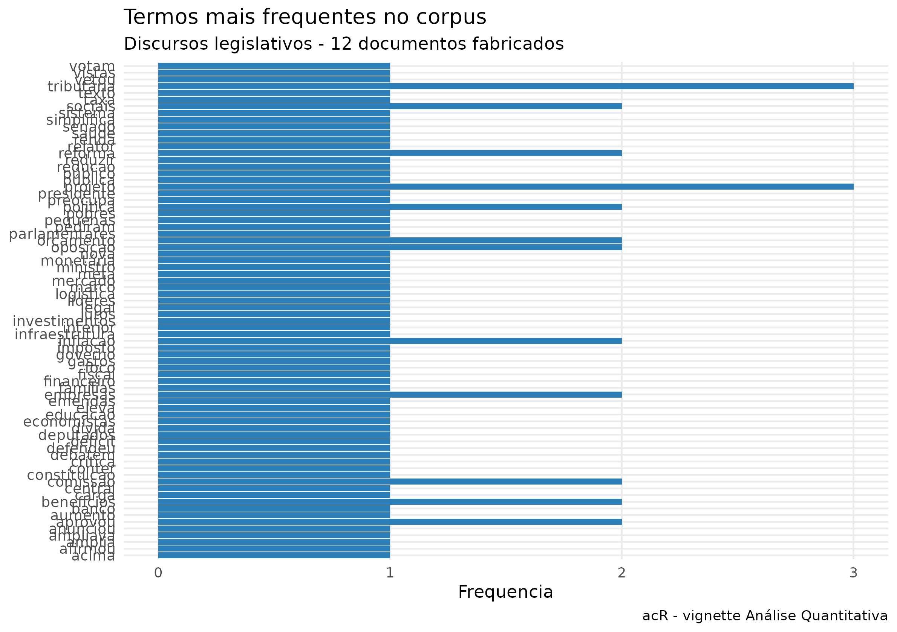
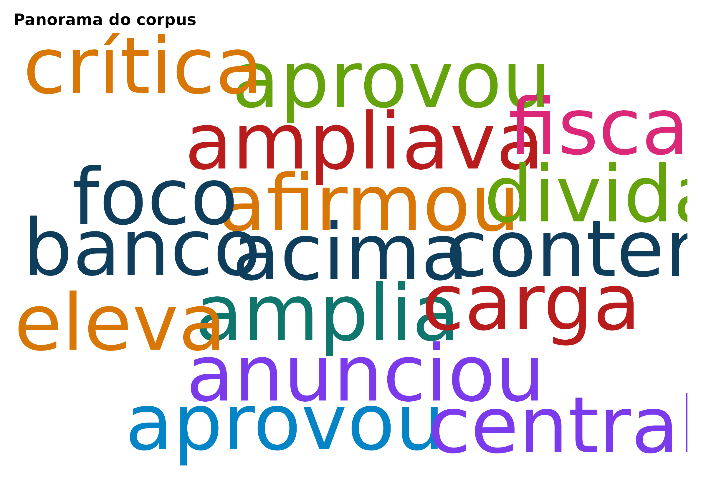
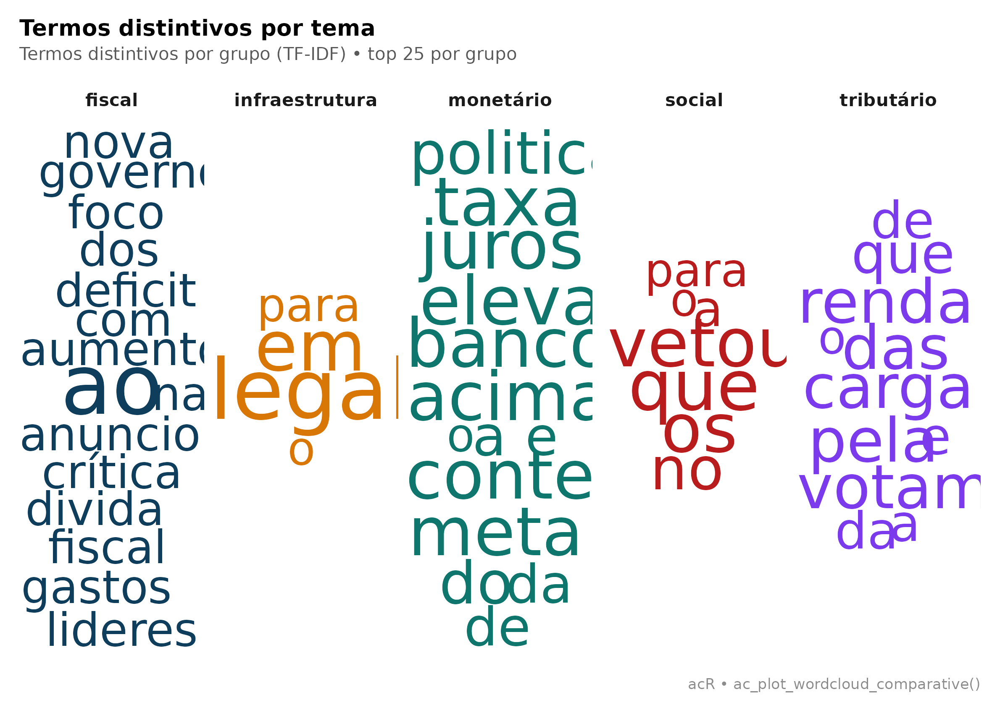
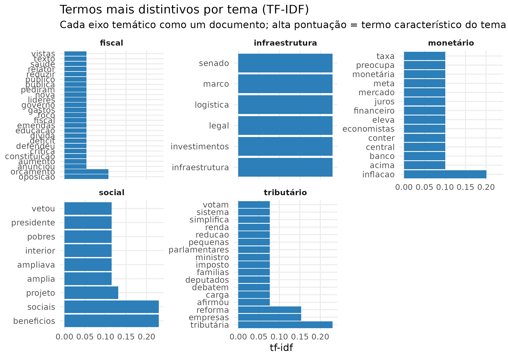
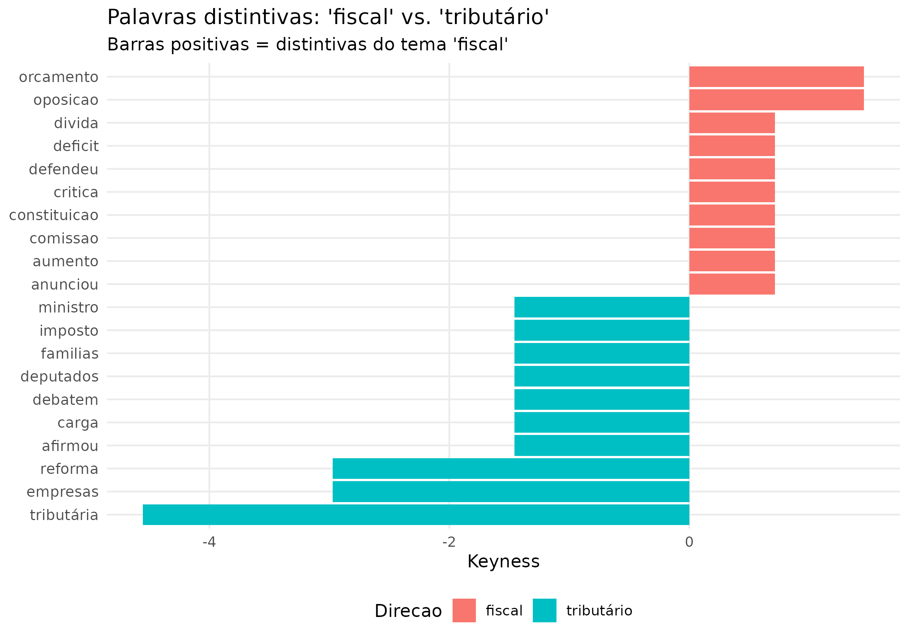
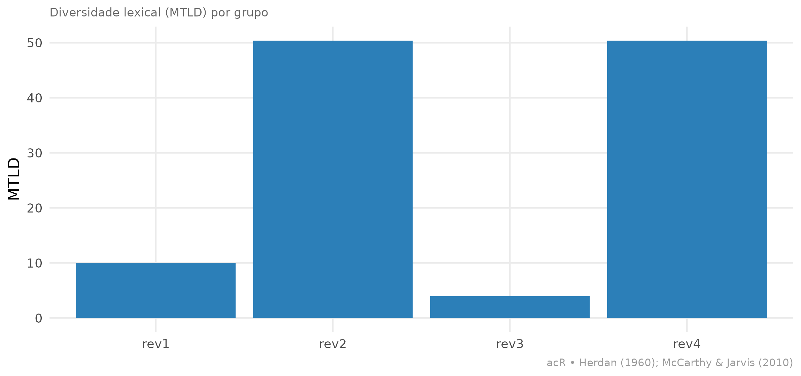
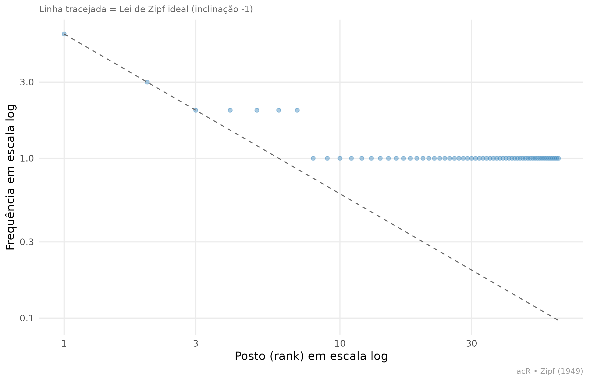
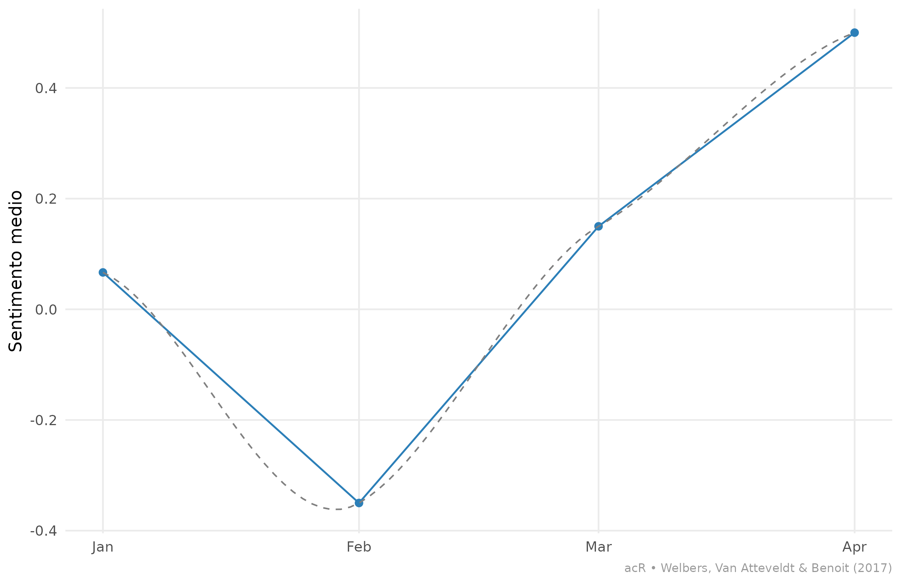
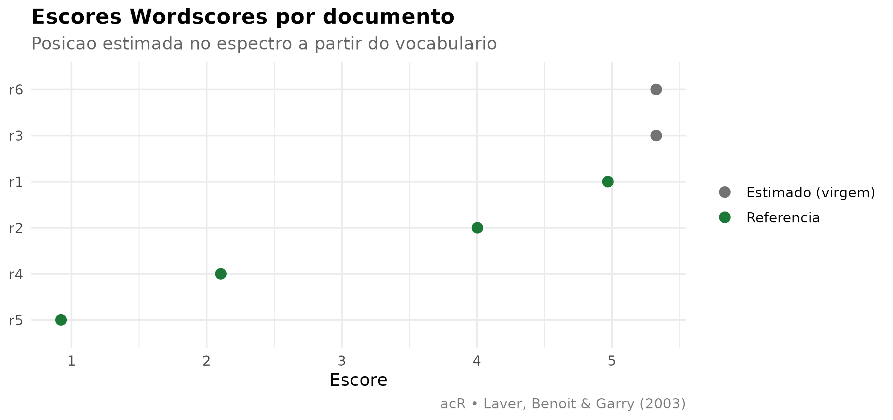
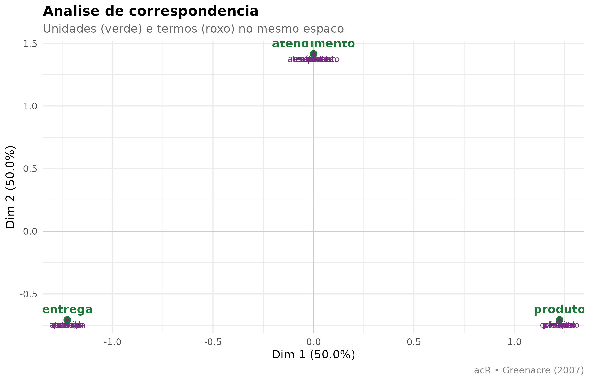

# Análise quantitativa de texto

Esta vignette percorre o **módulo quantitativo** do `acR` em cima de um
corpus de discursos parlamentares fabricado para o exemplo. Cada etapa é
apresentada com uma pergunta metodológica — *por que faço isso?* — antes
do código e do gráfico.

O caminho é o clássico da análise de conteúdo estatística: **corpus →
limpeza → tokenização → frequências → distintividade → visualização**.

## Qual métrica responde qual pergunta?

O módulo quantitativo tem dezoito técnicas, agrupadas em cinco famílias.
Aprender qual usar em cada situação vale mais que decorar sintaxe: a
pergunta de pesquisa escolhe a técnica, não o contrário.

**Frequência, distintividade e coocorrência**

| Pergunta | Técnica | Função |
|----|----|----|
| Que palavras dominam o corpus como um todo? | Frequência bruta | [`ac_count()`](https://andersonheri.github.io/acR/reference/ac_count.md) → [`ac_top_terms()`](https://andersonheri.github.io/acR/reference/ac_top_terms.md) |
| Que palavras são **distintivas** de cada documento vs. o resto? | TF-IDF | [`ac_tf_idf()`](https://andersonheri.github.io/acR/reference/ac_tf_idf.md) → [`ac_plot_tf_idf()`](https://andersonheri.github.io/acR/reference/ac_plot_tf_idf.md) |
| Que palavras separam **um grupo** do outro estatisticamente? | *Keyness* | [`ac_keyness()`](https://andersonheri.github.io/acR/reference/ac_keyness.md) → [`ac_plot_keyness()`](https://andersonheri.github.io/acR/reference/ac_plot_keyness.md) |
| Que palavras **andam juntas** (associação sintagmática)? | Coocorrência | [`ac_cooccurrence()`](https://andersonheri.github.io/acR/reference/ac_cooccurrence.md) → [`ac_plot_cooccurrence()`](https://andersonheri.github.io/acR/reference/ac_plot_cooccurrence.md) |
| Que bigramas/trigramas aparecem juntos mais do que o esperado pelo acaso? | Colocações | [`ac_collocations()`](https://andersonheri.github.io/acR/reference/ac_collocations.md) |
| **Onde no texto** um termo aparece com mais frequência? | X-ray plot | [`ac_plot_xray()`](https://andersonheri.github.io/acR/reference/ac_plot_xray.md) |
| Em que contexto exato um termo aparece a cada ocorrência? | Concordância/KWIC | [`ac_kwic()`](https://andersonheri.github.io/acR/reference/ac_kwic.md) |
| Panorama visual rápido para relatório ou apresentação | Nuvem de palavras | [`ac_wordcloud()`](https://andersonheri.github.io/acR/reference/ac_wordcloud.md) (`ggwordcloud`) |

**Diagnóstico do corpus**

| Pergunta | Técnica | Função |
|----|----|----|
| O texto é fácil ou difícil de ler? | Legibilidade | [`ac_readability()`](https://andersonheri.github.io/acR/reference/ac_readability.md) |
| O vocabulário é rico ou repetitivo? | Diversidade lexical | [`ac_lexical_diversity()`](https://andersonheri.github.io/acR/reference/ac_lexical_diversity.md) |
| O corpus se comporta como linguagem natural (não dominado por ruído)? | Lei de Zipf | [`ac_plot_zipf()`](https://andersonheri.github.io/acR/reference/ac_plot_zipf.md) |

**Série temporal**

| Pergunta | Técnica | Função |
|----|----|----|
| Um termo, sentimento ou qualquer métrica muda ao longo do tempo? | Série temporal | [`ac_temporal()`](https://andersonheri.github.io/acR/reference/ac_temporal.md) → [`ac_plot_temporal()`](https://andersonheri.github.io/acR/reference/ac_plot_temporal.md) |

**Escalas e mapas**

| Pergunta | Técnica | Função |
|----|----|----|
| Onde cada documento se posiciona num espectro contínuo (favorável↔︎desfavorável)? | Wordscores | [`ac_wordscores()`](https://andersonheri.github.io/acR/reference/ac_wordscores.md) |
| Como grupos e termos se relacionam num mapa 2D, sem assumir tópicos latentes? | Análise de correspondência | [`ac_ca()`](https://andersonheri.github.io/acR/reference/ac_ca.md) |

**Dicionários e léxicos**

| Pergunta | Técnica | Função |
|----|----|----|
| Quanto do texto pertence a cada categoria temática que eu defino? | Dicionário multi-categoria | [`ac_dictionary()`](https://andersonheri.github.io/acR/reference/ac_dictionary.md) |
| Que emoções (não só positivo/negativo) o texto expressa? | Léxico de emoção | [`ac_emotion()`](https://andersonheri.github.io/acR/reference/ac_emotion.md) |
| Meu dicionário classifica bem, comparado a uma codificação humana? | Validação de dicionário | [`ac_dictionary_validate()`](https://andersonheri.github.io/acR/reference/ac_dictionary_validate.md) |

**Não é redundância.** As três métricas de frequência respondem
perguntas diferentes:

- **Frequência bruta** conta ocorrências. É a primeira olhada, mas os
  termos no topo tendem a ser genéricos (mesmo depois de tirar
  *stopwords*).
- **TF-IDF** penaliza termos que aparecem em muitos documentos: destaca
  o vocabulário **próprio** de cada texto. Sem grupo definido a priori.
- **Keyness** compara **grupos** com um teste estatístico (χ² ou
  log-likelihood). Precisa de uma variável categórica no corpus.

Para descobrir tipologias emergentes sem categoria a priori, veja
[`vignette("cluster")`](https://andersonheri.github.io/acR/articles/cluster.md)
e
[`vignette("lda")`](https://andersonheri.github.io/acR/articles/lda.md)
(não supervisionado). Para rotular com categorias teóricas, veja
[`vignette("qualitativo-llm")`](https://andersonheri.github.io/acR/articles/qualitativo-llm.md)
(assistido).

``` r

library(acR)
```

## 1. Construir o corpus

O
[`ac_corpus()`](https://andersonheri.github.io/acR/reference/ac_corpus.md)
padroniza qualquer `data.frame` em um objeto com colunas fixas `doc_id`
e `text`, mantendo os metadados que você quiser preservar para
comparações posteriores.

``` r

textos <- c(
  "O governo anunciou nova politica fiscal para reduzir o deficit público.",
  "A oposicao crítica o aumento dos gastos e da divida pública no orcamento.",
  "Parlamentares debatem a reforma tributária e o imposto de renda das familias.",
  "O presidente vetou o projeto que ampliava beneficios sociais para os pobres.",
  "O Senado aprovou o marco legal para investimentos em infraestrutura logistica.",
  "Deputados votam pela reducao da carga tributária para pequenas empresas.",
  "A politica monetária do Banco Central eleva a taxa de juros para conter inflacao.",
  "A inflacao acima da meta preocupa economistas e o mercado financeiro.",
  "O relator defendeu emendas ao texto do orcamento com foco em saude e educacao.",
  "A comissao aprovou o projeto que amplia beneficios sociais no interior.",
  "O ministro afirmou que a reforma tributária simplifica o sistema para empresas.",
  "Lideres da oposicao pediram vistas ao projeto na comissao de constituicao."
)

meta <- data.frame(
  text = textos,
  tema = c("fiscal","fiscal","tributário","social","infraestrutura",
           "tributário","monetário","monetário","fiscal","social",
           "tributário","fiscal"),
  stringsAsFactors = FALSE
)

corpus <- ac_corpus(meta)
corpus
#> 
#> ── Corpus acR ──────────────────────────────────────────────────────────────────
#> • Documentos: 12
#> • Metadados: 1 coluna
#> • Idioma: "pt"
#> 
#> # A tibble: 12 × 3
#>   doc_id text                                                              tema 
#>   <chr>  <chr>                                                             <chr>
#> 1 doc_1  O governo anunciou nova politica fiscal para reduzir o deficit p… fisc…
#> 2 doc_2  A oposicao crítica o aumento dos gastos e da divida pública no o… fisc…
#> 3 doc_3  Parlamentares debatem a reforma tributária e o imposto de renda … trib…
#> 4 doc_4  O presidente vetou o projeto que ampliava beneficios sociais par… soci…
#> 5 doc_5  O Senado aprovou o marco legal para investimentos em infraestrut… infr…
#> 6 doc_6  Deputados votam pela reducao da carga tributária para pequenas e… trib…
#> # ℹ 6 more rows
```

## 2. Limpeza: por que remover *stopwords*?

Sem remoção de *stopwords*, os termos mais frequentes de qualquer corpus
em português são artigos, preposições e conjunções (`o`, `a`, `de`,
`que`, `para`…). Eles carregam pouquíssima informação temática e sufocam
qualquer padrão real de vocabulário. A regra prática em análise de
conteúdo (Sampaio & Lycarião, 2021) é sempre remover *stopwords* antes
de contar frequências ou calcular distintividade.

O
[`ac_clean()`](https://andersonheri.github.io/acR/reference/ac_clean.md)
aceita o parâmetro `remove_stopwords = "pt"` para aplicar uma lista de
*stopwords* portuguesas curada. Você pode adicionar seu próprio
glossário via `extra_stopwords`.

``` r

corpus_limpo <- ac_clean(
  corpus,
  remove_stopwords = "pt",
  extra_stopwords  = c("pra", "pro")  # opcional: coloquiais
)
corpus_limpo
#> 
#> ── Corpus acR ──────────────────────────────────────────────────────────────────
#> • Documentos: 12
#> • Metadados: 1 coluna
#> • Idioma: "pt"
#> 
#> # A tibble: 12 × 3
#>   doc_id text                                                              tema 
#>   <chr>  <chr>                                                             <chr>
#> 1 doc_1  governo anunciou nova politica fiscal reduzir deficit público     fisc…
#> 2 doc_2  oposicao crítica aumento gastos divida pública orcamento          fisc…
#> 3 doc_3  parlamentares debatem reforma tributária imposto renda familias   trib…
#> 4 doc_4  presidente vetou projeto ampliava beneficios sociais pobres       soci…
#> 5 doc_5  senado aprovou marco legal investimentos infraestrutura logistica infr…
#> 6 doc_6  deputados votam reducao carga tributária pequenas empresas        trib…
#> # ℹ 6 more rows
```

## 3. Tokenização

[`ac_tokenize()`](https://andersonheri.github.io/acR/reference/ac_tokenize.md)
quebra cada documento em unidades de análise. Com `n = 1L` são unigramas
(palavras); com `n = 2L`, bigramas (“reforma tributária”). Bigramas são
úteis quando você quer capturar **expressões compostas** que perdem
sentido tokenizadas separadamente.

``` r

tokens <- ac_tokenize(corpus_limpo, n = 1L)
head(tokens, 12)
#> # A tibble: 12 × 3
#>    doc_id token_id token   
#>    <chr>     <int> <chr>   
#>  1 doc_1         1 governo 
#>  2 doc_1         2 anunciou
#>  3 doc_1         3 nova    
#>  4 doc_1         4 politica
#>  5 doc_1         5 fiscal  
#>  6 doc_1         6 reduzir 
#>  7 doc_1         7 deficit 
#>  8 doc_1         8 público 
#>  9 doc_2         1 oposicao
#> 10 doc_2         2 crítica 
#> 11 doc_2         3 aumento 
#> 12 doc_2         4 gastos
```

## 4. Frequência

Contagem de ocorrências por documento e depois agregação.
[`ac_count()`](https://andersonheri.github.io/acR/reference/ac_count.md)
já retorna no formato *tidy* pronto para pipeline com `dplyr` e
`ggplot2`.

``` r

contagem <- ac_count(corpus_limpo)
contagem
#> # A tibble: 88 × 3
#>    doc_id token        n
#>    <chr>  <chr>    <int>
#>  1 doc_1  anunciou     1
#>  2 doc_1  deficit      1
#>  3 doc_1  fiscal       1
#>  4 doc_1  governo      1
#>  5 doc_1  nova         1
#>  6 doc_1  politica     1
#>  7 doc_1  público      1
#>  8 doc_1  reduzir      1
#>  9 doc_10 amplia       1
#> 10 doc_10 aprovou      1
#> # ℹ 78 more rows
```

## 5. Top termos: o vocabulário do corpus

O gráfico abaixo mostra as **15 palavras mais frequentes** — agora, com
*stopwords* removidas, é possível ler os *temas* dominantes: reforma,
projeto, tributária, orçamento, etc.

``` r

top <- ac_top_terms(contagem, n = 15)
ac_plot_top_terms(top) +
  ggplot2::labs(
    title    = "Termos mais frequentes no corpus",
    subtitle = "Discursos legislativos - 12 documentos fabricados",
    caption  = "acR - vignette Análise Quantitativa"
  )
```



## 6. Nuvem de palavras

Uma nuvem funciona como **panorama visual** rápido, útil para relatórios
e apresentações. Não substitui análise numérica: o tamanho da palavra é
proporcional à frequência, mas a posição no plot é aleatória.

Desde a versão 0.3.1 o
[`ac_wordcloud()`](https://andersonheri.github.io/acR/reference/ac_wordcloud.md)
prefere automaticamente o motor `ggwordcloud` (retorna um `ggplot`, com
tipografia mais legível e layout consistente com o tema do pacote); se
ele não estiver instalado, cai para o `wordcloud` clássico. Você pode
forçar via `backend = "ggwordcloud"` ou `backend = "wordcloud"`.

``` r

ac_wordcloud(contagem, max_words = 40, title = "Panorama do corpus")
#> Warning in wordcloud_boxes(data_points = points_valid_first, boxes = boxes, :
#> Some words could not fit on page. They have been removed.
```



### 6.1 Nuvem comparativa entre grupos

Quando o corpus tem uma variável de agrupamento (partido, período, tema,
etc.), a nuvem comparativa mostra lado a lado os termos mais
**distintivos** de cada grupo — pontuados por TF-IDF calculado tratando
cada grupo como um “documento”. Aceita 2, 3 ou mais grupos.

``` r

# Nosso corpus tem 5 temas distintos — todos entram na comparativa:
ac_plot_wordcloud_comparative(
  corpus,
  group     = tema,
  max_words = 25,
  title     = "Termos distintivos por tema"
)
#> Warning in wordcloud_boxes(data_points = points_valid_first, boxes = boxes, :
#> Some words could not fit on page. They have been removed.
#> Warning in wordcloud_boxes(data_points = points_valid_first, boxes = boxes, :
#> Some words could not fit on page. They have been removed.
#> Warning in wordcloud_boxes(data_points = points_valid_first, boxes = boxes, :
#> Some words could not fit on page. They have been removed.
#> Warning in wordcloud_boxes(data_points = points_valid_first, boxes = boxes, :
#> Some words could not fit on page. They have been removed.
#> Warning in wordcloud_boxes(data_points = points_valid_first, boxes = boxes, :
#> Some words could not fit on page. They have been removed.
```



O layout usa `ggwordcloud` com facets quando disponível
(`backend = "auto"`), e cai em `geom_text` com jitter reproduzível
quando não. A semente do posicionamento é controlada por `seed = 42L`.
Cores vêm de
[`ac_palette()`](https://andersonheri.github.io/acR/reference/ac_palette.md)
por padrão — uma por grupo.

## 7. TF-IDF: o que é *distintivo* em cada documento?

Frequência bruta favorece palavras que aparecem em quase todos os
documentos (mesmo depois de *stopwords*). O **TF-IDF** (*term frequency
× inverse document frequency*) penaliza termos comuns e destaca
vocabulário próprio de cada grupo — útil quando o corpus é composto por
textos com propostas ou temas distintos.

Com **12 discursos curtos** e cada palavra aparecendo em 1–2 documentos,
o TF-IDF *por documento* resulta em barras quase todas iguais (todo
termo único vale o mesmo). O padrão fica mais legível **agregando por
tema**: tratamos cada tema como um “documento” e o TF-IDF revela o
vocabulário característico de cada eixo temático do corpus.

``` r

freq_tema  <- ac_count(corpus_limpo, by = "tema")
tfidf_tema <- ac_tf_idf(freq_tema, by = "tema")

ac_plot_tf_idf(tfidf_tema, by = "tema", n = 6) +
  ggplot2::labs(
    title    = "Termos mais distintivos por tema (TF-IDF)",
    subtitle = "Cada eixo temático como um documento; alta pontuação = termo característico do tema"
  )
```



## 8. *Keyness*: o que é distintivo entre **grupos**?

Enquanto TF-IDF compara documento vs. corpus, ***keyness*** compara
**grupos** — e o critério que define o grupo é seu, não do pacote. Pode
ser partido, período histórico, tema, região, autor, condição
experimental, faixa etária, qualquer variável categórica no seu corpus.
É a métrica clássica para a pergunta comparativa: *“o que um grupo diz
que o outro não diz?”*.

Aqui comparamos os temas **fiscal** e **tributário** — quais palavras
marcam cada lado?

``` r

freq_tema     <- ac_count(corpus_limpo, by = "tema")
freq_2grupos  <- freq_tema[freq_tema$tema %in% c("fiscal", "tributário"), ]

kn <- ac_keyness(freq_2grupos, group = "tema", target = "fiscal")

ac_plot_keyness(kn, n = 10) +
  ggplot2::labs(
    title    = "Palavras distintivas: 'fiscal' vs. 'tributário'",
    subtitle = "Barras positivas = distintivas do tema 'fiscal'"
  )
```



Interpretação: chi-quadrado alto indica **sobre-representação
estatística**. Termos como *deficit* e *orçamento* marcam o eixo fiscal;
*carga* e *renda* o tributário — resultado consistente com o corpus de
exemplo.

## 9. Rede de co-ocorrência

Palavras que aparecem próximas com frequência formam **agrupamentos
semânticos**. A rede de coocorrência mostra essas vizinhanças com base
numa **janela** de tokens (aqui, 5 palavras à esquerda e à direita).

Útil para: identificar frames, mapear associações conceituais e
encontrar combinações de palavras que definem sub-temas dentro do
corpus.

``` r

cooc <- ac_cooccurrence(corpus_limpo, window = 5L, min_count = 2L)

if (requireNamespace("ggraph", quietly = TRUE)) {
  ac_plot_cooccurrence(cooc, top_n = 25) +
    ggplot2::labs(
      title    = "Rede de coocorrência (janela = 5, freq mínima = 2)",
      subtitle = "Arestas conectam termos que co-ocorrem no mesmo contexto"
    )
}
```


### 9.1 Trocando o peso: PMI em vez de contagem

A rede padrão pondera arestas pela **contagem** de coocorrências —
termos frequentes tendem a dominar. O **PMI** (*pointwise mutual
information*) mede o quanto duas palavras aparecem juntas *acima do
esperado por acaso*; revela pares surpreendentes, mesmo que raros.

``` r

if (requireNamespace("ggraph", quietly = TRUE)) {
  ac_plot_cooccurrence(cooc, top_n = 25, weight = "pmi") +
    ggplot2::labs(
      title    = "Rede de coocorrência ponderada por PMI",
      subtitle = "Destaca pares associados além do esperado por acaso"
    )
}
```


### 9.2 Trocando o layout

O layout controla como os nós são posicionados no plano. O padrão `"fr"`
(Fruchterman-Reingold) minimiza cruzamentos; `"kk"` (Kamada-Kawai)
respeita distâncias de grafo; `"circle"` alinha tudo num anel — útil
para corpora pequenos onde a topologia importa menos que a legibilidade.

``` r

if (requireNamespace("ggraph", quietly = TRUE)) {
  ac_plot_cooccurrence(cooc, top_n = 25, layout = "circle") +
    ggplot2::labs(
      title    = "Rede de coocorrência — layout circular",
      subtitle = "Todas as palavras num anel; arestas mostram o grafo cru"
    )
}
```


### 9.3 Coocorrência como matriz (heatmap)

Quando a rede fica saturada de arestas, um **heatmap** das top-N
palavras pode ser mais legível: linhas e colunas são termos, e a
intensidade da célula é a coocorrência. Não requer `ggraph`.

``` r

top_tokens <- ac_top_terms(ac_count(corpus_limpo), n = 12)$token
cooc_mat   <- cooc[cooc$word1 %in% top_tokens & cooc$word2 %in% top_tokens, ]

ggplot2::ggplot(cooc_mat,
                ggplot2::aes(word1, word2, fill = cooc)) +
  ggplot2::geom_tile(color = "white") +
  ggplot2::scale_fill_gradient(low = "#F1F5F9", high = ac_palette(1)) +
  ggplot2::labs(
    title    = "Matriz de coocorrência (top 12 termos)",
    subtitle = "Alternativa ao grafo quando a rede fica densa",
    x = NULL, y = NULL, fill = "cooc."
  ) +
  theme_ac() +
  ggplot2::theme(
    axis.text.x = ggplot2::element_text(angle = 45, hjust = 1)
  )
```


## Novidades: diagnóstico de corpus, escalas e dicionários

As seções anteriores giram em torno de discursos parlamentares — um
domínio comum na ciência política, mas o módulo quantitativo não é
específico a ele. As técnicas a seguir são novas no pacote e são
apresentadas com exemplos de **outros domínios** (avaliações de produto,
atendimento ao cliente, notícias) para deixar claro que servem a
qualquer corpus de texto.

### 10. Legibilidade e diversidade lexical

Duas perguntas distintas sobre a *forma* do texto, independente do
conteúdo:

- **Legibilidade**
  ([`ac_readability()`](https://andersonheri.github.io/acR/reference/ac_readability.md)):
  o texto é fácil de ler? Adapta o índice de Flesch para português
  (Martins et al., 1996), combinando palavras por frase e sílabas por
  palavra. Útil para comparar, por exemplo, a complexidade de um manual
  técnico com a de um texto de divulgação para o público geral.
- **Diversidade lexical**
  ([`ac_lexical_diversity()`](https://andersonheri.github.io/acR/reference/ac_lexical_diversity.md)):
  o vocabulário é rico ou repetitivo? TTR é sensível ao tamanho do
  texto; Herdan’s C (Herdan,
  1960. e o MTLD (McCarthy & Jarvis, 2010) corrigem isso — o MTLD é a
        métrica recomendada para comparar textos de tamanhos diferentes.

``` r

avaliacoes <- data.frame(
  id = paste0("rev", 1:4),
  texto = c(
    "Este produto é incrível. Funciona perfeitamente bem e chegou rápido.",
    "O manual técnico específica que a calibração requer ajuste periódico do sensor piezoelétrico conforme a norma vigente, o que demanda qualificação especializada do operador responsável pela manutenção preventiva do equipamento.",
    "Bom. Chegou. Funciona. Recomendo.",
    "A experiência de uso revelou inconsistências na usabilidade da interface, comprometendo a jornada do consumidor e gerando fricção considerável ao longo do processo de integração do dispositivo ao ecossistema existente."
  ),
  stringsAsFactors = FALSE
)
corpus_aval <- ac_corpus(avaliacoes, text = texto, docid = id)
```

``` r

ac_readability(corpus_aval)
#> # A tibble: 4 × 6
#>   doc_id n_palavras n_frases n_silabas flesch nivel        
#>   <chr>       <int>    <int>     <dbl>  <dbl> <chr>        
#> 1 rev1           10        2        24   40.7 dificil      
#> 2 rev2           30        1        84  -18.5 muito dificil
#> 3 rev3            4        4        10   36.3 dificil      
#> 4 rev4           30        1        81  -10.0 muito dificil
```

``` r

ac_lexical_diversity(corpus_aval)
#> # A tibble: 4 × 6
#>   doc_id n_tokens n_types   ttr herdan_c  mtld
#>   <chr>     <int>   <int> <dbl>    <dbl> <dbl>
#> 1 rev1         10      10 1        1      10  
#> 2 rev2         30      25 0.833    0.946  50.4
#> 3 rev3          4       4 1        1       4  
#> 4 rev4         30      25 0.833    0.946  50.4
```

``` r

ac_plot_lexical_diversity(ac_lexical_diversity(corpus_aval), group_col = "doc_id",
                           metric = "mtld", type = "bar")
```



### 11. Lei de Zipf: o corpus se comporta como linguagem natural?

A Lei de Zipf (Zipf, 1949) prevê que a frequência de uma palavra é
inversamente proporcional ao seu ranking — um diagnóstico clássico para
saber se um corpus é “normal” (ex.: não dominado por um único termo
repetido artificialmente, como aconteceria em dados mal limpos).

``` r

freq_aval <- ac_count(corpus_aval, drop_punct = TRUE)
ac_plot_zipf(freq_aval)
```



### 12. Concordância (KWIC) e colocações

Frequência bruta não mostra *como* uma palavra é usada. Duas ferramentas
complementares:

- **KWIC** (*keyword-in-context*, Sinclair, 1991): lista cada ocorrência
  de um termo com o contexto antes/depois — o primeiro passo de qualquer
  análise de discurso de corpus (*corpus-based discourse analysis*).
- **Colocações**
  ([`ac_collocations()`](https://andersonheri.github.io/acR/reference/ac_collocations.md)):
  quais bigramas/trigramas aparecem juntos mais do que o esperado pelo
  acaso, medido por PMI (Church & Hanks, 1990), log-likelihood
  (Dunning, 1993) ou qui-quadrado — não apenas frequência bruta de
  n-gramas.

``` r

atendimento <- data.frame(
  id = paste0("call", 1:3),
  texto = c(
    "o cliente reclamou que o produto chegou com defeito de fabrica",
    "outro cliente relatou defeito no produto depois de uma semana de uso",
    "o produto sem defeito foi elogiado pelo cliente no final da ligacao"
  ),
  stringsAsFactors = FALSE
)
corpus_atend <- ac_corpus(atendimento, text = texto, docid = id)

ac_kwic(corpus_atend, pattern = "defeito", window = 4)
#> # A tibble: 3 × 5
#>   doc_id position before                keyword after                    
#>   <chr>     <int> <chr>                 <chr>   <chr>                    
#> 1 call1         9 o produto chegou com  defeito de fabrica               
#> 2 call2         4 outro cliente relatou defeito no produto depois de     
#> 3 call3         4 o produto sem         defeito foi elogiado pelo cliente
```

``` r

ac_collocations(corpus_atend, n = 2, measure = "pmi", min_count = 1)
#> # A tibble: 31 × 3
#>    collocation      count association
#>    <chr>            <int>       <dbl>
#>  1 chegou com           1        5.13
#>  2 da ligacao           1        5.13
#>  3 elogiado pelo        1        5.13
#>  4 final da             1        5.13
#>  5 foi elogiado         1        5.13
#>  6 reclamou que         1        5.13
#>  7 uma semana           1        5.13
#>  8 no final             1        4.13
#>  9 cliente reclamou     1        3.54
#> 10 cliente relatou      1        3.54
#> # ℹ 21 more rows
```

### 13. Análise temporal/diacrônica

Quando o corpus tem datas, perguntas que antes eram estáticas (quanto um
termo aparece?) passam a ter uma dimensão temporal (quando ele aparece
mais?) — essencial para cobertura jornalística, séries de atendimento ao
cliente, ou qualquer corpus com carimbo de data (Welbers, Van Atteveldt
& Benoit, 2017).

``` r

noticias <- data.frame(
  data      = as.Date("2024-01-01") + c(0, 10, 20, 35, 50, 65, 80, 95),
  sentimento = c(0.2, 0.1, -0.1, -0.4, -0.3, 0.0, 0.3, 0.5)
)
serie <- ac_temporal(noticias, date_col = "data", value_col = "sentimento",
                      unit = "month", stat = "mean")
ac_plot_temporal(serie, ylab = "Sentimento médio")
#> Warning in simpleLoess(y, x, w, span, degree = degree, parametric = parametric,
#> : span too small.  fewer data values than degrees of freedom.
#> Warning in simpleLoess(y, x, w, span, degree = degree, parametric = parametric,
#> : pseudoinverse used at 19723
#> Warning in simpleLoess(y, x, w, span, degree = degree, parametric = parametric,
#> : neighborhood radius 60.455
#> Warning in simpleLoess(y, x, w, span, degree = degree, parametric = parametric,
#> : reciprocal condition number 0
#> Warning in simpleLoess(y, x, w, span, degree = degree, parametric = parametric,
#> : There are other near singularities as well. 3654.8
```



### 14. Escalonamento Wordscores: posicionar documentos numa escala

Às vezes queremos posicionar documentos num espectro contínuo
(favorável↔︎ desfavorável, satisfeito↔︎insatisfeito) sem codificar
manualmente todos eles. O método Wordscores (Laver, Benoit & Garry,
2003) estima a posição de documentos “virgens” a partir de um pequeno
conjunto de referência com posição conhecida — aqui, avaliações de
produto com nota conhecida servem de referência para estimar a
satisfação implícita em avaliações sem nota.

``` r

resenhas <- data.frame(
  id = paste0("r", 1:6),
  texto = c(
    "produto excelente, superou expectativas, recomendo muito",
    "muito bom, chegou rápido e funciona perfeitamente",
    "produto regular, cumpre o básico",
    "não funcionou bem, qualidade ruim, não recomendo",
    "péssimo, quebrado e com defeito, decepcao total",
    "produto ok, nada de especial mas atende"
  ),
  stringsAsFactors = FALSE
)
corpus_resenhas <- ac_corpus(resenhas, text = texto, docid = id)

# r1, r2, r4, r5 com nota conhecida (1-5); r3 e r6 sao "virgens" a estimar
notas <- c(r1 = 5, r2 = 4, r4 = 2, r5 = 1)
wordscores <- ac_wordscores(corpus_resenhas, notas, rescale = "lbg")
wordscores
#> # A tibble: 6 × 4
#>   doc_id score score_raw is_reference
#>   <chr>  <dbl>     <dbl> <lgl>       
#> 1 r1     4.97       4.69 TRUE        
#> 2 r2     4.00       3.86 TRUE        
#> 3 r3     5.33       5    FALSE       
#> 4 r4     2.11       2.23 TRUE        
#> 5 r5     0.923      1.21 TRUE        
#> 6 r6     5.33       5    FALSE
```

``` r

ac_plot_wordscores(wordscores)
```



### 15. Dicionários multi-categoria, emoções e validação

Nem toda análise baseada em dicionário é positivo/negativo.
[`ac_dictionary()`](https://andersonheri.github.io/acR/reference/ac_dictionary.md)
generaliza a lógica de
[`ac_sentiment()`](https://andersonheri.github.io/acR/reference/ac_sentiment.md)
para **qualquer** conjunto de categorias (temas, enquadramentos,
emoções), no espírito do General Inquirer (Stone et al., 1966) e de
“Text as Data” (Grimmer & Stewart, 2013).
[`ac_emotion()`](https://andersonheri.github.io/acR/reference/ac_emotion.md)
é uma camada especializada para léxicos de emoção (inspirada no NRC
Emotion Lexicon; Mohammad & Turney, 2013).

``` r

dict <- ac_build_dictionary(
  entrega = c("entrega", "atrasou", "atrasada", "rápida", "rastreio"),
  produto = c("defeito", "quebrado", "perfeito", "excelente")
)
ac_dictionary(corpus_atend, dict)
#> # A tibble: 3 × 6
#>   doc_id total_tokens entrega_n produto_n entrega_prop produto_prop
#>   <chr>         <int>     <int>     <int>        <dbl>        <dbl>
#> 1 call1            11         0         1            0       0.0909
#> 2 call2            12         0         1            0       0.0833
#> 3 call3            12         0         1            0       0.0833
```

Nenhum dicionário deveria ser usado numa análise publicável sem comparar
sua classificação a uma amostra codificada por humano — a mesma lógica
de
[`ac_qual_reliability()`](https://andersonheri.github.io/acR/reference/ac_qual_reliability.md)
(para codificação por LLM), aplicada aqui ao método de dicionário:

``` r

scored <- ac_dictionary(corpus_atend, dict)
humano <- tibble::tibble(
  doc_id    = scored$doc_id,
  categoria = c("entrega", "entrega|produto", "produto")
)
ac_dictionary_validate(scored, humano)
#> # A tibble: 2 × 12
#>   categoria     n    vp    fp    fn    vn concordancia precisao recall    f1
#>   <chr>     <int> <int> <int> <int> <int>        <dbl>    <dbl>  <dbl> <dbl>
#> 1 entrega       3     0     0     2     1        0.333   NA          0  NA  
#> 2 produto       3     2     1     0     0        0.667    0.667      1   0.8
#> # ℹ 2 more variables: gwet_ac1 <dbl>, krippendorff_alfa <dbl>
```

### 16. Análise de correspondência (CA): um mapa de grupos e termos

Quando queremos visualizar em 2D como o vocabulário difere entre grupos,
sem assumir um número de tópicos latentes (como em
[`ac_lda()`](https://andersonheri.github.io/acR/reference/ac_lda.md)), a
Análise de Correspondência (Greenacre, 2007) posiciona grupos e termos
no mesmo espaço geométrico — pontos próximos tendem a co-ocorrer mais do
que o esperado pelo acaso.

``` r

categorias <- data.frame(
  id = paste0("d", 1:6),
  texto = c(
    "entrega atrasada rastreio sumiu",
    "pedido atrasou rastreio sumiu",
    "produto defeito quebrado chegou",
    "veio quebrado produto péssimo",
    "atendimento excelente resolveram rápido",
    "suporte educado resolveu rápido"
  ),
  categoria = c("entrega", "entrega", "produto", "produto",
                "atendimento", "atendimento"),
  stringsAsFactors = FALSE
)
corpus_cat <- ac_corpus(categorias, text = texto, docid = id, meta = categoria)
ca <- ac_ca(corpus_cat, by = "categoria", min_count = 1)
ac_plot_ca(ca)
```



## Referências

- Church, K. W.; Hanks, P. (1990). Word Association Norms, Mutual
  Information, and Lexicography. *Computational Linguistics*, 16(1),
  22-29.
- Dunning, T. (1993). Accurate Methods for the Statistics of Surprise
  and Coincidence. *Computational Linguistics*, 19(1), 61-74.
- Greenacre, M. (2007). *Correspondence Analysis in Practice* (2nd ed.).
  Chapman and Hall/CRC.
- Grimmer, J.; Stewart, B. M. (2013). Text as Data: The Promise and
  Pitfalls of Automatic Content Analysis Methods for Political Texts.
  *Political Analysis*, 21(3), 267-297.
- Herdan, G. (1960). *Type-Token Mathematics*. Mouton.
- Krippendorff, K. (2018). *Content Analysis: An Introduction to Its
  Methodology*. 4. ed. SAGE.
- Laver, M.; Benoit, K.; Garry, J. (2003). Extracting Policy Positions
  from Political Texts Using Words as Data. *American Political Science
  Review*, 97(2), 311-331.
- Martins, T. B. F. et al. (1996). Readability formulas applied to
  textbooks in Brazilian Portuguese. *Memorandum*, 28.
- McCarthy, P. M.; Jarvis, S. (2010). MTLD, vocd-D, and HD-D: A
  validation study of sophisticated approaches to lexical diversity
  assessment. *Behavior Research Methods*, 42(2), 381-392.
- Mohammad, S. M.; Turney, P. D. (2013). Crowdsourcing a Word-Emotion
  Association Lexicon. *Computational Intelligence*, 29(3), 436-465.
- Sampaio, R. C.; Lycarião, D. (2021). *Análise de conteúdo categorial:
  manual de aplicação*. ENAP.
- Silge, J.; Robinson, D. (2017). *Text Mining with R*. O’Reilly.
- Sinclair, J. (1991). *Corpus, Concordance, Collocation*. Oxford
  University Press.
- Stone, P. J. et al. (1966). *The General Inquirer: A Computer Approach
  to Content Analysis*. MIT Press.
- Welbers, K.; Van Atteveldt, W.; Benoit, K. (2017). Text Analysis in R.
  *Communication Methods and Measures*, 11(4), 245-265.
- Zipf, G. K. (1949). *Human Behavior and the Principle of Least
  Effort*. Addison-Wesley.
