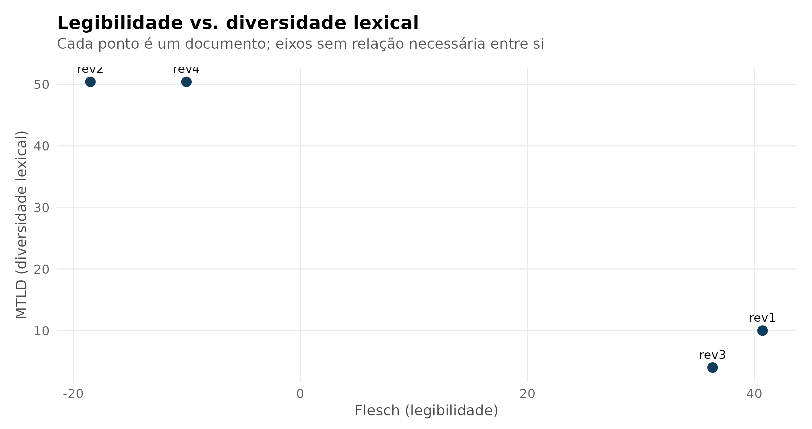
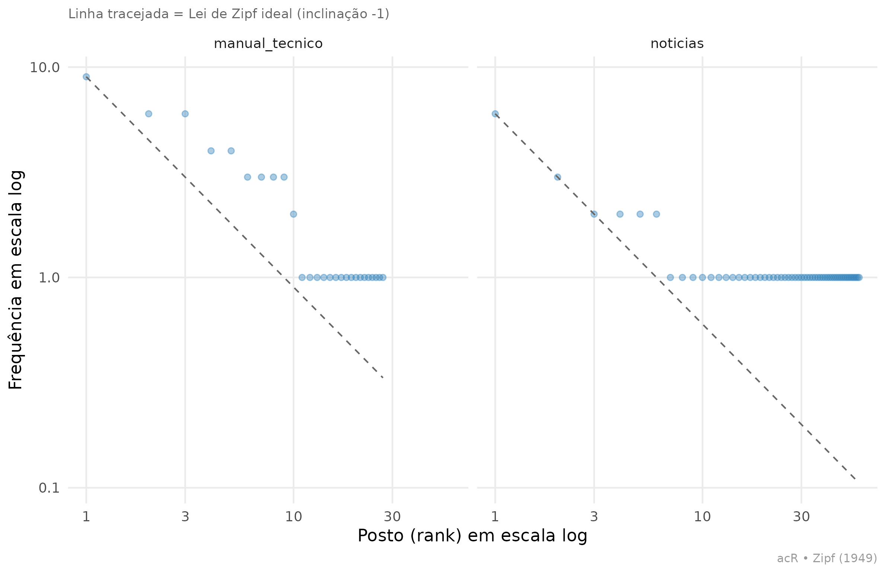
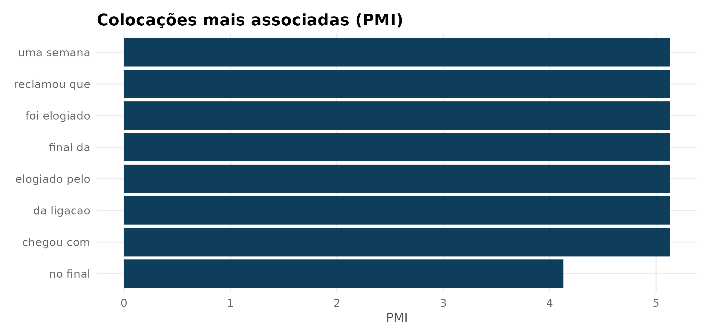
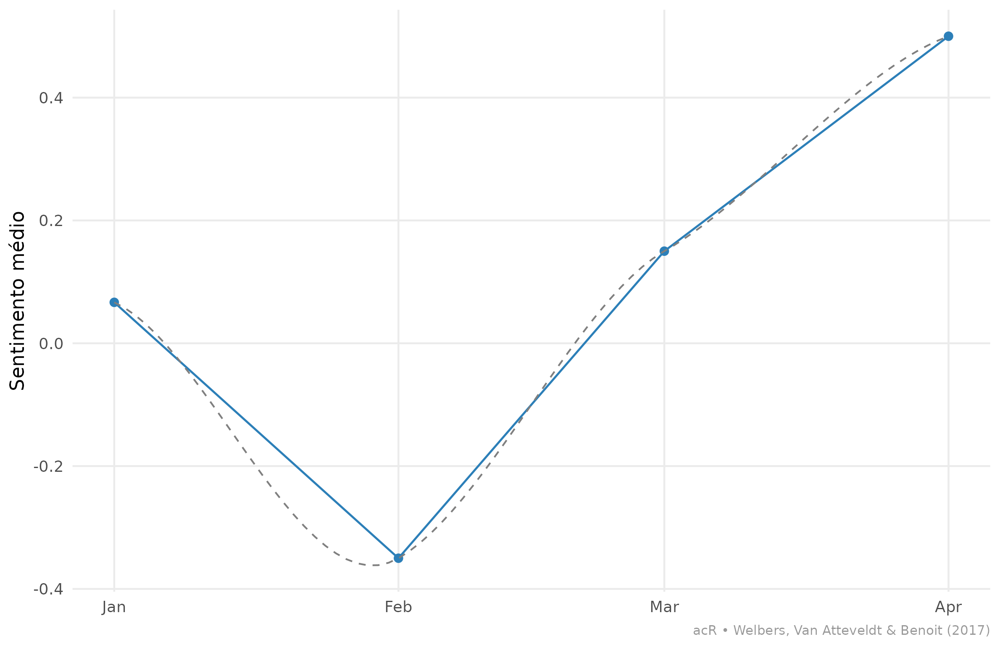
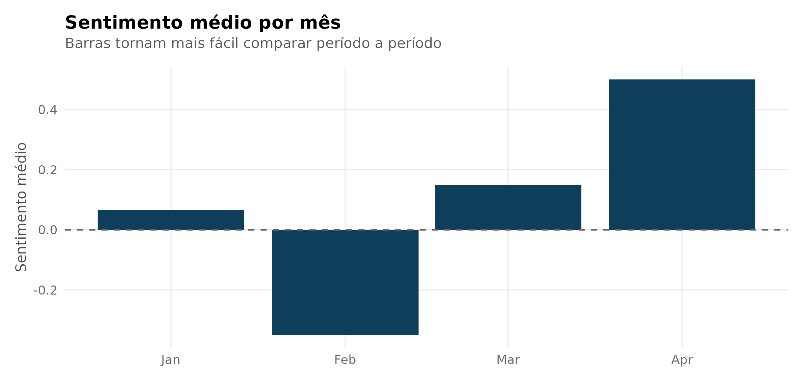
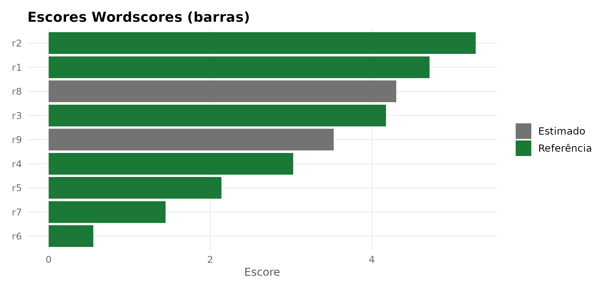
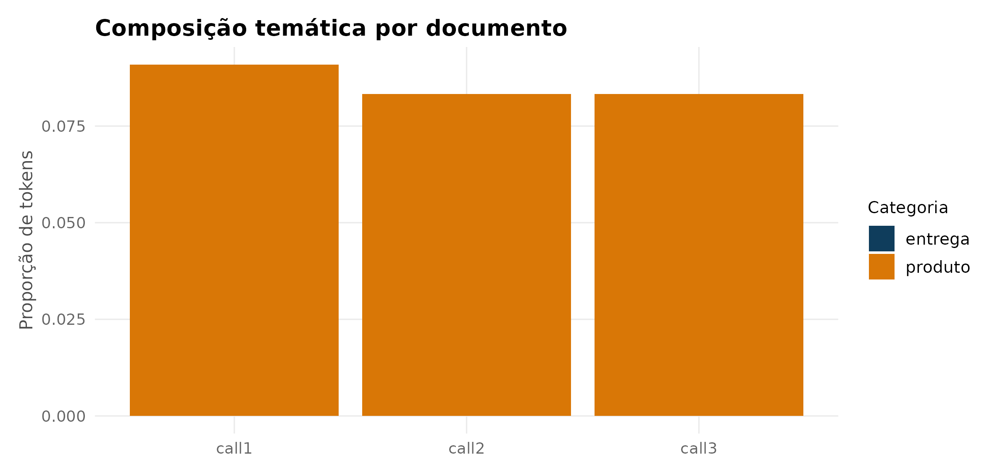
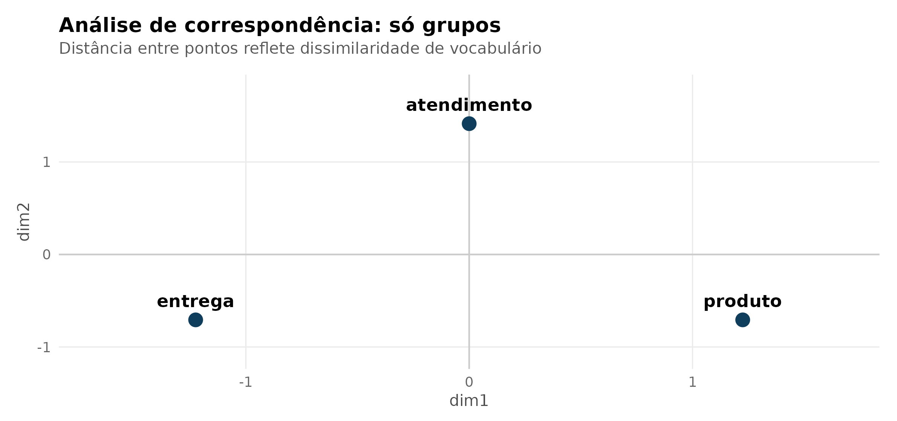

# Análise quantitativa de texto

Esta vignette percorre o **módulo quantitativo** do `acR` em cima de um
corpus de discursos parlamentares fabricado para o exemplo. Cada etapa é
apresentada com uma pergunta metodológica (*por que faço isso?*) antes
do código e do gráfico.

O caminho é o clássico da análise de conteúdo estatística: **corpus →
limpeza → tokenização → frequências → distintividade → visualização**.

## Qual métrica responde qual pergunta?

O módulo quantitativo tem dezoito técnicas, agrupadas em cinco famílias.
Aprender qual usar em cada situação vale mais que decorar sintaxe: a
pergunta de pesquisa escolhe a técnica, não o contrário.

**Frequência, distintividade e coocorrência**

| Pergunta | Técnica | Função |
|----|----|----|
| Que palavras dominam o corpus como um todo? | Frequência bruta | [`ac_count()`](https://ahenriquecp.com/acR/reference/ac_count.md) → [`ac_top_terms()`](https://ahenriquecp.com/acR/reference/ac_top_terms.md) |
| Que palavras são **distintivas** de cada documento vs. o resto? | TF-IDF | [`ac_tf_idf()`](https://ahenriquecp.com/acR/reference/ac_tf_idf.md) → [`ac_plot_tf_idf()`](https://ahenriquecp.com/acR/reference/ac_plot_tf_idf.md) |
| Que palavras separam **um grupo** do outro estatisticamente? | *Keyness* | [`ac_keyness()`](https://ahenriquecp.com/acR/reference/ac_keyness.md) → [`ac_plot_keyness()`](https://ahenriquecp.com/acR/reference/ac_plot_keyness.md) |
| Que palavras **andam juntas** (associação sintagmática)? | Coocorrência | [`ac_cooccurrence()`](https://ahenriquecp.com/acR/reference/ac_cooccurrence.md) → [`ac_plot_cooccurrence()`](https://ahenriquecp.com/acR/reference/ac_plot_cooccurrence.md) |
| Que bigramas/trigramas aparecem juntos mais do que o esperado pelo acaso? | Colocações | [`ac_collocations()`](https://ahenriquecp.com/acR/reference/ac_collocations.md) |
| **Onde no texto** um termo aparece com mais frequência? | X-ray plot | [`ac_plot_xray()`](https://ahenriquecp.com/acR/reference/ac_plot_xray.md) |
| Em que contexto exato um termo aparece a cada ocorrência? | Concordância/KWIC | [`ac_kwic()`](https://ahenriquecp.com/acR/reference/ac_kwic.md) |
| Panorama visual rápido para relatório ou apresentação | Nuvem de palavras | [`ac_wordcloud()`](https://ahenriquecp.com/acR/reference/ac_wordcloud.md) (`ggwordcloud`) |

**Diagnóstico do corpus**

| Pergunta | Técnica | Função |
|----|----|----|
| O texto é fácil ou difícil de ler? | Legibilidade | [`ac_readability()`](https://ahenriquecp.com/acR/reference/ac_readability.md) |
| O vocabulário é rico ou repetitivo? | Diversidade lexical | [`ac_lexical_diversity()`](https://ahenriquecp.com/acR/reference/ac_lexical_diversity.md) |
| O corpus se comporta como linguagem natural (não dominado por ruído)? | Lei de Zipf | [`ac_plot_zipf()`](https://ahenriquecp.com/acR/reference/ac_plot_zipf.md) |

**Série temporal**

| Pergunta | Técnica | Função |
|----|----|----|
| Um termo, sentimento ou qualquer métrica muda ao longo do tempo? | Série temporal | [`ac_temporal()`](https://ahenriquecp.com/acR/reference/ac_temporal.md) → [`ac_plot_temporal()`](https://ahenriquecp.com/acR/reference/ac_plot_temporal.md) |

**Escalas e mapas**

| Pergunta | Técnica | Função |
|----|----|----|
| Onde cada documento se posiciona num espectro contínuo (favorável↔︎desfavorável)? | Wordscores | [`ac_wordscores()`](https://ahenriquecp.com/acR/reference/ac_wordscores.md) |
| Como grupos e termos se relacionam num mapa 2D, sem assumir tópicos latentes? | Análise de correspondência | [`ac_ca()`](https://ahenriquecp.com/acR/reference/ac_ca.md) |

**Dicionários e léxicos**

| Pergunta | Técnica | Função |
|----|----|----|
| Quanto do texto pertence a cada categoria temática que eu defino? | Dicionário multi-categoria | [`ac_dictionary()`](https://ahenriquecp.com/acR/reference/ac_dictionary.md) |
| Que emoções (não só positivo/negativo) o texto expressa? | Léxico de emoção | [`ac_emotion()`](https://ahenriquecp.com/acR/reference/ac_emotion.md) |
| Meu dicionário classifica bem, comparado a uma codificação humana? | Validação de dicionário | [`ac_dictionary_validate()`](https://ahenriquecp.com/acR/reference/ac_dictionary_validate.md) |

**Não é redundância.** As três métricas de frequência respondem
perguntas diferentes:

- **Frequência bruta** conta ocorrências. É a primeira olhada, mas os
  termos no topo tendem a ser genéricos (mesmo depois de tirar
  *stopwords*).
- **TF-IDF** penaliza termos que aparecem em muitos documentos: destaca
  o vocabulário **próprio** de cada texto. Sem grupo definido a priori.
- **Keyness** compara **grupos** com um teste estatístico (χ² ou
  log-likelihood). Precisa de uma variável categórica no corpus.

Para descobrir tipologias emergentes sem categoria a priori, veja
[`vignette("cluster")`](https://ahenriquecp.com/acR/articles/cluster.md)
e [`vignette("lda")`](https://ahenriquecp.com/acR/articles/lda.md) (não
supervisionado). Para rotular com categorias teóricas, veja
[`vignette("qualitativo-llm")`](https://ahenriquecp.com/acR/articles/qualitativo-llm.md)
(assistido).

## Sequência sugerida para reportar resultados

Um erro comum em análise de conteúdo computacional é aplicar uma técnica
isoladamente, sem o diagnóstico que justifica o resultado. A ordem
abaixo segue a lógica de qualquer método reportável: primeiro você
mostra que o corpus é adequado para a análise, depois descreve seu
conteúdo, e só então compara grupos ou constrói escalas.

| Ordem | Etapa | Por que vem nessa posição |
|:--:|----|----|
| 1 | Limpeza e tokenização (§2-3) | Sem isso, qualquer contagem é dominada por artigos e preposições, mascarando o sinal. |
| 2 | Diagnóstico do corpus (§10-11) | Legibilidade e diversidade lexical descrevem *o material em si*: um corpus muito homogêneo ou pouco diverso limita o que qualquer análise posterior pode revelar. Um desvio forte da Lei de Zipf pode sinalizar ruído ou dados malformados (ela vale de forma muito geral para texto natural; Piantadosi, 2014), embora não prove sozinha que os dados estão bons. |
| 3 | Frequência e distintividade (§5, §7) | Primeiro você descreve o vocabulário geral (frequência), depois o que é próprio de cada documento (TF-IDF). Isso ancora a leitura qualitativa dos resultados seguintes. |
| 4 | Comparação entre grupos (§8, §13) | *Keyness* e série temporal respondem à pergunta comparativa central da maioria dos estudos: o que muda entre grupos ou ao longo do tempo. Só faz sentido depois que o vocabulário geral já foi descrito. |
| 5 | Associação e contexto (§9, §12) | Coocorrência, colocações e KWIC aprofundam *por que* um termo é relevante, qualificando os achados das etapas 3-4 com evidência de uso em contexto. |
| 6 | Escalas e classificação (§14-16) | Wordscores, análise de correspondência e dicionários produzem medidas derivadas (posição num espectro, categoria temática). Por dependerem do vocabulário já mapeado nas etapas anteriores, vêm depois, não antes. |
| 7 | Validação | Toda classificação por dicionário (§15) precisa de [`ac_dictionary_validate()`](https://ahenriquecp.com/acR/reference/ac_dictionary_validate.md) contra uma amostra humana antes de ir para o relatório final: é o que transforma uma heurística em achado defensável (Grimmer & Stewart, 2013). |

Essa ordem é um ponto de partida, não uma regra rígida: um estudo focado
só em descrever o corpus pode parar na etapa 2; um estudo que já tem uma
variável de grupo definida a priori pode ir direto da etapa 1 à 4. O que
não muda é a lógica: descreva antes de comparar, e valide antes de
publicar.

``` r

library(acR)
```

## 1. Construir o corpus

O [`ac_corpus()`](https://ahenriquecp.com/acR/reference/ac_corpus.md)
padroniza qualquer `data.frame` em um objeto com colunas fixas `doc_id`
e `text`, mantendo os metadados que você quiser preservar para
comparações posteriores.

``` r

textos <- c(
  "O governo anunciou nova politica fiscal para reduzir o deficit público.",
  "A oposicao critica o aumento dos gastos e da divida pública no orcamento.",
  "Parlamentares debatem a reforma tributária e o imposto de renda das familias.",
  "O presidente vetou o projeto que ampliava beneficios sociais para os pobres.",
  "O Senado aprovou o marco legal para investimentos em infraestrutura logistica.",
  "Deputados votam pela reducao da carga tributária para pequenas empresas.",
  "A politica monetária do Banco Central eleva a taxa de juros para conter inflacao.",
  "A inflacao acima da meta preocupa economistas e o mercado financeiro.",
  "O relator defendeu emendas ao texto do orcamento com foco em saude e educacao.",
  "A comissao aprovou o projeto que amplia beneficios sociais no interior.",
  "O ministro afirmou que a reforma tributária simplifica o sistema para empresas.",
  "Lideres da oposicao pediram vistas ao projeto na comissao de constituicao."
)

meta <- data.frame(
  text = textos,
  tema = c("fiscal","fiscal","tributário","social","infraestrutura",
           "tributário","monetário","monetário","fiscal","social",
           "tributário","fiscal"),
  stringsAsFactors = FALSE
)

corpus <- ac_corpus(meta)
corpus
#> 
#> ── Corpus acR ──────────────────────────────────────────────────────────────────
#> • Documentos: 12
#> • Metadados: 1 coluna
#> • Idioma: "pt"
#> 
#> # A tibble: 12 × 3
#>   doc_id text                                                              tema 
#>   <chr>  <chr>                                                             <chr>
#> 1 doc_1  O governo anunciou nova politica fiscal para reduzir o deficit p… fisc…
#> 2 doc_2  A oposicao critica o aumento dos gastos e da divida pública no o… fisc…
#> 3 doc_3  Parlamentares debatem a reforma tributária e o imposto de renda … trib…
#> 4 doc_4  O presidente vetou o projeto que ampliava beneficios sociais par… soci…
#> 5 doc_5  O Senado aprovou o marco legal para investimentos em infraestrut… infr…
#> 6 doc_6  Deputados votam pela reducao da carga tributária para pequenas e… trib…
#> # ℹ 6 more rows
```

## 2. Limpeza: por que remover *stopwords*?

Sem remoção de *stopwords*, os termos mais frequentes de qualquer corpus
em português são artigos, preposições e conjunções (`o`, `a`, `de`,
`que`, `para`…). Eles carregam pouquíssima informação temática e sufocam
qualquer padrão real de vocabulário. A regra prática em análise de
conteúdo (Sampaio & Lycarião, 2021) é sempre remover *stopwords* antes
de contar frequências ou calcular distintividade.

O [`ac_clean()`](https://ahenriquecp.com/acR/reference/ac_clean.md)
aceita o parâmetro `remove_stopwords = "pt"` para aplicar uma lista de
*stopwords* portuguesas curada. Você pode adicionar seu próprio
glossário via `extra_stopwords`.

``` r

corpus_limpo <- ac_clean(
  corpus,
  remove_stopwords = "pt",
  extra_stopwords  = c("pra", "pro")  # opcional: coloquiais
)
corpus_limpo
#> 
#> ── Corpus acR ──────────────────────────────────────────────────────────────────
#> • Documentos: 12
#> • Metadados: 1 coluna
#> • Idioma: "pt"
#> 
#> # A tibble: 12 × 3
#>   doc_id text                                                              tema 
#>   <chr>  <chr>                                                             <chr>
#> 1 doc_1  governo anunciou nova politica fiscal reduzir deficit público     fisc…
#> 2 doc_2  oposicao critica aumento gastos divida pública orcamento          fisc…
#> 3 doc_3  parlamentares debatem reforma tributária imposto renda familias   trib…
#> 4 doc_4  presidente vetou projeto ampliava beneficios sociais pobres       soci…
#> 5 doc_5  senado aprovou marco legal investimentos infraestrutura logistica infr…
#> 6 doc_6  deputados votam reducao carga tributária pequenas empresas        trib…
#> # ℹ 6 more rows
```

## 3. Tokenização

[`ac_tokenize()`](https://ahenriquecp.com/acR/reference/ac_tokenize.md)
quebra cada documento em unidades de análise. Com `n = 1L` são unigramas
(palavras); com `n = 2L`, bigramas (“reforma tributária”). Bigramas são
úteis quando você quer capturar **expressões compostas** que perdem
sentido tokenizadas separadamente.

``` r

tokens <- ac_tokenize(corpus_limpo, n = 1L)
head(tokens, 12)
#> # A tibble: 12 × 3
#>    doc_id token_id token   
#>    <chr>     <int> <chr>   
#>  1 doc_1         1 governo 
#>  2 doc_1         2 anunciou
#>  3 doc_1         3 nova    
#>  4 doc_1         4 politica
#>  5 doc_1         5 fiscal  
#>  6 doc_1         6 reduzir 
#>  7 doc_1         7 deficit 
#>  8 doc_1         8 público 
#>  9 doc_2         1 oposicao
#> 10 doc_2         2 critica 
#> 11 doc_2         3 aumento 
#> 12 doc_2         4 gastos
```

## 4. Frequência

Contagem de ocorrências por documento e depois agregação.
[`ac_count()`](https://ahenriquecp.com/acR/reference/ac_count.md) já
retorna no formato *tidy* pronto para pipeline com `dplyr` e `ggplot2`.

``` r

contagem <- ac_count(corpus_limpo)
contagem
#> # A tibble: 88 × 3
#>    doc_id token        n
#>    <chr>  <chr>    <int>
#>  1 doc_1  anunciou     1
#>  2 doc_1  deficit      1
#>  3 doc_1  fiscal       1
#>  4 doc_1  governo      1
#>  5 doc_1  nova         1
#>  6 doc_1  politica     1
#>  7 doc_1  público      1
#>  8 doc_1  reduzir      1
#>  9 doc_10 amplia       1
#> 10 doc_10 aprovou      1
#> # ℹ 78 more rows
```

## 5. Top termos: o vocabulário do corpus

O gráfico abaixo mostra as **12 palavras mais frequentes**. Agora, com
*stopwords* removidas, é possível ler os *temas* dominantes: reforma,
projeto, tributária, orçamento, etc.

``` r

top <- ac_top_terms(contagem, n = 12)
ac_plot_top_terms(top) +
  ggplot2::labs(
    title    = "Termos mais frequentes no corpus",
    subtitle = "Discursos legislativos - 12 documentos fabricados",
    caption  = "acR - vignette Análise Quantitativa"
  )
```


> **Como ler este gráfico**
>
> 1.  **Onde olhar.** Cada barra é uma palavra, e o comprimento é
>     quantas vezes ela aparece somando os 12 discursos. Leia de cima
>     para baixo: a primeira barra é a palavra mais usada do corpus.
>
> 2.  **O que este exemplo mostra.** *tributária* e *projeto* estão no
>     topo, com 3 ocorrências cada; as outras 10 palavras do gráfico
>     aparecem 2 vezes. Todo o resto do vocabulário aparece uma vez só e
>     por isso ficou de fora do top 12.
>
> 3.  **Em palavras simples.** O corpus fala muito de reforma tributária
>     e de projetos em tramitação. É o retrato do vocabulário *mais
>     usado*, ainda não do vocabulário *mais característico*.
>
> 4.  **Cuidado.** Frequência não é relevância. *projeto* está no topo
>     porque quase todo discurso legislativo fala de projeto, não porque
>     seja um tema. Para achar o que distingue um texto dos outros, a
>     ideia é dar menos peso a palavras espalhadas por todos os
>     documentos (Spärck Jones, 1972): é o que fazem o TF-IDF (§7) e o
>     *keyness* (§8). E com 12 discursos, a diferença entre 3 e 2
>     ocorrências é uma única palavra.

## 6. Nuvem de palavras

Uma nuvem funciona como **panorama visual** rápido, útil para relatórios
e apresentações. Não substitui análise numérica: o tamanho da palavra é
proporcional à frequência, mas a posição no plot é aleatória.

Desde a versão 0.3.1 o
[`ac_wordcloud()`](https://ahenriquecp.com/acR/reference/ac_wordcloud.md)
prefere automaticamente o motor `ggwordcloud` (retorna um `ggplot`, com
tipografia mais legível e layout consistente com o tema do pacote); se
ele não estiver instalado, cai para o `wordcloud` clássico. Você pode
forçar via `backend = "ggwordcloud"` ou `backend = "wordcloud"`.

``` r

ac_wordcloud(contagem, max_words = 40, title = "Panorama do corpus")
#> Warning in wordcloud_boxes(data_points = points_valid_first, boxes = boxes, :
#> Some words could not fit on page. They have been removed.
```


### 6.1 Nuvem comparativa entre grupos

Quando o corpus tem uma variável de agrupamento (partido, período, tema,
etc.), a nuvem comparativa mostra lado a lado os termos mais
**distintivos** de cada grupo, pontuados por TF-IDF calculado tratando
cada grupo como um “documento”. Aceita 2, 3 ou mais grupos.

``` r

# Nosso corpus tem 5 temas distintos: todos entram na comparativa.
ac_plot_wordcloud_comparative(
  corpus,
  group     = tema,
  max_words = 25,
  title     = "Termos distintivos por tema"
)
#> Warning in wordcloud_boxes(data_points = points_valid_first, boxes = boxes, :
#> Some words could not fit on page. They have been removed.
#> Warning in wordcloud_boxes(data_points = points_valid_first, boxes = boxes, :
#> Some words could not fit on page. They have been removed.
#> Warning in wordcloud_boxes(data_points = points_valid_first, boxes = boxes, :
#> Some words could not fit on page. They have been removed.
#> Warning in wordcloud_boxes(data_points = points_valid_first, boxes = boxes, :
#> Some words could not fit on page. They have been removed.
#> Warning in wordcloud_boxes(data_points = points_valid_first, boxes = boxes, :
#> Some words could not fit on page. They have been removed.
```


O layout usa `ggwordcloud` com facets quando disponível
(`backend = "auto"`), e cai em `geom_text` com jitter reproduzível
quando não. A semente do posicionamento é controlada por `seed = 42L`.
Cores vêm de
[`ac_palette()`](https://ahenriquecp.com/acR/reference/ac_palette.md)
por padrão: uma por grupo.

## 7. TF-IDF: o que é *distintivo* em cada documento?

Frequência bruta favorece palavras que aparecem em quase todos os
documentos (mesmo depois de *stopwords*). O **TF-IDF** (*term frequency
× inverse document frequency*) penaliza termos comuns e destaca
vocabulário próprio de cada grupo, útil quando o corpus é composto por
textos com propostas ou temas distintos.

Com **12 discursos curtos** e cada palavra aparecendo em 1–2 documentos,
o TF-IDF *por documento* resulta em barras quase todas iguais (todo
termo único vale o mesmo). O padrão fica mais legível **agregando por
tema**: tratamos cada tema como um “documento” e o TF-IDF revela o
vocabulário característico de cada eixo temático do corpus.

``` r

freq_tema  <- ac_count(corpus_limpo, by = "tema")
tfidf_tema <- ac_tf_idf(freq_tema, by = "tema")

ac_plot_tf_idf(tfidf_tema, by = "tema", n = 6) +
  ggplot2::labs(
    title    = "Termos mais distintivos por tema (TF-IDF)",
    subtitle = "Cada eixo temático como um documento; alta pontuação = termo característico do tema"
  )
```


## 8. *Keyness*: o que é distintivo entre **grupos**?

Enquanto TF-IDF compara documento vs. corpus, ***keyness*** compara
**grupos**: o critério que define o grupo é seu, não do pacote. Pode ser
partido, período histórico, tema, região, autor, condição experimental,
faixa etária, qualquer variável categórica no seu corpus. É a métrica
clássica para a pergunta comparativa: *“o que um grupo diz que o outro
não diz?”*.

Aqui comparamos os temas **fiscal** e **tributário**: quais palavras
marcam cada lado?

``` r

freq_tema     <- ac_count(corpus_limpo, by = "tema")
freq_2grupos  <- freq_tema[freq_tema$tema %in% c("fiscal", "tributário"), ]

kn <- ac_keyness(freq_2grupos, group = "tema", target = "fiscal")

ac_plot_keyness(kn, n = 10) +
  ggplot2::labs(
    title    = "Palavras distintivas: 'fiscal' vs. 'tributário'",
    subtitle = "Barras positivas = distintivas do tema 'fiscal'"
  )
```


> **Como ler este gráfico**
>
> 1.  **Onde olhar.** Cada barra é uma palavra. Barra para a **direita**
>     (vermelha) = palavra mais usada nos textos `fiscal`; para a
>     **esquerda** (verde-azulada) = mais usada nos textos `tributário`.
>     Quanto mais comprida a barra, maior a diferença entre os dois
>     grupos.
>
> 2.  **O que este exemplo mostra.** A barra mais comprida é
>     *tributária*, para a esquerda: aparece 3 vezes nos textos
>     tributários e nenhuma nos fiscais. Logo abaixo vêm *reforma* e
>     *empresas* (2 contra 0). À direita, as maiores são *orcamento* e
>     *oposicao* (2 vezes no fiscal, 0 no tributário). As várias barras
>     curtas e iguais são palavras que aparecem uma única vez, só num
>     dos lados.
>
> 3.  **Em palavras simples.** Quem fala de imposto diz “reforma
>     tributária” e fala de empresas; quem fala de contas públicas fala
>     de orçamento e de oposição.
>
> 4.  **Cuidado.** Barra comprida não é prova. Os dois grupos somam só
>     51 palavras, e só *tributária* passa do limite usual de
>     significância (qui-quadrado de 4,55 contra 3,84), por pouco. Com
>     contagens tão baixas o qui-quadrado é pouco confiável (Dunning,
>     1993, propõe o log-likelihood, `measure = "ll"`); e, testando
>     dezenas de palavras de uma vez, alguma passa do limite por acaso:
>     com correção para comparações múltiplas (Benjamini & Hochberg,
>     1995), nem *tributária* passaria. Aqui, leia a **ordem** das
>     barras como pista, não como conclusão.

## 9. Rede de co-ocorrência

Palavras que aparecem próximas com frequência formam **agrupamentos
semânticos**. A rede de coocorrência mostra essas vizinhanças com base
numa **janela** de tokens (aqui, 5 palavras à esquerda e à direita).

Útil para: identificar frames, mapear associações conceituais e
encontrar combinações de palavras que definem sub-temas dentro do
corpus.

``` r

cooc <- ac_cooccurrence(corpus_limpo, window = 5L, min_count = 2L)

if (requireNamespace("ggraph", quietly = TRUE)) {
  ac_plot_cooccurrence(cooc, top_n = 25) +
    ggplot2::labs(
      title    = "Rede de coocorrência (janela = 5, freq mínima = 2)",
      subtitle = "Arestas conectam termos que co-ocorrem no mesmo contexto"
    )
}
```


> **Como ler este gráfico**
>
> 1.  **Onde olhar.** Cada bolinha (nó) é uma palavra; cada linha
>     (aresta) liga duas palavras que apareceram a até 5 palavras de
>     distância uma da outra pelo menos 2 vezes (`min_count = 2L`).
>     Bolinha maior = palavra ligada a mais palavras diferentes; linha
>     mais grossa = par que se encontrou mais vezes.
>
> 2.  **O que este exemplo mostra.** Com o filtro de 2 encontros, sobram
>     só 6 ligações, que formam duas “ilhas” separadas: {*projeto*,
>     *beneficios*, *sociais*, *comissao*} e {*tributária*, *reforma*,
>     *empresas*}. *projeto* é o nó mais conectado (3 ligações).
>
> 3.  **Em palavras simples.** As ilhas são subtemas: um bloco fala de
>     projetos de benefícios sociais em comissão; o outro, de reforma
>     tributária e empresas.
>
> 4.  **Cuidado.** Aparecer perto não é ter o mesmo sentido: é só
>     proximidade no texto. A posição das bolinhas no desenho é
>     calculada para evitar sobreposição (algoritmo de Fruchterman &
>     Reingold,
>
>     1991. e muda a cada rodada: só as **ligações** têm significado, a
>           distância no papel não. E com `min_count = 2`, um par entra
>           com apenas 2 encontros; em corpus real, use 5 ou mais.

### 9.1 Trocando o peso: PMI em vez de contagem

A rede padrão pondera arestas pela **contagem** de coocorrências: termos
frequentes tendem a dominar. O **PMI** (*pointwise mutual information*)
mede o quanto duas palavras aparecem juntas *acima do esperado por
acaso*; revela pares surpreendentes, mesmo que raros.

``` r

if (requireNamespace("ggraph", quietly = TRUE)) {
  ac_plot_cooccurrence(cooc, top_n = 25, weight = "pmi") +
    ggplot2::labs(
      title    = "Rede de coocorrência ponderada por PMI",
      subtitle = "Destaca pares associados além do esperado por acaso"
    )
}
```


### 9.2 Trocando o layout

O layout controla como os nós são posicionados no plano. O padrão `"fr"`
(Fruchterman-Reingold) minimiza cruzamentos; `"kk"` (Kamada-Kawai)
respeita distâncias de grafo; `"circle"` alinha tudo num anel: útil para
corpora pequenos onde a topologia importa menos que a legibilidade.

``` r

if (requireNamespace("ggraph", quietly = TRUE)) {
  ac_plot_cooccurrence(cooc, top_n = 25, layout = "circle") +
    ggplot2::labs(
      title    = "Rede de coocorrência: layout circular",
      subtitle = "Todas as palavras num anel; arestas mostram o grafo cru"
    )
}
```


### 9.3 Coocorrência como matriz (heatmap)

Quando a rede fica saturada de arestas, um **heatmap** das top-N
palavras pode ser mais legível: linhas e colunas são termos, e a
intensidade da célula é a coocorrência. Não requer `ggraph`.

``` r

top_tokens <- ac_top_terms(ac_count(corpus_limpo), n = 12)$token
cooc_mat   <- cooc[cooc$word1 %in% top_tokens & cooc$word2 %in% top_tokens, ]

ggplot2::ggplot(cooc_mat,
                ggplot2::aes(word1, word2, fill = cooc)) +
  ggplot2::geom_tile(color = "white") +
  ggplot2::scale_fill_gradient(low = "#F1F5F9", high = ac_palette(1)) +
  ggplot2::labs(
    title    = "Matriz de coocorrência (top 12 termos)",
    subtitle = "Alternativa ao grafo quando a rede fica densa",
    x = NULL, y = NULL, fill = "cooc."
  ) +
  theme_ac() +
  ggplot2::theme(
    axis.text.x = ggplot2::element_text(angle = 45, hjust = 1)
  )
```


## Novidades: diagnóstico de corpus, escalas e dicionários

As seções anteriores giram em torno de discursos parlamentares: um
domínio comum na ciência política, mas o módulo quantitativo não é
específico a ele. As técnicas a seguir são novas no pacote e são
apresentadas com exemplos de **outros domínios** (avaliações de produto,
atendimento ao cliente, notícias) para deixar claro que servem a
qualquer corpus de texto.

### 10. Legibilidade e diversidade lexical

Duas perguntas distintas sobre a *forma* do texto, independente do
conteúdo:

- **Legibilidade**
  ([`ac_readability()`](https://ahenriquecp.com/acR/reference/ac_readability.md)):
  o texto é fácil de ler? Adapta o índice de Flesch para português
  (Martins et al., 1996), combinando palavras por frase e sílabas por
  palavra. Útil para comparar, por exemplo, a complexidade de um manual
  técnico com a de um texto de divulgação para o público geral.
- **Diversidade lexical**
  ([`ac_lexical_diversity()`](https://ahenriquecp.com/acR/reference/ac_lexical_diversity.md)):
  o vocabulário é rico ou repetitivo? A TTR cai mecanicamente quando o
  texto cresce, porque palavras começam a se repetir. O C de Herdan
  (Herdan, 1960) atenua esse efeito, mas não o elimina (Tweedie &
  Baayen, 1998); o MTLD foi a medida menos sensível ao tamanho do texto
  entre as avaliadas por McCarthy & Jarvis (2010), que a recomendam para
  comparar textos de tamanhos diferentes.

``` r

avaliacoes <- data.frame(
  id = paste0("rev", 1:4),
  texto = c(
    "Este produto é incrível. Funciona perfeitamente bem e chegou rápido.",
    "O manual técnico especifica que a calibração requer ajuste periódico do sensor piezoelétrico conforme a norma vigente, o que demanda qualificação especializada do operador responsável pela manutenção preventiva do equipamento.",
    "Bom. Chegou. Funciona. Recomendo.",
    "A experiência de uso revelou inconsistências na usabilidade da interface, comprometendo a jornada do consumidor e gerando fricção considerável ao longo do processo de integração do dispositivo ao ecossistema existente."
  ),
  stringsAsFactors = FALSE
)
corpus_aval <- ac_corpus(avaliacoes, text = texto, docid = id)
```

``` r

ac_readability(corpus_aval)
#> # A tibble: 4 × 6
#>   doc_id n_palavras n_frases n_silabas flesch nivel        
#>   <chr>       <int>    <int>     <dbl>  <dbl> <chr>        
#> 1 rev1           10        2        24   40.7 dificil      
#> 2 rev2           30        1        84  -18.5 muito dificil
#> 3 rev3            4        4        10   36.3 dificil      
#> 4 rev4           30        1        81  -10.0 muito dificil
```

> **Como ler esta tabela**
>
> 1.  **Onde olhar.** Olhe a coluna `flesch` (quanto **maior**, mais
>     fácil de ler) e a coluna `nivel`, que traduz o número em palavras.
>     As colunas `n_palavras`, `n_frases` e `n_silabas` mostram de onde
>     o número veio.
>
> 2.  **O que este exemplo mostra.** As duas avaliações curtas ficam em
>     *difícil*: `rev1` com 40,7 e `rev3` com 36,3. O manual técnico
>     (`rev2`, −18,5) e o texto corporativo (`rev4`, −10,0) caem em
>     *muito difícil*, com valores negativos: os dois têm uma frase só
>     de 30 palavras e quase 3 sílabas por palavra.
>
> 3.  **Em palavras simples.** O índice pune duas coisas: frases longas
>     e palavras longas. `rev2` e `rev4` têm as duas; por isso ficam
>     muito abaixo das avaliações curtas.
>
> 4.  **Cuidado.** O índice não tem teto nem piso (dá negativo), e as
>     faixas de `nivel` foram calibradas em livros didáticos (Martins et
>     al., 1996), não em avaliações de produto. Até “Bom. Chegou.
>     Funciona. Recomendo.” sai *difícil* (36,3): com só 4 palavras, a
>     média de 2,5 sílabas por palavra pesa demais na fórmula. Use o
>     índice para **comparar** textos do mesmo tipo, não para dar uma
>     nota isolada.

``` r

ac_lexical_diversity(corpus_aval)
#> # A tibble: 4 × 6
#>   doc_id n_tokens n_types   ttr herdan_c  mtld
#>   <chr>     <int>   <int> <dbl>    <dbl> <dbl>
#> 1 rev1         10      10 1        1      10  
#> 2 rev2         30      25 0.833    0.946  50.4
#> 3 rev3          4       4 1        1       4  
#> 4 rev4         30      25 0.833    0.946  50.4
```

> **Como ler esta tabela**
>
> 1.  **Onde olhar.** Olhe a coluna `mtld` junto com `n_tokens` (quantas
>     palavras o texto tem). `ttr` é a fração de palavras diferentes (1
>     = nenhuma repetida).
>
> 2.  **O que este exemplo mostra.** `rev2` e `rev4` têm 30 palavras, 25
>     diferentes, e MTLD de 50,4. Já `rev1` e `rev3` têm MTLD igual ao
>     próprio número de palavras (10 e 4): nenhuma palavra se repete
>     neles.
>
> 3.  **Em palavras simples.** O MTLD responde “quantas palavras, em
>     média, o autor escreve antes de começar a se repetir” (McCarthy &
>     Jarvis, 2010). Quando o texto acaba antes de qualquer repetição, a
>     resposta possível é só “o texto inteiro”, e por isso o valor
>     coincide com o tamanho.
>
> 4.  **Cuidado.** Com textos tão curtos o MTLD não mede riqueza de
>     vocabulário. Ele foi validado em textos de cerca de 100 a 2.000
>     palavras (McCarthy & Jarvis, 2010) e fica instável abaixo de ~100
>     (Koizumi, 2012). Os 4 exemplos (4 a 30 palavras) servem para
>     mostrar o cálculo, não para comparar os autores; e não existem
>     faixas universais de “MTLD alto” ou “baixo”.

``` r

ac_plot_lexical_diversity(ac_lexical_diversity(corpus_aval), group_col = "doc_id",
                           metric = "mtld", type = "bar")
```


Uma visão alternativa, útil quando há muitos documentos: um *scatter
plot* de legibilidade por diversidade lexical, cruzando as duas métricas
da seção num só gráfico, para ver se textos difíceis de ler também
tendem a ser lexicalmente mais ricos (ou se as duas dimensões são
independentes).

``` r

leg  <- ac_readability(corpus_aval)
div  <- ac_lexical_diversity(corpus_aval)
cruz <- merge(leg, div, by = "doc_id")

ggplot2::ggplot(cruz, ggplot2::aes(x = flesch, y = mtld, label = doc_id)) +
  ggplot2::geom_point(color = ac_palette(1), size = 3) +
  ggplot2::geom_text(vjust = -1, size = 3.2) +
  ggplot2::labs(
    title = "Legibilidade vs. diversidade lexical",
    subtitle = "Cada ponto é um documento; eixos sem relação necessária entre si",
    x = "Flesch (legibilidade)", y = "MTLD (diversidade lexical)"
  ) +
  theme_ac()
```



### 11. Lei de Zipf: o corpus se comporta como linguagem natural?

A Lei de Zipf (Zipf, 1949) prevê que a frequência de uma palavra é
inversamente proporcional ao seu ranking: a palavra mais comum aparece
aproximadamente duas vezes mais que a segunda mais comum, três vezes
mais que a terceira, e assim por diante. É um diagnóstico clássico para
saber se um corpus é “normal” (não dominado por um único termo repetido
artificialmente, como aconteceria em dados malformados ou com erro de
coleta).

``` r

freq_aval <- ac_count(corpus_aval, drop_punct = TRUE)
ac_plot_zipf(freq_aval)
```


> **Como ler este gráfico**
>
> 1.  **Onde olhar.** Cada ponto é uma palavra: no eixo horizontal, a
>     posição dela no ranking (1 = a mais frequente); no vertical,
>     quantas vezes aparece. Os dois eixos estão em escala logarítmica.
>     A linha tracejada é a Lei de Zipf ideal, **desenhada a partir do
>     primeiro ponto**: por isso o ponto 1 sempre cai em cima dela.
>     Compare os pontos seguintes com a linha.
>
> 2.  **O que este exemplo mostra.** A palavra mais frequente é *do* (6
>     vezes), seguida de *a* (3), que cai bem na linha. Depois os pontos
>     param de descer e formam um patamar plano em 1: das 62 palavras
>     diferentes, a maioria aparece uma única vez.
>
> 3.  **Em palavras simples.** No começo, o corpus se comporta como a
>     lei prevê (a 2ª palavra aparece metade das vezes da 1ª). O patamar
>     no fim é o “chão”: nenhuma palavra pode aparecer menos de 1 vez.
>
> 4.  **Cuidado.** O patamar em 1 é inevitável em corpus pequeno e não
>     indica problema nos dados. A Lei de Zipf é uma tendência que
>     aparece em corpora grandes (Piantadosi, 2014); com 4 textos
>     curtos, só a parte inicial da curva é comparável. Note também que
>     as palavras mais frequentes são *do* e *a*: este exemplo não
>     passou por
>     [`ac_clean()`](https://ahenriquecp.com/acR/reference/ac_clean.md),
>     então as *stopwords* estão lá.

Quando o corpus tem grupos, `ac_plot_zipf(freq_tbl, by = "grupo")`
faceta um painel por grupo, útil para comparar se todos os subcorpora
têm comportamento igualmente “natural” ou se algum se destoa (por
exemplo, por ter sido coletado de uma fonte com vocabulário mais técnico
ou repetitivo). Um exemplo com duas fontes bem diferentes: textos
jornalísticos variados vs. um manual técnico que repete o mesmo
vocabulário especializado.

``` r

grupos_zipf <- data.frame(
  id = paste0("doc", 1:12),
  texto = c(
    "O presidente anunciou um pacote de medidas economicas para estimular o crescimento.",
    "A prefeitura inaugurou um novo parque publico no bairro central da cidade.",
    "Cientistas descobriram uma nova especie de inseto na floresta amazonica.",
    "O time local venceu a partida decisiva do campeonato estadual de futebol.",
    "A exposicao de arte contemporanea atraiu milhares de visitantes no fim de semana.",
    "Pesquisadores desenvolveram uma vacina experimental contra uma doenca rara.",
    "O sistema deve ser configurado conforme o manual tecnico do equipamento.",
    "Configure o equipamento tecnico seguindo o manual de configuracao tecnica.",
    "O manual tecnico especifica a configuracao tecnica do sistema tecnico.",
    "Consulte o manual tecnico para configurar corretamente o sistema tecnico.",
    "A configuracao tecnica do equipamento segue o manual tecnico padrao.",
    "O equipamento tecnico requer configuracao conforme manual tecnico oficial."
  ),
  fonte = rep(c("noticias", "manual_tecnico"), each = 6),
  stringsAsFactors = FALSE
)
corpus_zipf_grupo <- ac_corpus(grupos_zipf, text = texto, docid = id, meta = fonte)
freq_zipf_grupo   <- ac_count(corpus_zipf_grupo, by = "fonte", drop_punct = TRUE)
ac_plot_zipf(freq_zipf_grupo, by = "fonte")
```



> **Como ler este gráfico**
>
> 1.  **Onde olhar.** Um painel por grupo. Ignore o primeiro ponto de
>     cada painel (a linha é desenhada a partir dele, então ele sempre
>     fica em cima). Olhe os pontos **2 a 10**: se ficam acima da linha,
>     as palavras seguintes se repetem mais do que a Lei de Zipf prevê.
>
> 2.  **O que este exemplo mostra.** Em `manual_tecnico`, os pontos 2 a
>     9 ficam bem acima da linha: depois de *tecnico* (9 vezes) vêm
>     *manual* e *o* (6 cada) e várias palavras com 3 ou 4 ocorrências.
>     Em `noticias`, os pontos 2 e 3 caem em cima da linha, e a partir
>     do 7º tudo está no patamar de 1: quase todas as palavras aparecem
>     uma vez só.
>
> 3.  **Em palavras simples.** O manual repete o mesmo punhado de termos
>     o tempo todo (vocabulário concentrado); as notícias variam muito
>     de palavra (vocabulário espalhado). É o que se espera de um texto
>     técnico e formulaico comparado a notícias de assuntos diversos.
>
> 4.  **Cuidado.** Com 6 textos curtos por grupo, compare os grupos
>     **entre si**, não cada um com a linha (Piantadosi, 2014). E repare
>     em *A* maiúsculo entre as mais frequentes de `noticias`: sem
>     [`ac_clean()`](https://ahenriquecp.com/acR/reference/ac_clean.md),
>     “A” e “a” contam como palavras diferentes.

### 12. Concordância (KWIC) e colocações

Frequência bruta não mostra *como* uma palavra é usada. Duas ferramentas
complementares respondem a essa lacuna: **KWIC** mostra o contexto de
cada ocorrência individual; **colocações** medem, de forma agregada,
quais pares de palavras andam juntos mais do que o acaso explicaria. São
técnicas distintas que respondem perguntas diferentes, então cada uma
tem sua própria subseção abaixo.

Corpus de exemplo para as duas: três registros fictícios de atendimento
ao cliente.

``` r

atendimento <- data.frame(
  id = paste0("call", 1:3),
  texto = c(
    "o cliente reclamou que o produto chegou com defeito de fabrica",
    "outro cliente relatou defeito no produto depois de uma semana de uso",
    "o produto sem defeito foi elogiado pelo cliente no final da ligacao"
  ),
  stringsAsFactors = FALSE
)
corpus_atend <- ac_corpus(atendimento, text = texto, docid = id)
```

#### 12.1 KWIC: ver cada ocorrência em contexto

**KWIC** (*keyword-in-context*, Sinclair, 1991) lista cada ocorrência de
um termo com o texto imediatamente antes e depois dele. É o primeiro
passo de qualquer análise de discurso baseada em corpus (*corpus-based
discourse analysis*): antes de interpretar por que um termo é frequente,
leia como ele é usado em cada caso individual.

``` r

ac_kwic(corpus_atend, pattern = "defeito", window = 4)
#> # A tibble: 3 × 5
#>   doc_id position before                keyword after                    
#>   <chr>     <int> <chr>                 <chr>   <chr>                    
#> 1 call1         9 o produto chegou com  defeito de fabrica               
#> 2 call2         4 outro cliente relatou defeito no produto depois de     
#> 3 call3         4 o produto sem         defeito foi elogiado pelo cliente
```

> **Como ler esta tabela**
>
> 1.  **Onde olhar.** Leia cada linha da esquerda para a direita, como
>     uma frase: `before` (o que vem antes) + `keyword` (o termo
>     buscado)
>
>     - `after` (o que vem depois). `doc_id` e `position` dizem onde
>       achar o trecho no texto original.
>
> 2.  **O que este exemplo mostra.** As três linhas têm *defeito*, mas
>     em sentidos diferentes: “chegou com **defeito** de fabrica” e
>     “relatou **defeito** no produto” são reclamações; “o produto sem
>     **defeito** foi elogiado” é o contrário, um elogio.
>
> 3.  **Em palavras simples.** Uma contagem diria “*defeito* aparece 3
>     vezes = 3 reclamações”. O contexto mostra que são 2.
>
> 4.  **Cuidado.** O KWIC é para ler, não para contar. É o primeiro
>     passo da análise de discurso baseada em corpus (Sinclair, 1991):
>     antes de interpretar por que uma palavra é frequente, leia algumas
>     ocorrências. Em corpus grande, leia uma amostra das linhas, não
>     todas.

#### 12.2 Colocações: associação estatística entre palavras

Enquanto o KWIC mostra ocorrências individuais, **colocações**
([`ac_collocations()`](https://ahenriquecp.com/acR/reference/ac_collocations.md))
respondem a uma pergunta agregada: quais bigramas/trigramas aparecem
juntos mais do que o esperado pelo acaso, medido por PMI (Church &
Hanks, 1990), log-likelihood (Dunning, 1993) ou qui-quadrado. Vai além
da frequência bruta de n-gramas: um bigrama pode ser raro e ainda assim
estatisticamente muito associado.

``` r

ac_collocations(corpus_atend, n = 2, measure = "pmi", min_count = 1)
#> # A tibble: 31 × 3
#>    collocation      count association
#>    <chr>            <int>       <dbl>
#>  1 chegou com           1        5.13
#>  2 da ligacao           1        5.13
#>  3 elogiado pelo        1        5.13
#>  4 final da             1        5.13
#>  5 foi elogiado         1        5.13
#>  6 reclamou que         1        5.13
#>  7 uma semana           1        5.13
#>  8 no final             1        4.13
#>  9 cliente reclamou     1        3.54
#> 10 cliente relatou      1        3.54
#> # ℹ 21 more rows
```

> **Como ler esta tabela**
>
> 1.  **Onde olhar.** Cada linha é um par de palavras vizinhas. Olhe
>     `association` (o PMI: quanto **maior**, mais as duas aparecem
>     juntas acima do que o acaso explicaria) e, sempre ao lado, `count`
>     (quantas vezes o par apareceu).
>
> 2.  **O que este exemplo mostra.** As sete primeiras linhas empatam em
>     5,13, todas com `count = 1`. Das 31 duplas, só uma aparece duas
>     vezes: “o produto”, e ela tem PMI **menor** (2,96), porque “o” e
>     “produto” são palavras frequentes, então encontrá-las juntas
>     surpreende menos.
>
> 3.  **Em palavras simples.** PMI de 5,13 quer dizer que o par apareceu
>     cerca de 35 vezes mais do que o acaso preveria (2 elevado a 5,13 ≈
>     35). Aqui, 5,13 é o valor máximo possível: é o que qualquer dupla
>     de palavras que aparecem uma vez cada recebe.
>
> 4.  **Cuidado.** O PMI favorece pares raros (Church & Hanks, 1990;
>     Evert, 2005), e o empate no topo mostra isso: são pares que
>     ocorreram uma única vez. Num corpus real, use `min_count` de 5 ou
>     mais, ou `measure = "ll"` (Dunning, 1993), que pesa melhor a
>     frequência.

Para visualizar as colocações mais fortes em vez de ler a tabela, um
gráfico de barras ordenado funciona bem com poucos pares:

``` r

colocacoes <- ac_collocations(corpus_atend, n = 2, measure = "pmi", min_count = 1)
colocacoes_top <- utils::head(colocacoes, 8)

ggplot2::ggplot(colocacoes_top,
                ggplot2::aes(x = association, y = reorder(collocation, association))) +
  ggplot2::geom_col(fill = ac_palette(1)) +
  ggplot2::labs(
    title = "Colocações mais associadas (PMI)",
    x = "PMI", y = NULL
  ) +
  theme_ac()
```



### 13. Análise temporal/diacrônica

Quando o corpus tem datas, perguntas que antes eram estáticas (quanto um
termo aparece?) passam a ter uma dimensão temporal (quando ele aparece
mais?). É essencial para cobertura jornalística, séries de atendimento
ao cliente, ou qualquer corpus com carimbo de data (Welbers, Van
Atteveldt & Benoit, 2017).

[`ac_temporal()`](https://ahenriquecp.com/acR/reference/ac_temporal.md)
é deliberadamente genérica: a coluna numérica agregada (`value_col`)
pode ser a saída de qualquer outra função do pacote (score de
[`ac_sentiment()`](https://ahenriquecp.com/acR/reference/ac_sentiment.md),
índice de
[`ac_readability()`](https://ahenriquecp.com/acR/reference/ac_readability.md),
contagem de um termo de
[`ac_count()`](https://ahenriquecp.com/acR/reference/ac_count.md)…),
desde que exista uma coluna de data no mesmo `data.frame`. Dois
parâmetros controlam a agregação:

- `unit`: o tamanho da janela de tempo: `"day"`, `"week"`, `"month"`
  (padrão) ou `"year"`.
- `stat`: como agregar os valores dentro de cada janela: `"mean"`
  (padrão), `"sum"` ou `"n"` (conta documentos, ignorando `value_col`).

No exemplo abaixo, `sentimento` já é o score de
[`ac_sentiment()`](https://ahenriquecp.com/acR/reference/ac_sentiment.md)
pré-calculado para 8 notícias fictícias, cada uma com sua data de
publicação:

``` r

noticias <- data.frame(
  data       = as.Date("2024-01-01") + c(0, 10, 20, 35, 50, 65, 80, 95),
  sentimento = c(0.2, 0.1, -0.1, -0.4, -0.3, 0.0, 0.3, 0.5)
)
serie <- ac_temporal(noticias, date_col = "data", value_col = "sentimento",
                      unit = "month", stat = "mean")
serie
#> # A tibble: 4 × 3
#>   period       value n_docs
#>   <date>       <dbl>  <int>
#> 1 2024-01-01  0.0667      3
#> 2 2024-02-01 -0.35        2
#> 3 2024-03-01  0.15        2
#> 4 2024-04-01  0.5         1
```

> **Como ler esta tabela**
>
> 1.  **Onde olhar.** Cada linha é um período (aqui, um mês; `period` é
>     o primeiro dia dele). Olhe **primeiro `n_docs`** (quantas notícias
>     caíram no mês) e só depois `value` (a média do sentimento naquele
>     mês).
>
> 2.  **O que este exemplo mostra.** Janeiro tem 3 notícias e média ≈
>     0,07; fevereiro cai para −0,35 (2 notícias); março volta a
>     0,15 (2) e abril chega a 0,50, mas com **1 notícia só**.
>
> 3.  **Em palavras simples.** O sentimento fica neutro em janeiro,
>     piora em fevereiro e se recupera em março e abril.
>
> 4.  **Cuidado.** Um mês com 1 documento não tem “média”: é aquele
>     documento. O 0,50 de abril pode ser só uma notícia muito positiva.
>     Antes de falar em tendência, confira se todos os períodos têm
>     documentos suficientes; se não tiverem, use uma unidade de tempo
>     maior (`unit = "year"`, por exemplo).

``` r

ac_plot_temporal(serie, ylab = "Sentimento médio")
#> Warning in simpleLoess(y, x, w, span, degree = degree, parametric = parametric,
#> : span too small.  fewer data values than degrees of freedom.
#> Warning in simpleLoess(y, x, w, span, degree = degree, parametric = parametric,
#> : pseudoinverse used at 19723
#> Warning in simpleLoess(y, x, w, span, degree = degree, parametric = parametric,
#> : neighborhood radius 60.455
#> Warning in simpleLoess(y, x, w, span, degree = degree, parametric = parametric,
#> : reciprocal condition number 0
#> Warning in simpleLoess(y, x, w, span, degree = degree, parametric = parametric,
#> : There are other near singularities as well. 3654.8
```



> **Como ler este gráfico**
>
> 1.  **Onde olhar.** Os pontos azuis são os valores mensais da tabela
>     acima, ligados por uma linha azul. A linha tracejada cinza é a
>     tendência suavizada (LOESS; Cleveland, 1979), que ignora as
>     oscilações de curto prazo.
>
> 2.  **O que este exemplo mostra.** Os pontos descem de janeiro para
>     fevereiro e sobem em março e abril. Os avisos logo acima do
>     gráfico (“span too small”, “pseudoinverse used”) são o próprio
>     [`loess()`](https://rdrr.io/r/stats/loess.html) dizendo que tem
>     pontos de menos para estimar a curva.
>
> 3.  **Em palavras simples.** Queda no começo do período e recuperação
>     depois.
>
> 4.  **Cuidado.** Com 4 pontos, a linha tracejada é pouco confiável:
>     ela precisa de vários pontos em cada trecho da série para suavizar
>     (Cleveland, 1979). Aqui, confie nos pontos, não na curva. Com
>     séries longas (dezenas de períodos, cada um com vários
>     documentos), a curva passa a ser útil.

Uma visão alternativa, mais direta para comparar poucos períodos entre
si, é o gráfico de barras:

``` r

ggplot2::ggplot(serie, ggplot2::aes(x = period, y = value)) +
  ggplot2::geom_col(fill = ac_palette(1)) +
  ggplot2::geom_hline(yintercept = 0, color = "grey40", linetype = "dashed") +
  ggplot2::labs(
    title = "Sentimento médio por mês",
    subtitle = "Barras tornam mais fácil comparar período a período",
    x = NULL, y = "Sentimento médio"
  ) +
  theme_ac()
```



### 14. Escalonamento Wordscores: posicionar documentos numa escala

Às vezes queremos posicionar documentos num espectro contínuo
(favorável↔︎ desfavorável, satisfeito↔︎insatisfeito) sem codificar
manualmente todos eles. O método Wordscores (Laver, Benoit & Garry,
2003) faz isso em duas etapas, de forma parecida com uma régua calibrada
por exemplos conhecidos:

1.  **Aprender a régua.** Você fornece um pequeno conjunto de documentos
    com posição *já conhecida* (aqui, a nota de 1 a 5 que o cliente deu
    à avaliação). O método observa quais palavras aparecem mais em notas
    altas e quais aparecem mais em notas baixas, construindo um “escore”
    implícito para cada palavra do vocabulário.
2.  **Aplicar a régua.** Para cada documento **sem** nota conhecida (os
    “virgens”), o método olha o vocabulário usado e calcula uma média
    ponderada dos escores de palavra aprendidos na etapa 1 — produzindo
    uma posição estimada no mesmo espectro, sem nunca ter visto uma nota
    para aquele texto.

O exemplo abaixo usa sete avaliações de produto com nota conhecida (de 1
a 5, incluindo duas em cada extremo para dar ao método mais vocabulário
de referência) e duas avaliações **sem nota**, uma claramente
entusiasmada e outra deliberadamente mediana, para ver se o método
recupera essa diferença só pelo texto.

``` r

resenhas <- data.frame(
  id = paste0("r", 1:9),
  texto = c(
    # Referencia: nota 5
    "produto excelente, superou todas as expectativas, qualidade impecavel, recomendo muito a todos",
    "amei esse produto, chegou rapido, funciona perfeitamente, melhor compra que fiz esse ano",
    # Referencia: nota 4
    "muito bom, chegou no prazo e funciona bem, pequenos detalhes a melhorar mas vale a pena",
    # Referencia: nota 3
    "produto regular, cumpre o basico, nada de especial mas tambem nao decepciona",
    # Referencia: nota 2
    "nao funcionou muito bem, qualidade deixou a desejar, esperava mais pelo preco pago",
    # Referencia: nota 1
    "pessimo, quebrado na caixa, com defeito serio, decepcao total com essa compra",
    "produto horrivel, nao recomendo a ninguem, dinheiro jogado fora, qualidade pessima",
    # "Virgens": sem nota, a estimar so pelo vocabulario
    "simplesmente perfeito, superou expectativas, qualidade impecavel, recomendo de olhos fechados",
    "produto ok, atende o basico, nem bom nem ruim, mediano"
  ),
  stringsAsFactors = FALSE
)
corpus_resenhas <- ac_corpus(resenhas, text = texto, docid = id)

# r1, r2, r3, r4, r5, r6, r7 tem nota conhecida; r8 e r9 sao "virgens"
notas <- c(r1 = 5, r2 = 5, r3 = 4, r4 = 3, r5 = 2, r6 = 1, r7 = 1)
wordscores <- ac_wordscores(corpus_resenhas, notas, rescale = "mv")
wordscores
#> # A tibble: 9 × 4
#>   doc_id score score_raw is_reference
#>   <chr>  <dbl>     <dbl> <lgl>       
#> 1 r1     4.71       4.23 TRUE        
#> 2 r2     5.29       4.65 TRUE        
#> 3 r3     4.18       3.83 TRUE        
#> 4 r4     3.03       2.98 TRUE        
#> 5 r5     2.14       2.33 TRUE        
#> 6 r6     0.552      1.16 TRUE        
#> 7 r7     1.45       1.82 TRUE        
#> 8 r8     4.30       3.92 FALSE       
#> 9 r9     3.53       3.35 FALSE
```

``` r

ac_plot_wordscores(wordscores)
```


> **Como ler este gráfico**
>
> 1.  **Onde olhar.** Cada ponto é uma avaliação, posicionada no eixo
>     horizontal pelo escore estimado. Verde = avaliação com nota
>     conhecida (referência); cinza = avaliação sem nota (virgem), que o
>     método estimou. Compare a coluna `score` da tabela com as notas
>     que você conhece.
>
> 2.  **O que este exemplo mostra.** Primeiro teste, nas referências:
>     `r3` (nota 4) sai em ≈ 4,18, `r4` (nota 3) em ≈ 3,03 e `r5` (nota
>
>     2.  em ≈ 2,14, perto das notas verdadeiras. Segundo teste, nos
>         dois virgens: `r8` (“simplesmente perfeito”) fica em ≈ 4,30,
>         entre as referências de nota 4 e 5, e `r9` (“nem bom nem ruim,
>         mediano”) em ≈ 3,53, entre as de nota 3 e 4.
>
> 3.  **Em palavras simples.** Sem nunca ver uma nota de `r8` ou `r9`, o
>     método os colocou em lugares que fazem sentido, só pelo
>     vocabulário. `r9` não cai exatamente em 3 porque contém “bom”, que
>     nas referências só aparece numa avaliação de nota 4: o método
>     conta palavras e não entende o “nem”.
>
> 4.  **Cuidado.** O escore é uma posição relativa às referências, não
>     uma nota. Os escores brutos (`score_raw`) vão só de ≈ 1,16 a ≈
>     4,65, porque palavras comuns a todas as avaliações (“produto”,
>     “qualidade”) puxam tudo para o centro; o `rescale = "mv"` (Martin
>     & Vanberg, 2008) estica a escala ancorando nas referências
>     extremas. Evite `"lbg"` com poucos virgens: com só 2, a
>     transformação de Laver, Benoit & Garry (2003) sempre os coloca a ≈
>     0,71 desvio-padrão para cada lado da média deles, seja qual for o
>     texto (por isso a função avisa).

Uma alternativa que aparece com frequência em relatórios, mas que exige
cuidado, é o gráfico de barras:

``` r

wordscores$doc_id <- factor(wordscores$doc_id, levels = wordscores$doc_id[order(wordscores$score)])

ggplot2::ggplot(wordscores, ggplot2::aes(x = score, y = doc_id, fill = is_reference)) +
  ggplot2::geom_col() +
  ggplot2::scale_fill_manual(
    values = c(`TRUE` = "#1b7837", `FALSE` = "#737373"),
    labels = c(`TRUE` = "Referência", `FALSE` = "Estimado"),
    name = NULL
  ) +
  ggplot2::labs(title = "Escores Wordscores (barras)", x = "Escore", y = NULL) +
  theme_ac()
```



> **Como ler este gráfico**
>
> 1.  **Onde olhar.** O ranking é o mesmo do gráfico de pontos. A
>     diferença está no que o olho lê: o **comprimento** de cada barra,
>     medido a partir do zero.
>
> 2.  **O que este exemplo mostra.** `r6` tem a barra mais curta (≈
>     0,55) e `r2` a mais longa (≈ 5,29). Pela figura, `r8` parece ter
>     “o dobro” de `r5`.
>
> 3.  **Em palavras simples.** Essa leitura está errada. A escala do
>     Wordscores não tem um zero com significado: 0 não quer dizer
>     “nenhuma satisfação”, e a barra de `r6` só é curta porque a escala
>     pode passar um pouco das notas de referência.
>
> 4.  **Cuidado.** Use barras só para quantidades com zero real, como
>     contagens. Para posições numa escala, prefira o gráfico de pontos:
>     Cleveland (1985) recomenda *dot plots* justamente quando o eixo
>     não começa num zero significativo.

### 15. Dicionários multi-categoria, emoções e validação

Nem toda análise baseada em dicionário é positivo/negativo.
[`ac_dictionary()`](https://ahenriquecp.com/acR/reference/ac_dictionary.md)
generaliza a lógica de
[`ac_sentiment()`](https://ahenriquecp.com/acR/reference/ac_sentiment.md)
para **qualquer** conjunto de categorias (temas, enquadramentos,
emoções), no espírito do General Inquirer (Stone et al., 1966) e de
“Text as Data” (Grimmer & Stewart, 2013): você define as categorias e as
palavras de cada uma, e o pacote conta. Esta seção tem três partes: o
dicionário em si (15.1), uma camada especializada para emoções (15.2), e
a validação contra codificação humana que toda análise de dicionário
publicável precisa ter (15.3).

Corpus de exemplo: seis registros de atendimento cobrindo problemas de
**entrega** e de **produto**, às vezes os dois no mesmo registro.

``` r

atendimento2 <- data.frame(
  id = paste0("call", 1:6),
  texto = c(
    "a entrega atrasou muito e o rastreio nao atualizava ha dias",
    "o produto chegou com defeito e veio quebrado da fabrica",
    "entrega rapida produto excelente superou expectativas",
    "o rastreio mostrava entrega prevista mas o pacote nunca chegou",
    "produto perfeito funciona bem sem nenhum problema",
    "entrega no prazo mas o produto veio com defeito de fabricacao"
  ),
  stringsAsFactors = FALSE
)
corpus_atend2 <- ac_corpus(atendimento2, text = texto, docid = id)
```

#### 15.1 Dicionário multi-categoria

``` r

dict <- ac_build_dictionary(
  entrega = c("entrega", "atrasou", "atrasada", "rapida", "rastreio", "prazo"),
  produto = c("defeito", "quebrado", "perfeito", "excelente")
)
resultado_dict <- ac_dictionary(corpus_atend2, dict)
resultado_dict
#> # A tibble: 6 × 6
#>   doc_id total_tokens entrega_n produto_n entrega_prop produto_prop
#>   <chr>         <int>     <int>     <int>        <dbl>        <dbl>
#> 1 call1            11         3         0        0.273       0     
#> 2 call2            10         0         2        0           0.2   
#> 3 call3             6         2         1        0.333       0.167 
#> 4 call4            10         2         0        0.2         0     
#> 5 call5             7         0         1        0           0.143 
#> 6 call6            11         2         1        0.182       0.0909
```

> **Como ler esta tabela**
>
> 1.  **Onde olhar.** Para cada documento, `entrega_n` e `produto_n`
>     contam quantas palavras do texto estão em cada lista do
>     dicionário; `_prop` divide essa contagem pelo total de palavras
>     (`total_tokens`).
>
> 2.  **O que este exemplo mostra.** `call1` tem 3 palavras de entrega
>     em 11 (*entrega*, *atrasou*, *rastreio*: 27%). `call2` tem 2 de
>     produto (*defeito*, *quebrado*: 20%). `call3` e `call6` pontuam
>     nas duas categorias.
>
> 3.  **Em palavras simples.** Os registros 1 e 4 falam de entrega; 2 e
>     5, de produto; 3 e 6, das duas coisas.
>
> 4.  **Cuidado.** O dicionário conta palavras, não sentido. `call5`
>     (“produto perfeito … sem nenhum problema”) pontua em `produto` por
>     causa de *perfeito*, embora seja um elogio, e uma reclamação
>     escrita com palavras fora da lista daria zero. As categorias não
>     são excludentes: um registro pode estar nas duas. Por isso a
>     validação contra codificação humana (15.3) é obrigatória antes de
>     usar os números (Grimmer & Stewart, 2013).

Para visualizar a composição temática de vários documentos de uma vez,
um gráfico de barras empilhadas às proporções funciona melhor que a
tabela:

``` r

long_dict <- data.frame(
  doc_id   = rep(resultado_dict$doc_id, 2),
  categoria = rep(c("entrega", "produto"), each = nrow(resultado_dict)),
  prop      = c(resultado_dict$entrega_prop, resultado_dict$produto_prop)
)

ggplot2::ggplot(long_dict, ggplot2::aes(x = doc_id, y = prop, fill = categoria)) +
  ggplot2::geom_col(position = "stack") +
  ggplot2::scale_fill_manual(values = ac_palette(2)) +
  ggplot2::labs(
    title = "Composição temática por documento",
    x = NULL, y = "Proporção de tokens", fill = "Categoria"
  ) +
  theme_ac()
```



> **Como ler este gráfico**
>
> 1.  **Onde olhar.** Uma barra por registro. A altura de cada cor é a
>     proporção do texto que pertence àquela categoria; a altura total é
>     o quanto do texto o dicionário reconheceu.
>
> 2.  **O que este exemplo mostra.** As barras mais altas são `call3`
>     (cerca de 50%: 2 palavras de entrega e 1 de produto em 6) e
>     `call1` (27%). `call3` e `call6` são as únicas com as duas cores.
>
> 3.  **Em palavras simples.** Nenhuma barra chega perto de 100%: a
>     maior parte de qualquer texto é gramática e palavras que não estão
>     no dicionário. Barras de duas cores são registros que tratam dos
>     dois problemas.
>
> 4.  **Cuidado.** A altura depende também do tamanho do texto: um
>     registro curto (`call3`, 6 palavras) tem barra alta com poucas
>     palavras do dicionário. Compare a composição de cores, não só a
>     altura, e lembre que proporção alta não diz se o tom é positivo ou
>     negativo.

#### 15.2 Léxico de emoções

[`ac_emotion()`](https://ahenriquecp.com/acR/reference/ac_emotion.md) é
uma camada especializada do mesmo mecanismo para léxicos de emoção
(inspirada no NRC Emotion Lexicon; Mohammad & Turney, 2013), indo além
de só positivo/negativo:

``` r

lexico_emocao <- data.frame(
  termo  = c("excelente", "perfeito", "defeito", "quebrado", "atrasou"),
  emocao = c("alegria",   "alegria",  "tristeza", "raiva",   "raiva"),
  stringsAsFactors = FALSE
)
ac_emotion(corpus_atend2, lexicon = lexico_emocao)
#> # A tibble: 6 × 8
#>   doc_id total_tokens alegria_n raiva_n tristeza_n alegria_prop raiva_prop
#>   <chr>         <int>     <int>   <int>      <int>        <dbl>      <dbl>
#> 1 call1            11         0       1          0        0         0.0909
#> 2 call2            10         0       1          1        0         0.1   
#> 3 call3             6         1       0          0        0.167     0     
#> 4 call4            10         0       0          0        0         0     
#> 5 call5             7         1       0          0        0.143     0     
#> 6 call6            11         0       0          1        0         0     
#> # ℹ 1 more variable: tristeza_prop <dbl>
```

> **Como ler esta tabela**
>
> 1.  **Onde olhar.** Mesma lógica da tabela do dicionário: uma coluna
>     `_n` (contagem) e uma `_prop` (proporção) por emoção.
>
> 2.  **O que este exemplo mostra.** `call2` (“chegou com defeito e veio
>     quebrado”) pontua em `raiva` (*quebrado*) **e** em `tristeza`
>     (*defeito*): a mesma reclamação foi dividida em duas emoções só
>     porque o léxico de exemplo classificou as duas palavras de jeitos
>     diferentes. E `call4` (“o pacote nunca chegou”), claramente uma
>     reclamação, tem zero em tudo: nenhuma palavra dele está no léxico.
>
> 3.  **Em palavras simples.** A função conta palavras ligadas a
>     emoções; ela não detecta a emoção de quem escreveu.
>
> 4.  **Cuidado.** O resultado depende inteiramente do léxico (Mohammad
>     & Turney, 2013). O pacote não traz um léxico de emoções pronto,
>     por isso o exemplo define um à mão; para português, use léxicos
>     adaptados do NRC ou construa o seu com
>     [`ac_build_dictionary()`](https://ahenriquecp.com/acR/reference/ac_build_dictionary.md)
>     a partir de categorias da literatura da sua área, e valide.

#### 15.3 Validação contra codificação humana

Nenhum dicionário deveria ser usado numa análise publicável sem comparar
sua classificação a uma amostra codificada por humano: é a mesma lógica
de
[`ac_qual_reliability()`](https://ahenriquecp.com/acR/reference/ac_qual_reliability.md)
(para codificação por LLM), aplicada aqui ao método de dicionário. Para
ilustrar os dois tipos de erro que a validação revela, o `humano` abaixo
discorda do dicionário em um ponto: em `call1` (“a entrega atrasou
muito…”), o revisor humano leu o registro como uma reclamação sobre o
*produto* em geral, não especificamente sobre a entrega — uma
divergência plausível entre dicionário e leitor humano, que ao mesmo
tempo produz um falso positivo para “entrega” (o dicionário marcou, o
humano não) e um falso negativo para “produto” (o humano marcou, o
dicionário não).

``` r

humano <- tibble::tibble(
  doc_id    = resultado_dict$doc_id,
  categoria = c("produto", "produto", "entrega|produto", "entrega", "produto", "entrega|produto")
)
ac_dictionary_validate(resultado_dict, humano)
#> # A tibble: 2 × 12
#>   categoria     n    vp    fp    fn    vn concordancia precisao recall    f1
#>   <chr>     <int> <int> <int> <int> <int>        <dbl>    <dbl>  <dbl> <dbl>
#> 1 entrega       6     3     1     0     2        0.833     0.75    1   0.857
#> 2 produto       6     4     0     1     1        0.833     1       0.8 0.889
#> # ℹ 2 more variables: gwet_ac1 <dbl>, krippendorff_alfa <dbl>
```

> **Como ler esta tabela**
>
> 1.  **Onde olhar.** Uma linha por categoria. `vp` = o dicionário e o
>     humano marcaram; `fp` = só o dicionário marcou (alarme falso);
>     `fn` = só o humano marcou (caso perdido). `precisao` e `recall`
>     resumem esses erros.
>
> 2.  **O que este exemplo mostra.** `entrega` tem precisão 0,75: o
>     dicionário marcou `call1` como entrega, e o humano não (1 alarme
>     falso). `produto` tem recall 0,8: o humano marcou um caso de
>     produto que o dicionário não pegou (1 caso perdido).
>
> 3.  **Em palavras simples.** Precisão baixa = o dicionário marca
>     demais. Recall baixo = o dicionário deixa passar. Qual erro
>     importa mais depende do uso: numa triagem para revisão humana,
>     você não quer perder casos (recall); num relatório automático sem
>     revisão, não quer alarmes falsos (precisão).
>
> 4.  **Cuidado.** Com 6 documentos nada disso pode ser afirmado: o
>     exemplo mostra o cálculo, não um tamanho de amostra adequado. Para
>     concluir sobre a confiabilidade, Krippendorff (2018, sec. 12.4)
>     pede `krippendorff_alfa` de pelo menos 0,800 (0,667 só para
>     conclusões provisórias), numa amostra aleatória de tamanho
>     suficiente.

### 16. Análise de correspondência (CA): um mapa de grupos e termos

Quando queremos visualizar em 2D como o vocabulário difere entre grupos,
sem assumir um número de tópicos latentes (como em
[`ac_lda()`](https://ahenriquecp.com/acR/reference/ac_lda.md)), a
Análise de Correspondência (Greenacre, 2007) posiciona grupos e termos
no mesmo espaço geométrico. A distância até a origem indica quão
distintivo (vs. genérico) é um termo ou grupo; grupos próximos entre si
têm vocabulário parecido, e termos próximos entre si são usados de forma
parecida.

``` r

categorias <- data.frame(
  id = paste0("d", 1:9),
  texto = c(
    "entrega atrasou rastreio sumiu pedido",
    "pedido atrasou entrega demora atendimento",
    "rastreio parado entrega demora pedido",
    "produto quebrado defeito troca",
    "produto defeito demora troca atendimento",
    "veio quebrado produto troca defeito",
    "atendimento educado resolveu rapido",
    "suporte resolveu troca rapido atendimento",
    "atendimento demora mas resolveu educado"
  ),
  categoria = rep(c("entrega", "produto", "atendimento"), each = 3),
  stringsAsFactors = FALSE
)
corpus_cat <- ac_corpus(categorias, text = texto, docid = id, meta = categoria)
ca <- ac_ca(corpus_cat, by = "categoria", min_count = 2)
ac_plot_ca(ca)
```


> **Como ler este gráfico**
>
> 1.  **Onde olhar.** Pontos verdes = categorias de atendimento;
>     triângulos roxos = palavras. Comece pela **origem** (o cruzamento
>     das linhas cinzas, no centro): ela representa o “perfil médio” do
>     corpus. Depois veja em que **direção**, a partir da origem, cada
>     palavra e cada categoria estão.
>
> 2.  **O que este exemplo mostra.** As três categorias ficam em
>     direções diferentes: `atendimento` em cima, `entrega` à direita,
>     `produto` embaixo à esquerda. As palavras exclusivas de cada uma
>     ficam na mesma direção e afastadas do centro (*educado, rapido,
>     resolveu* junto de atendimento; *atrasou, entrega, pedido,
>     rastreio* junto de entrega). *demora*, que aparece nas três
>     categorias, fica perto da origem; *troca*, usada em produto e em
>     atendimento, fica entre as duas.
>
> 3.  **Em palavras simples.** Quanto mais longe do centro, mais
>     característica de um grupo é a palavra; perto do centro, a palavra
>     é de todo mundo. Palavras com o mesmo perfil caem no mesmo ponto,
>     e o gráfico junta os rótulos delas.
>
> 4.  **Cuidado.** Neste tipo de mapa (“simétrico”) a distância entre
>     uma palavra e uma categoria não tem interpretação direta; leia a
>     relação pela direção a partir da origem (Greenacre, 2007, cap.
>     8-9). Compare distâncias só entre categorias ou só entre palavras.
>     E veja os dois eixos: aqui eles explicam 54,7% e 45,3% da
>     variação, então nenhum dos dois sozinho conta a história.

Quando o mapa fica poluído de termos, uma alternativa é olhar só as
coordenadas dos grupos, sem os termos: útil quando a pergunta é apenas
“quão diferentes os grupos são entre si”:

``` r

ggplot2::ggplot(ca$row_coords, ggplot2::aes(x = dim1, y = dim2, label = unit)) +
  ggplot2::geom_hline(yintercept = 0, color = "grey80") +
  ggplot2::geom_vline(xintercept = 0, color = "grey80") +
  ggplot2::geom_point(color = ac_palette(1), size = 4) +
  ggplot2::geom_text(vjust = -1, fontface = "bold") +
  ggplot2::scale_x_continuous(expand = ggplot2::expansion(mult = 0.25)) +
  ggplot2::scale_y_continuous(expand = ggplot2::expansion(mult = 0.25)) +
  ggplot2::labs(
    title = "Análise de correspondência: só grupos",
    subtitle = "Distância entre pontos reflete dissimilaridade de vocabulário"
  ) +
  theme_ac()
```



## Referências

- Benjamini, Y.; Hochberg, Y. (1995). Controlling the False Discovery
  Rate: A Practical and Powerful Approach to Multiple Testing. *Journal
  of the Royal Statistical Society: Series B*, 57(1), 289-300.
- Church, K. W.; Hanks, P. (1990). Word Association Norms, Mutual
  Information, and Lexicography. *Computational Linguistics*, 16(1),
  22-29.
- Cleveland, W. S. (1979). Robust Locally Weighted Regression and
  Smoothing Scatterplots. *Journal of the American Statistical
  Association*, 74(368), 829-836.
- Cleveland, W. S. (1985). *The Elements of Graphing Data*. Wadsworth.
- Dunning, T. (1993). Accurate Methods for the Statistics of Surprise
  and Coincidence. *Computational Linguistics*, 19(1), 61-74.
- Evert, S. (2005). *The Statistics of Word Cooccurrences: Word Pairs
  and Collocations*. Tese (Doutorado), Universität Stuttgart.
- Flesch, R. (1948). A New Readability Yardstick. *Journal of Applied
  Psychology*, 32(3), 221-233.
- Fruchterman, T. M. J.; Reingold, E. M. (1991). Graph drawing by
  force-directed placement. *Software: Practice and Experience*, 21(11),
  1129-1164.
- Greenacre, M. (2007). *Correspondence Analysis in Practice* (2nd ed.).
  Chapman and Hall/CRC.
- Grimmer, J.; Stewart, B. M. (2013). Text as Data: The Promise and
  Pitfalls of Automatic Content Analysis Methods for Political Texts.
  *Political Analysis*, 21(3), 267-297.
- Herdan, G. (1960). *Type-Token Mathematics*. Mouton.
- Koizumi, R. (2012). Relationships between text length and lexical
  diversity measures: Can we use short texts of less than 100 tokens?
  *Vocabulary Learning and Instruction*, 1(1), 60-69.
- Krippendorff, K. (2018). *Content Analysis: An Introduction to Its
  Methodology*. 4. ed. SAGE.
- Laver, M.; Benoit, K.; Garry, J. (2003). Extracting Policy Positions
  from Political Texts Using Words as Data. *American Political Science
  Review*, 97(2), 311-331.
- Martin, L. W.; Vanberg, G. (2008). A Robust Transformation Procedure
  for Interpreting Political Text. *Political Analysis*, 16(1), 93-100.
- Martins, T. B. F. et al. (1996). Readability formulas applied to
  textbooks in Brazilian Portuguese. *Memorandum*, 28.
- McCarthy, P. M.; Jarvis, S. (2010). MTLD, vocd-D, and HD-D: A
  validation study of sophisticated approaches to lexical diversity
  assessment. *Behavior Research Methods*, 42(2), 381-392.
- Mohammad, S. M.; Turney, P. D. (2013). Crowdsourcing a Word-Emotion
  Association Lexicon. *Computational Intelligence*, 29(3), 436-465.
- Piantadosi, S. T. (2014). Zipf’s word frequency law in natural
  language: A critical review and future directions. *Psychonomic
  Bulletin & Review*, 21(5), 1112-1130.
- Sampaio, R. C.; Lycarião, D. (2021). *Análise de conteúdo categorial:
  manual de aplicação*. ENAP.
- Silge, J.; Robinson, D. (2017). *Text Mining with R*. O’Reilly.
- Sinclair, J. (1991). *Corpus, Concordance, Collocation*. Oxford
  University Press.
- Spärck Jones, K. (1972). A statistical interpretation of term
  specificity and its application in retrieval. *Journal of
  Documentation*, 28(1), 11-21.
- Stone, P. J. et al. (1966). *The General Inquirer: A Computer Approach
  to Content Analysis*. MIT Press.
- Tweedie, F. J.; Baayen, R. H. (1998). How variable may a constant be?
  Measures of lexical richness in perspective. *Computers and the
  Humanities*, 32(5), 323-352.
- Welbers, K.; Van Atteveldt, W.; Benoit, K. (2017). Text Analysis in R.
  *Communication Methods and Measures*, 11(4), 245-265.
- Zipf, G. K. (1949). *Human Behavior and the Principle of Least
  Effort*. Addison-Wesley.
