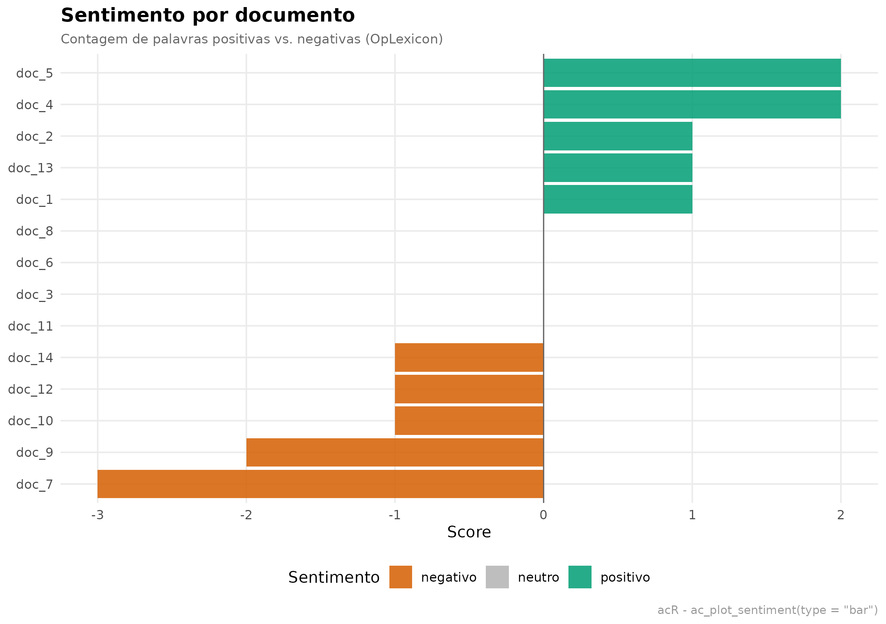
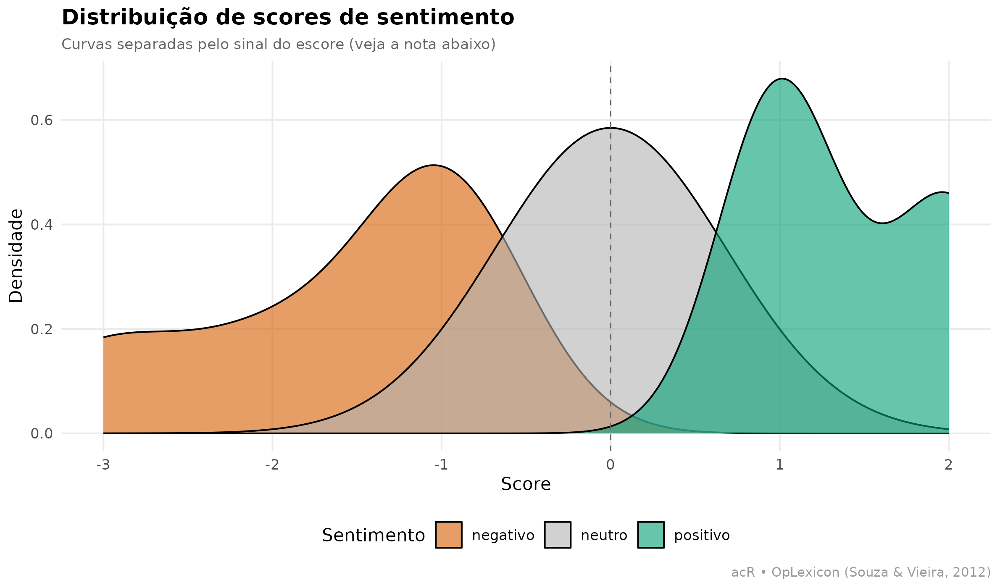
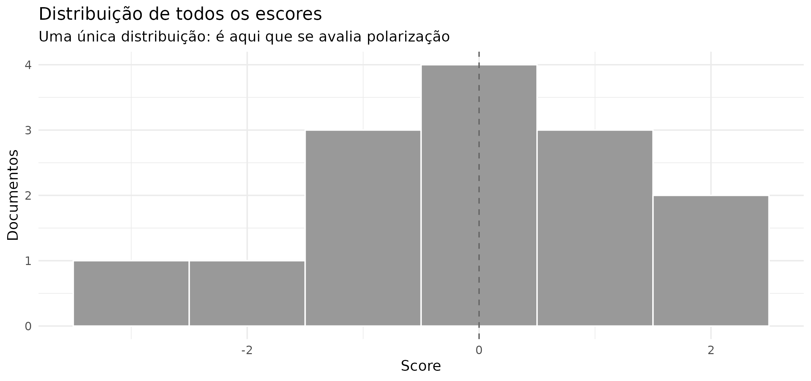
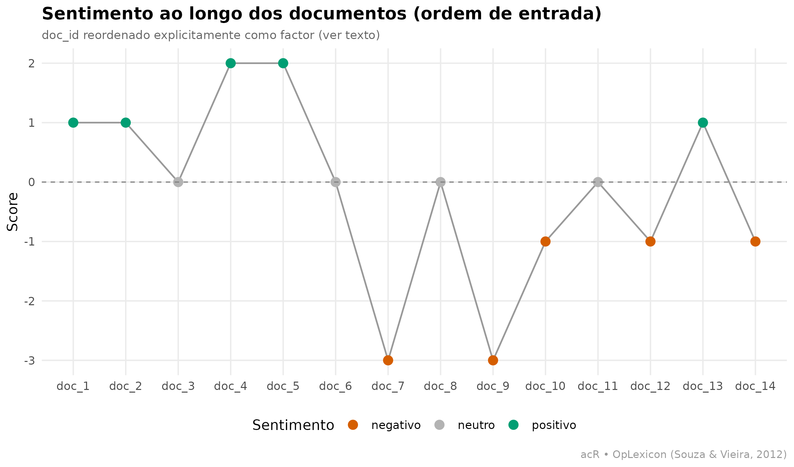
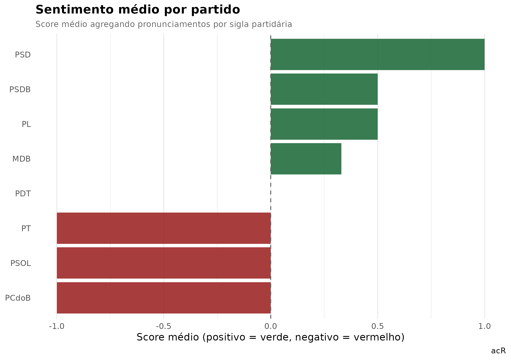
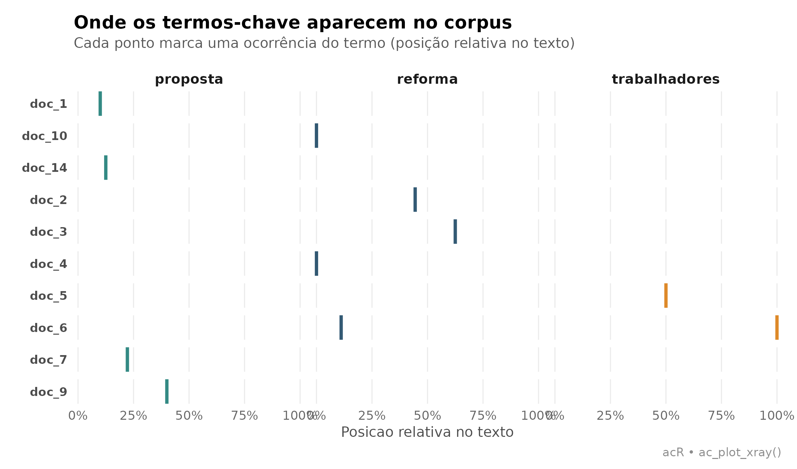

# Análise de sentimento

## O que é análise de sentimento com léxico

Análise de sentimento baseada em **léxico** classifica textos em
positivo, negativo ou neutro **contando palavras** de listas curadas:
palavras que carregam valência positiva (*excelente*, *aprovar*,
*conquista*) contra palavras de valência negativa (*péssimo*,
*fracasso*, *retrocesso*).

O `acR` usa por padrão o **OpLexicon** (Souza & Vieira, 2012), o mais
usado para português brasileiro, com cerca de 30 mil palavras rotuladas.

### Quando usar léxico vs. LLM?

| Cenário                          | Léxico | LLM            |
|----------------------------------|--------|----------------|
| Sinal grosso em milhares de docs | ✅     | ❌ caro        |
| Ironia, sarcasmo, contexto       | ❌     | ✅             |
| Sem chave de API, sem rede       | ✅     | ❌             |
| Precisa reprodutibilidade exata  | ✅     | ⚠️ estocástico |
| Documentos muito curtos (tweets) | ⚠️     | ✅             |

Regra prática: use léxico para **panorama rápido** e **filtragem de
casos extremos**, depois use codificação qualitativa (via
[`ac_qual_code()`](https://andersonheri.github.io/acR/reference/ac_qual_code.md))
na amostra que interessa.

``` r

library(acR)
library(dplyr)
#> 
#> Attaching package: 'dplyr'
#> The following objects are masked from 'package:stats':
#> 
#>     filter, lag
#> The following objects are masked from 'package:base':
#> 
#>     intersect, setdiff, setequal, union
```

## 1. Corpus: pronunciamentos sobre uma reforma polêmica

Corpus fabricado de 14 pronunciamentos, com metadados de partido e
posição declarada. Serve para exercitar visualizações; em corpora reais,
substitua pela coleta via
[`ac_fetch_camara()`](https://andersonheri.github.io/acR/reference/ac_fetch_camara.md)
ou
[`ac_fetch_senado()`](https://andersonheri.github.io/acR/reference/ac_fetch_senado.md).

``` r

textos <- c(
  # Favoráveis
  "Excelente proposta que moderniza o sistema e protege as geracoes futuras.",
  "Aprovamos com convicção esta reforma responsável e necessária ao país.",
  "Vitória histórica para a economia: reforma corrige distorções antigas.",
  "Reforma equilibrada garante sustentabilidade fiscal e futuro promissor.",
  "Conquista importante que beneficia trabalhadores e empresas do Brasil.",
  # Contrários
  "Esta reforma é um retrocesso vergonhoso que prejudica os trabalhadores.",
  "Voto contra: proposta desastrosa ataca os mais pobres e vulneráveis.",
  "Uma tragédia nacional: estão roubando direitos duramente conquistados.",
  "Rejeitamos com indignação essa proposta injusta e cruel com o povo.",
  "Reforma péssima que aprofunda desigualdades e destrói a proteção social.",
  # Neutros / técnicos
  "O texto substitutivo altera o artigo 201 da Constituição Federal.",
  "O relatório final incorporou emendas apresentadas em plenário.",
  "A comissão aprovou o parecer com dez votos a favor e oito contra.",
  "A proposta segue para votação na próxima sessão ordinária."
)

df <- data.frame(
  text     = textos,
  posicao  = c(rep("favor", 5), rep("contra", 5), rep("neutro", 4)),
  partido  = c("PT","PSD","PL","MDB","PSDB",
               "PSOL","PT","PDT","PSOL","PCdoB",
               "MDB","PSDB","PL","MDB"),
  stringsAsFactors = FALSE
)
corpus <- ac_corpus(df)
corpus
#> 
#> ── Corpus acR ──────────────────────────────────────────────────────────────────
#> • Documentos: 14
#> • Metadados: 2 colunas
#> • Idioma: "pt"
#> 
#> # A tibble: 14 × 4
#>   doc_id text                                                    posicao partido
#>   <chr>  <chr>                                                   <chr>   <chr>  
#> 1 doc_1  Excelente proposta que moderniza o sistema e protege a… favor   PT     
#> 2 doc_2  Aprovamos com convicção esta reforma responsável e nec… favor   PSD    
#> 3 doc_3  Vitória histórica para a economia: reforma corrige dis… favor   PL     
#> 4 doc_4  Reforma equilibrada garante sustentabilidade fiscal e … favor   MDB    
#> 5 doc_5  Conquista importante que beneficia trabalhadores e emp… favor   PSDB   
#> 6 doc_6  Esta reforma é um retrocesso vergonhoso que prejudica … contra  PSOL   
#> # ℹ 8 more rows
```

## 2. Sentimento por documento

[`ac_sentiment()`](https://andersonheri.github.io/acR/reference/ac_sentiment.md)
retorna um tibble com contagens de palavras positivas (`n_pos`),
negativas (`n_neg`) e neutras (`n_neu`), o `score` (n_pos − n_neg pelo
método padrão `sum`) e o rótulo categórico `sentiment`.

``` r

sent <- ac_sentiment(corpus)
sent
#> # A tibble: 14 × 6
#>    doc_id n_pos n_neg n_neu score sentiment
#>    <chr>  <int> <int> <int> <int> <chr>    
#>  1 doc_1      1     0    10     1 positivo 
#>  2 doc_10     0     1     9    -1 negativo 
#>  3 doc_11     0     0    10     0 neutro   
#>  4 doc_12     0     1     7    -1 negativo 
#>  5 doc_13     1     0    12     1 positivo 
#>  6 doc_14     0     1     8    -1 negativo 
#>  7 doc_2      1     0     9     1 positivo 
#>  8 doc_3      0     0     9     0 neutro   
#>  9 doc_4      2     0     6     2 positivo 
#> 10 doc_5      2     0     7     2 positivo 
#> 11 doc_6      1     1     8     0 neutro   
#> 12 doc_7      0     3     7    -3 negativo 
#> 13 doc_8      0     0     8     0 neutro   
#> 14 doc_9      0     2     9    -2 negativo
```

Cruzando com a posição declarada: o léxico “acerta”?

``` r

sent |>
  dplyr::left_join(df |> dplyr::mutate(doc_id = paste0("doc_", dplyr::row_number())),
                   by = "doc_id") |>
  dplyr::count(posicao, sentiment) |>
  tidyr::pivot_wider(names_from = sentiment, values_from = n, values_fill = 0L)
#> # A tibble: 3 × 4
#>   posicao negativo neutro positivo
#>   <chr>      <int>  <int>    <int>
#> 1 contra         3      2        0
#> 2 favor          0      1        4
#> 3 neutro         2      1        1
```

> **Como ler esta tabela**
>
> 1.  **Onde olhar.** Cada linha é uma posição declarada pelos autores
>     (`favor`, `contra`, `neutro`); cada coluna é o rótulo que o léxico
>     deu. Leia **por linha**: o número em cada célula é quantos
>     discursos daquela posição receberam aquele rótulo. O acerto está
>     nas células “favor × positivo” e “contra × negativo”.
>
> 2.  **O que este exemplo mostra.** Dos 5 discursos `favor`, 4 saem
>     `positivo`; dos 5 `contra`, 3 saem `negativo`; nenhum discurso é
>     invertido (não há “contra” lido como positivo, nem “favor” como
>     negativo). Os erros caem todos em `neutro` ou nos textos técnicos.
>     Os três casos que mais ensinam: `doc_3` (“Vitória histórica para a
>     economia”) e `doc_8` (“Uma tragédia nacional: estão roubando
>     direitos”) saem neutros porque **nenhuma** das palavras deles está
>     no OpLexicon; e `doc_14` (“segue para votação na próxima sessão
>     ordinária”) sai negativo porque o léxico lê “ordinária” como
>     adjetivo pejorativo.
>
> 3.  **Em palavras simples.** O léxico acerta a direção quando o texto
>     usa adjetivos de opinião (“excelente”, “desastrosa”), e erra de
>     dois jeitos: quando a opinião está em substantivos e verbos que
>     ele não conhece (cobertura) e quando uma palavra tem outro sentido
>     no jargão legislativo (domínio).
>
> 4.  **Cuidado.** Esses dois erros são os clássicos do método de
>     dicionário (Grimmer & Stewart, 2013). O OpLexicon é formado
>     sobretudo por adjetivos (Souza et al., 2011), e palavras mudam de
>     polaridade conforme o domínio: Loughran & McDonald (2011)
>     mostraram o mesmo com “liability” em relatórios financeiros. Antes
>     de usar o léxico num corpus legislativo, liste os termos dele mais
>     frequentes no seu corpus, corrija os que têm outro sentido e
>     valide numa amostra humana
>     ([`ac_dictionary_validate()`](https://andersonheri.github.io/acR/reference/ac_dictionary_validate.md)).

## 3. Comparar métodos de agregação

Três métodos alteram como o `score` é calculado a partir das contagens:

- **`sum`** (padrão): `score = n_pos − n_neg`. Depende do tamanho do
  texto.
- **`mean`**: normaliza pelo número total de palavras. Comparável entre
  textos curtos e longos.
- **`ratio`**: `(n_pos − n_neg) / (n_pos + n_neg)`. Ignora palavras
  neutras, foca só na intensidade emotiva relativa.

``` r

sent_sum   <- ac_sentiment(corpus, method = "sum")
sent_mean  <- ac_sentiment(corpus, method = "mean")
sent_ratio <- ac_sentiment(corpus, method = "ratio")

comparacao <- data.frame(
  doc_id = sent_sum$doc_id,
  sum    = round(sent_sum$score,   2),
  mean   = round(sent_mean$score,  2),
  ratio  = round(sent_ratio$score, 2)
)
head(comparacao, 10)
#>    doc_id sum  mean ratio
#> 1   doc_1   1  0.09     1
#> 2  doc_10  -1 -0.10    -1
#> 3  doc_11   0  0.00     0
#> 4  doc_12  -1 -0.12    -1
#> 5  doc_13   1  0.08     1
#> 6  doc_14  -1 -0.11    -1
#> 7   doc_2   1  0.10     1
#> 8   doc_3   0  0.00     0
#> 9   doc_4   2  0.25     1
#> 10  doc_5   2  0.22     1
```

## 4. Visualização: barras por documento

``` r

ac_plot_sentiment(sent, type = "bar") +
  ggplot2::labs(
    title    = "Sentimento por documento",
    subtitle = "Contagem de palavras positivas vs. negativas (OpLexicon)",
    caption  = "acR - ac_plot_sentiment(type = \"bar\")"
  )
```



> **Como ler este gráfico**
>
> 1.  **Onde olhar.** Cada barra é um discurso, e o comprimento é o
>     `score` (palavras positivas menos negativas). Barra para a
>     **direita** (verde) = saldo positivo; para a **esquerda**
>     (laranja) = negativo; sem barra = saldo zero. As barras estão
>     ordenadas pelo escore, não pela ordem dos documentos.
>
> 2.  **O que este exemplo mostra.** No topo, `doc_4` e `doc_5` (+2,
>     ambos favoráveis); na base, `doc_7` (−3, contrário: “proposta
>     desastrosa ataca os mais pobres e vulneráveis”, três palavras
>     negativas). Quatro discursos ficam sem barra (escore 0): só um é
>     técnico (`doc_11`); os outros são `doc_3` (favorável), `doc_6` e
>     `doc_8` (contrários). E dois textos técnicos (`doc_12`, `doc_14`)
>     aparecem em laranja.
>
> 3.  **Em palavras simples.** O gráfico ordena os discursos do mais
>     positivo ao mais negativo segundo o léxico, mas a ordem só é tão
>     boa quanto o léxico: as barras “vazias” e as laranjas dos textos
>     técnicos são os erros de cobertura e de domínio da seção 2.
>
> 4.  **Cuidado.** A cor depende só do sinal: +1 recebe o mesmo verde
>     que +2, embora +1 seja um caso quase neutro (uma única palavra
>     positiva). E o escore `sum` cresce com o tamanho do texto; em
>     textos de tamanhos muito diferentes, compare com `method = "mean"`
>     ou `"ratio"` (seção 3).

## 5. Visualização: distribuição (densidade)

Útil para ver **a forma da distribuição**: sentimento é bimodal (dois
picos, favor e contra) ou tem uma cauda longa?

``` r

ac_plot_sentiment(sent, type = "density") +
  ggplot2::labs(
    title    = "Distribuição de scores de sentimento",
    subtitle = "Curvas separadas pelo sinal do escore (veja a nota abaixo)"
  )
```



> **Como ler este gráfico**
>
> 1.  **Onde olhar.** Uma curva colorida para cada rótulo (`positivo`,
>     `negativo`, `neutro`). A linha tracejada vertical marca o zero.
>
> 2.  **O que este exemplo mostra.** A curva verde fica toda à direita
>     do zero, a laranja toda à esquerda, e a cinza é um pico fino em
>     cima do zero.
>
> 3.  **Em palavras simples.** Essa separação **não é um achado**: as
>     cores foram definidas pelo próprio sinal do escore, então a curva
>     “positivo” só pode ficar à direita do zero, e a “neutro” só pode
>     ficar no zero. Aconteceria com qualquer conjunto de textos. Este
>     gráfico não mostra polarização; ele só mostra como cada grupo de
>     rótulo se espalha.
>
> 4.  **Cuidado.** Polarização, no sentido de DiMaggio, Evans & Bryson
>     (1996), é uma propriedade da distribuição **inteira** (o quanto os
>     escores se espalham e se formam dois montes). Avalie olhando todos
>     os escores juntos, como no histograma abaixo, ou colorindo por uma
>     variável que não seja o próprio escore (a posição declarada, por
>     exemplo). E com 14 documentos a estimativa de densidade é instável
>     (Silverman, 1986).

``` r

ggplot2::ggplot(sent, ggplot2::aes(x = score)) +
  ggplot2::geom_histogram(binwidth = 1, fill = "grey60", color = "white") +
  ggplot2::geom_vline(xintercept = 0, linetype = "dashed", color = "grey40") +
  ggplot2::labs(
    title    = "Distribuição de todos os escores",
    subtitle = "Uma única distribuição: é aqui que se avalia polarização",
    x = "Score", y = "Documentos"
  ) +
  ggplot2::theme_minimal()
```



> **Como ler este gráfico**
>
> 1.  **Onde olhar.** Cada barra é um valor de escore (−3, −2, …, +2), e
>     a altura é quantos discursos tiveram aquele escore. A linha
>     tracejada marca o zero. Procure **dois montes separados** (sinal
>     de polarização) ou **um monte só** (sinal de consenso ou de pouca
>     opinião).
>
> 2.  **O que este exemplo mostra.** A barra mais alta é a do zero (4
>     discursos); −1 e +1 vêm logo depois (3 cada); as pontas são curtas
>     (um discurso em −3, um em −2, dois em +2). É um monte só, centrado
>     perto do zero.
>
> 3.  **Em palavras simples.** Pelos escores do léxico, o corpus parece
>     **pouco** polarizado, embora os autores tenham declarado posições
>     bem opostas (favor e contra).
>
> 4.  **Cuidado.** O histograma descreve os escores, não as posições
>     reais. Parte dos discursos opinativos caiu no zero por falta de
>     cobertura do léxico (seção 2), o que puxa a distribuição para o
>     centro. Quando o histograma contradiz o que você sabe do corpus, a
>     explicação costuma estar no instrumento, não nos textos.

## 6. Visualização: série ordenada

Se seus documentos têm ordem temporal (discursos ao longo do ano), a
série mostra tendência. **Atenção:** `ac_plot_sentiment(type = "line")`
desenha o eixo X na ordem dos *levels* de `doc_id`; se `doc_id` for só
texto (`character`), o R usa ordem alfabética de string por padrão, não
a ordem de criação nem cronológica. Com rótulos como `doc_1`…`doc_14`,
isso significa que `doc_10` apareceria logo depois de `doc_1` e antes de
`doc_2`. Para evitar isso, transforme `doc_id` num `factor` com os
*levels* na ordem desejada antes de plotar:

``` r

sent_ordenado <- sent
sent_ordenado$doc_id <- factor(sent_ordenado$doc_id, levels = paste0("doc_", 1:14))

ac_plot_sentiment(sent_ordenado, type = "line") +
  ggplot2::labs(
    title    = "Sentimento ao longo dos documentos (ordem de entrada)",
    subtitle = "doc_id reordenado explicitamente como factor (ver texto)"
  )
```



> **Como ler este gráfico**
>
> 1.  **Onde olhar.** O eixo horizontal é a ordem dos documentos
>     (`doc_1` a `doc_14`); cada ponto é o escore de um documento,
>     colorido pelo rótulo; a linha tracejada é o zero.
>
> 2.  **O que este exemplo mostra.** Os 5 primeiros pontos ficam acima
>     do zero ou nele, os 5 seguintes (`doc_6` a `doc_10`) descem até
>     −3, e os 4 últimos ficam perto do zero.
>
> 3.  **Em palavras simples.** A “série” sobe, cai e se estabiliza, mas
>     isso **não é tendência no tempo**: os documentos foram criados em
>     três blocos, primeiro os favoráveis, depois os contrários, depois
>     os técnicos. O desenho só reproduz a ordem em que o exemplo foi
>     montado.
>
> 4.  **Cuidado.** Uma linha só mostra evolução se o eixo for de fato
>     tempo. Numa análise real, ordene pela data de publicação (ou use
>     [`ac_temporal()`](https://andersonheri.github.io/acR/reference/ac_temporal.md),
>     que agrega por período) e desconfie de oscilações ponto a ponto em
>     amostras pequenas: costumam ser ruído.

## 7. Agregação por grupo (partido)

A análise mais útil raramente é doc-a-doc: é comparar **grupos**. Vamos
agregar por partido:

``` r

por_partido <- sent |>
  dplyr::left_join(df |> dplyr::mutate(doc_id = paste0("doc_", dplyr::row_number())),
                   by = "doc_id") |>
  dplyr::group_by(partido) |>
  dplyr::summarise(
    n_docs     = dplyr::n(),
    score_med  = round(mean(score), 2),
    score_dp   = round(stats::sd(score, na.rm = TRUE), 2),
    n_positivo = sum(sentiment == "positivo"),
    n_negativo = sum(sentiment == "negativo"),
    n_neutro   = sum(sentiment == "neutro"),
    .groups    = "drop"
  ) |>
  dplyr::arrange(dplyr::desc(score_med))

por_partido
#> # A tibble: 8 × 7
#>   partido n_docs score_med score_dp n_positivo n_negativo n_neutro
#>   <chr>    <int>     <dbl>    <dbl>      <int>      <int>    <int>
#> 1 PSD          1      1       NA             1          0        0
#> 2 PL           2      0.5      0.71          1          0        1
#> 3 PSDB         2      0.5      2.12          1          1        0
#> 4 MDB          3      0.33     1.53          1          1        1
#> 5 PDT          1      0       NA             0          0        1
#> 6 PCdoB        1     -1       NA             0          1        0
#> 7 PSOL         2     -1        1.41          0          1        1
#> 8 PT           2     -1        2.83          1          1        0
```

Visualização (ranqueando partidos pelo score médio):

``` r

if (requireNamespace("ggplot2", quietly = TRUE)) {
  ggplot2::ggplot(
    por_partido,
    ggplot2::aes(x = stats::reorder(partido, score_med), y = score_med,
                 fill = score_med > 0)
  ) +
    ggplot2::geom_col(alpha = 0.85, show.legend = FALSE) +
    ggplot2::geom_hline(yintercept = 0, linetype = 2, color = "grey40") +
    ggplot2::coord_flip() +
    ggplot2::scale_fill_manual(values = c("TRUE" = "#166534", "FALSE" = "#991B1B")) +
    ggplot2::labs(
      title    = "Sentimento médio por partido",
      subtitle = "Score médio agregando pronunciamentos por sigla partidária",
      x        = NULL,
      y        = "Score médio (positivo = verde, negativo = vermelho)",
      caption  = "acR"
    ) +
    ggplot2::theme_minimal(base_size = 12) +
    ggplot2::theme(
      plot.title    = ggplot2::element_text(face = "bold"),
      plot.subtitle = ggplot2::element_text(color = "grey40", size = 10),
      panel.grid.major.y = ggplot2::element_blank()
    )
}
```



> **Como ler esta tabela**
>
> 1.  **Onde olhar.** Uma linha por partido. Leia `score_med` (média dos
>     escores) **sempre junto** com `n_docs` (quantos discursos entraram
>     na média) e `score_dp` (desvio-padrão: o quanto os discursos do
>     partido discordam entre si).
>
> 2.  **O que este exemplo mostra.** PSD tem a maior média (1,00), mas
>     com **1 discurso só**. O PT aparece com média −1,00, perto do PSOL
>     e do PCdoB, mas o desvio-padrão dele é o maior da tabela (2,83):
>     seus 2 discursos são um favorável (+1) e um contrário (−3), e a
>     média de posições opostas parece uma posição negativa que nenhum
>     dos dois discursos tem.
>
> 3.  **Em palavras simples.** A média resume bem um partido quando os
>     discursos dele são parecidos; quando são opostos, ela inventa um
>     meio-termo. O desvio-padrão alto é o aviso.
>
> 4.  **Cuidado.** Com 1 a 3 discursos por partido, nenhuma dessas
>     médias sustenta uma afirmação sobre “a posição do partido”.
>     Reporte `n_docs` e `score_dp` ao lado da média, e quando o
>     desvio-padrão for alto, olhe os discursos individuais antes de
>     concluir.

## 8. Termos-chave dentro do texto (X-ray)

[`ac_plot_xray()`](https://andersonheri.github.io/acR/reference/ac_plot_xray.md)
mostra **onde** termos-alvo aparecem dentro de cada documento. Útil para
ver se palavras negativas se concentram no começo, meio ou fim, sinal de
estrutura retórica.

``` r

ac_plot_xray(corpus, terms = c("reforma", "trabalhadores", "proposta")) +
  ggplot2::labs(
    title    = "Onde os termos-chave aparecem no corpus",
    subtitle = "Cada ponto marca uma ocorrência do termo (posição relativa no texto)"
  )
```



> **Como ler este gráfico**
>
> 1.  **Onde olhar.** Cada linha é um documento; cada marca é uma
>     ocorrência de um dos termos buscados, colorida pelo termo. O eixo
>     horizontal é a posição relativa dentro do texto: 0 = primeira
>     palavra, 1 = última.
>
> 2.  **O que este exemplo mostra.** *reforma* aparece no começo de
>     vários discursos (posição 0 em `doc_4` e `doc_10`, 0,11 em
>     `doc_6`); *proposta* também tende ao início (de 0,10 a 0,40);
>     *trabalhadores* aparece no meio de `doc_5` (0,50) e na última
>     palavra de `doc_6` (1,00).
>
> 3.  **Em palavras simples.** Nos discursos contrários e favoráveis, o
>     objeto do debate (“a reforma”, “a proposta”) é nomeado logo no
>     início da frase, e as consequências (“prejudica os trabalhadores”)
>     vêm no fim.
>
> 4.  **Cuidado.** O X-ray foi pensado para documentos longos, onde
>     início, meio e fim correspondem a partes do discurso (introdução,
>     argumento, conclusão). Aqui cada documento é uma frase só, então a
>     posição reflete a ordem das palavras na frase, não a estrutura
>     retórica. Use o gráfico para ver **onde** um termo aparece; a
>     interpretação de por que aparece ali pede leitura dos trechos
>     ([`ac_kwic()`](https://andersonheri.github.io/acR/reference/ac_kwic.md)).

## 9. Exportar para artigo/relatório

``` r

# Tabela por partido pronta para colar no LaTeX
ac_export(por_partido, arquivo = "sentimento_por_partido.tex", formato = "latex")

# CSV para Excel/planilha
ac_export(sent, arquivo = "sentimento.csv", formato = "csv")

# Se quiser passar para a etapa qualitativa (LLM):
# amostrar documentos ambíguos (perto de score = 0) para revisão humana
casos_limitrofes <- sent |> dplyr::filter(abs(score) <= 1)
```

## Referências

- Souza, M.; Vieira, R. (2012). Sentiment Analysis on Twitter with
  Portuguese Language. *4th Workshop on Computational Approaches to
  Subjectivity, Sentiment and Social Média Analysis*, PUCRS.
- DiMaggio, P.; Evans, J.; Bryson, B. (1996). Have Americans’ Social
  Attitudes Become More Polarized? *American Journal of Sociology*,
  102(3), 690-755.
- Grimmer, J.; Stewart, B. M. (2013). Text as Data: The Promise and
  Pitfalls of Automatic Content Analysis Methods for Political Texts.
  *Political Analysis*, 21(3), 267-297.
- Loughran, T.; McDonald, B. (2011). When Is a Liability Not a
  Liability? Textual Analysis, Dictionaries, and 10-Ks. *The Journal of
  Finance*, 66(1), 35-65.
- Souza, M.; Vieira, R.; Busetti, D.; Chishman, R.; Alves, I. M. (2011).
  Construction of a Portuguese Opinion Lexicon from multiple resources.
  *8th Brazilian Symposium in Information and Human Language Technology
  (STIL)*.
- Pang, B.; Lee, L. (2008). Opinion Mining and Sentiment Analysis.
  *Foundations and Trends in Information Retrieval*, 2(1-2), 1-135.
- Silge, J.; Robinson, D. (2017). *Text Mining with R*. O’Reilly.
- Silverman, B. W. (1986). *Density Estimation for Statistics and Data
  Analysis*. Chapman and Hall.
- Sampaio, R. C.; Lycarião, D. (2021). *Análise de conteúdo categorial:
  manual de aplicação*. ENAP.
